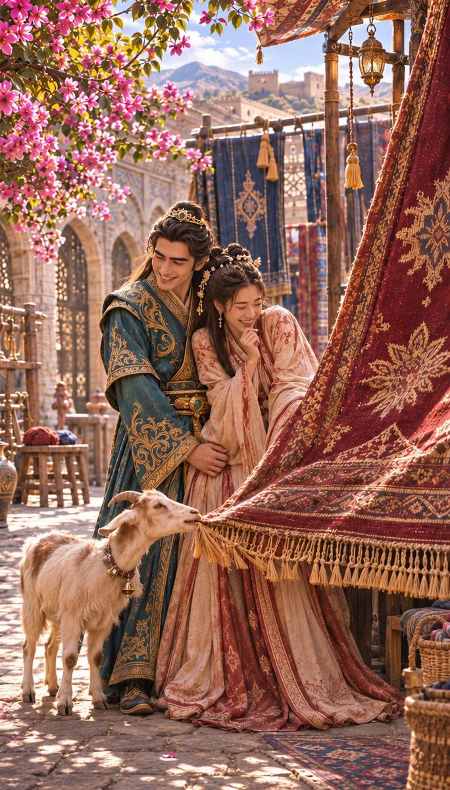

# 西域王子现身、小山羊偷咬地毯流苏：西域古装浪漫喜剧电影照（中文 prompt）

- 原帖链接：https://x.com/Ling_1055Tw/status/2122123254534140192
- 作者：LingTian594888（@Ling_1055Tw）
- 时间：2026-11-16 08:23 (UTC+8 / Asia/Taipei)
- 互动摘要：点赞 34 · 转发 10 · 回复 11 · 引用 1 · 书签 1 · 浏览 2091（采集快照：2026-11-16 19:43 UTC+8）
- 模型/工具：未注明（帖内只写「情境圖片提示詞」；成片为视频）
- 标签：真人
- 媒体路径：
  - `media/video-stills/2122123254534140192_still.jpg`（视频封面截图，）
  - 视频本体未入库，仅保留原帖链接：https://x.com/Ling_1055Tw/status/2122123254534140192
- 入库日期：2026-11-16
- prompt 来源：https://x.com/Ling_1055Tw/status/2122123254534140192
- 备注：prompt 在主帖正文（长帖）中，自「4K ，9:16」起原样摘录；前两行为标题与话题标签。作者给的是情境图片提示词，成片是视频，视频仅保留原帖链接。该帖引用了作者前一条「西域公主」帖（已在开放 PR #13 中，不重复收录）。

## prompt 原文

```text
4K ，9:16 ，真人超寫實西域古裝浪漫愛情喜劇電影劇照，古裝電影美學。ARRI ALEXA 35 Xtreme，ARRI Signature Prime 35mm 電影鏡頭，平視全身中遠景，細膩 35mm 彩色膠片顆粒，自然動態抓拍，溫暖金色陽光。

場景設定：陽光灑落古代西域熱鬧的地毯市集。左上方盛開的粉紅色花枝伸入畫面，後方是砂岩拱門、雕花建築與懸掛的深藍色織錦地毯；遠處可見山脈與古老城堡。
右側掛著一幅大型酒紅色西域地毯，上面布滿精緻的金色幾何花紋，地毯邊緣垂掛長長的金色流蘇。木架、黃銅吊燈、編織籃與古樸石板路增添市集生活氣息。

人物與情節：畫面中央是一位22歲年輕俊美的中亞成年西域王子，擁有立體深邃的五官、濃眉與修長臉型，一頭深棕色長髮半束，配戴鑲嵌綠色寶石的金色髮冠。他身穿深青綠色金線刺繡華麗長袍，腰繫金色寶石腰帶，站在女子身後，親密地輕扶著她，低頭開心微笑。

身旁是一位年輕美麗的22歲成年東亞女子，黑色長髮梳成古典髮髻，配戴精緻金色花飾與垂墜流蘇。她身穿淡粉色與玫瑰紅色花卉刺繡古裝長裙，微微彎身，一手輕掩嘴邊，望著小山羊開心大笑。

前景一隻毛茸茸的米白色小山羊，脖子掛著小鈴鐺，正調皮地咬住酒紅地毯的金色流蘇。兩人被牠逗笑，畫面自然溫馨，充滿浪漫喜劇氛圍。

畫面要求：人物與山羊完整入鏡，保持自然身體比例與真實肌膚質感，服裝刺繡與地毯紋理細膩，陽光穿過花枝形成柔和光影。無黑邊、無文字、無字幕、無浮水印、無多餘肢體。
```

---

个人学习归档，非商业。prompt 与媒体版权归原作者 @Ling_1055Tw，引用请回到原帖。
