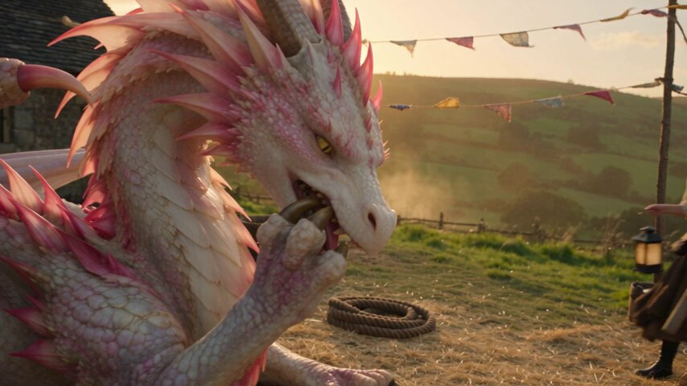

# 巨龙松动的牙：农场少女 Daisy 用绳子 + 苹果拔牙的 30 秒奇幻喜剧分时段脚本

- 原帖链接：https://x.com/ElsaSofia__AI/status/2122145632093954129
- 作者：Elsa Ai（@ElsaSofia__AI）
- 时间：2026-11-16 09:52 (UTC+8 / Asia/Taipei)
- 互动摘要：点赞 219 · 转发 15 · 回复 74 · 引用 0 · 书签 36 · 浏览 4656（采集快照：2026-11-16 19:43 UTC+8）
- 模型/工具：Seedance 2.5（视频）
- 标签：真人
- 媒体路径：
  - `media/video-stills/2122145632093954129_still.jpg`（视频封面截图，）
  - 视频本体未入库，仅保留原帖链接：https://x.com/ElsaSofia__AI/status/2122145632093954129
- 入库日期：2026-11-16
- prompt 来源：https://x.com/ElsaSofia__AI/status/2122145636355383757
- 备注：prompt 在作者自回复（2122145636355383757），需配 Daisy 与巨龙的参考图，原样摘录。视频仅保留原帖链接。

## prompt 原文

```text
Ultra-realistic live-action fantasy film look, Hollywood quality, 4K, 35mm lens, shallow depth of field, warm golden afternoon sunlight, rich natural colors, detailed dragon scales, wet saliva sheen, hay straw, rope fibers, soft dust particles in the light. Medieval hillside farm yard: stone cottage with a smoking chimney, a wooden three-legged stool, a thick coiled rope, a big red apple in a wicker basket, a haystack, a hanging iron lantern, a wooden bucket of water, colorful bunting flags, rolling green hills.

Match Daisy and the giant dragon exactly to the references; keep appearance, color, clothing and features consistent throughout. Daisy: young woman, dark hair in a bun, cream blouse with rolled sleeves, brown apron, long brown skirt. Dragon: pale pink-white scales, pink spines, golden eyes, tens of meters long, gentle, loyal, pet-like; always show its full body in wide or medium-wide shots. Only these two characters.

Audio: natural English dialogue with accurate lip-sync. Daisy has a warm, expressive young female voice. The dragon never speaks, only huffs, whimpers, rumbles, gulps and purrs. Realistic sound effects: creaking rope, thud of landing in hay, crunching apple, wet lick sounds, bird chirps, wind in the bunting flags. Soft cinematic orchestral score that swells at big moments and goes quiet at gentle ones.

0-4s (medium-wide, slow push-in): Dragon lies in the yard, one cheek puffed up, pawing at its jaw and whimpering softly. Daisy walks up with a wooden stool and a lantern, worried. Daisy: "Poor baby. Open wide, let me take a look." Dragon shakes its huge head and clamps its mouth shut, eyes wide with fear.

4-9s (close-up, then low angle): Daisy holds up a red apple. Dragon sniffs it and opens its mouth just a crack. Daisy climbs on the stool and peeks in with the lantern: "I see it! A wobbly tooth." Dragon's huge tongue suddenly licks her face from chin to forehead, leaving her hair standing up. Daisy, deadpan, dripping: "Thank you. Very helpful."

9-14s (wide, then side shot): Daisy ties the thick rope around the loose tooth and the other end around her own waist. Dragon panics, eyes crossing. Daisy counts: "One... two... THREE!" She pulls with all her might. The rope snaps and Daisy flies backward through the air, landing in the haystack. Straw sticks out of her hair. Daisy, from inside the hay: "Okay... that did NOT work."

14-19s (close-up on the dragon, macro on the apple): Dragon watches, ashamed, ears drooping. Daisy climbs out of the hay, brushes herself off, and smiles gently. She offers the apple on her palm: "No more pulling. Just one big bite. Slowly." Dragon takes a careful, nervous bite.

19-25s (extreme close-up, then wide): CRUNCH! The apple pops out the loose tooth. It flies in a slow arc and lands in Daisy's open hand. Dragon freezes, eyes crossed, feeling the gap with its tongue. Daisy holds up the tiny tooth: "Look! It's out! You were so brave!" Dragon stares at the tooth, eyes sparkling with pride.

25-30s: Dragon takes a happy breath and whistles through the gap, a funny high note that sways the bunting flags. Daisy bursts out laughing and hugs its nose. Dragon purrs, tail wagging gently. Wide golden sunset shot, flags fluttering.

Realistic rope, hay and saliva physics, micro-expressions, expressive acting, giant scale, warm humor. No slow motion, modern objects, subtitles, text or watermark.
```

---

个人学习归档，非商业。prompt 与媒体版权归原作者 @ElsaSofia__AI，引用请回到原帖。
