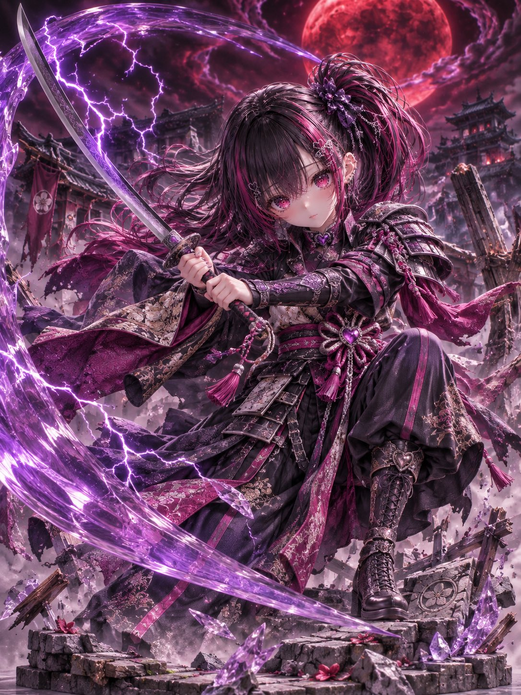
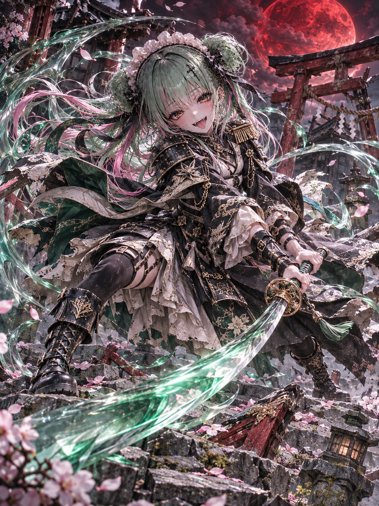
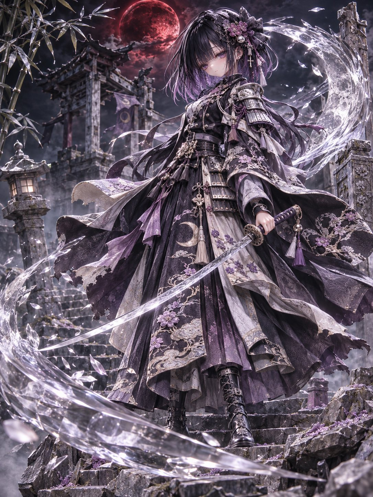
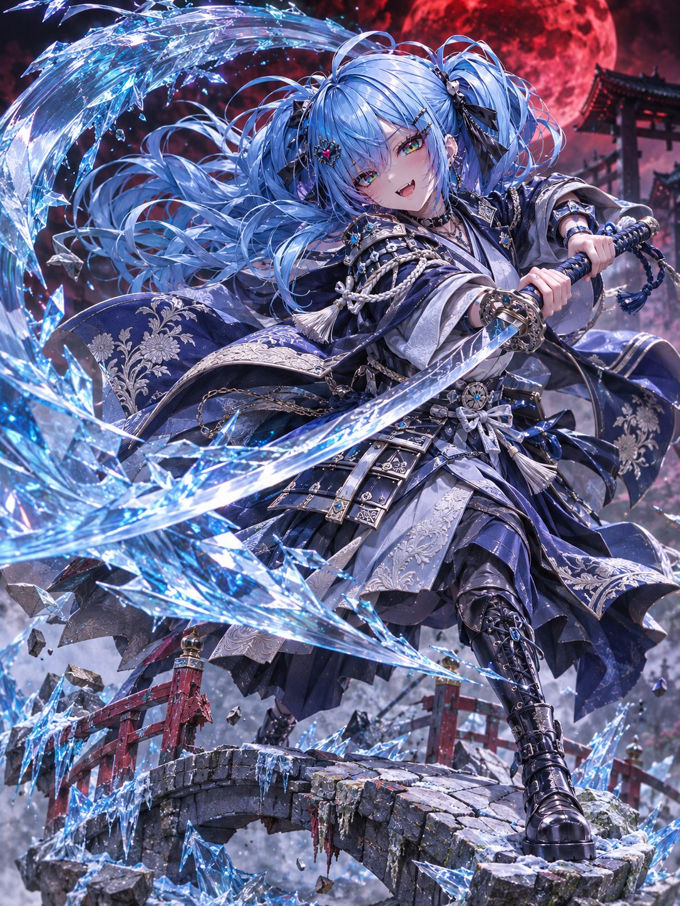

# 血月妖刀觉醒：角色参考图 → 日式战场情景 3D 手办（#るんプロンプト 第266弾）

- 原帖链接：https://x.com/ENJU1123PIPI/status/2121747507587792953
- 作者：るんちゃん🦋（@ENJU1123PIPI）
- 时间：2026-11-15 07:30 (UTC+8 / Asia/Taipei)
- 互动摘要：点赞 125 · 转发 40 · 回复 5 · 引用 19 · 书签 23 · 浏览 5683（采集快照：2026-11-17 09:03 UTC+8）
- 模型/工具：未注明（角色参考图驱动的通用 prompt）
- 标签：二次元
- 媒体路径：
  - `media/images/2121747507587792953_1.jpg`（）
  - `media/images/2121747507587792953_2.jpg`（）
  - `media/images/2121747507587792953_3.jpg`（）
  - `media/images/2121747507587792953_4.jpg`（）
- 入库日期：2026-11-17
- prompt 来源：https://x.com/ENJU1123PIPI/status/2121747509630390456（作者自回复）
- 备注：prompt 在作者自回复（https://x.com/ENJU1123PIPI/status/2121747509630390456），需上传一张角色参考图；内含元素/服装/动作/场景多组随机选项。4 张示例图全部入库。原样摘录。

## prompt 原文

```text
BLOOD MOON BLADE AWAKENING
Cursed Katana × Random Element × Japanese Military Fantasy

Use the attached character as the sole identity reference. Preserve face, hairstyle, hair and eye colors, proportions, head-to-body ratio, signature accessories, personality, and gender presentation.

Create ONE museum-quality physical 3D anime collectible in a Japanese battlefield diorama.

RANDOM ELEMENT — Choose ONE:
Crimson Flame / Violet Lightning / Azure Ice / Emerald Wind / Black Shadow / Lunar Silver / Sakura Storm / Ruby Crystal / Golden Solar Fire / Amethyst Void / Blue Spirit Fire / Celestial Starlight.

Match sword energy, outfit accents, effects, lighting, and destruction to this element. Keep original hair and eye colors.

KATANA
ONE authentic Japanese katana: gentle curvature, aligned blade and handle, realistic thickness, detailed fittings, sharp edge, scratches, correct grip.
Random finish: Blackened steel / Polished silver / Crystal edge / Glowing engraved steel / Dark metal / Translucent elemental material.

RANDOM OUTFIT — Choose ONE:
Gothic Imperial Sword Officer / Shrine Exorcist Commander / Dark Samurai Captain / Moonlit Military Onmyoji / Armored Kimono Warrior / Celestial Blade Guardian / Cursed Blade Executioner / Elemental Shogun / Sakura Battle Priest / Shadow Military Swordsman.

Randomize silhouette, palette, layered kimono, asymmetrical sleeves, hakama or tailored shorts, military jacket, armor, belts, gloves, boots, ribbons, and coat. Strong Japanese identity, luxurious textures, raised embroidery, thick layers. Non-graphic torn hems, dust, scorched edges, scratched armor, broken ornaments.

RANDOM ACTION — Choose ONE:
Explosive iai draw / Midair diagonal slash / Low sweeping strike / Reverse-grip defense / Ground-shattering downward cut / One-handed sword release / Twisting counterattack / Post-slash finishing stance.

Natural balance, correct anatomy and hands, convincing sword mechanics, dynamic rotation, flowing hair and clothing. Clear face and sword silhouette.

PHYSICAL CRAFTSMANSHIP
Hand-painted PVC, ABS, and resin: dimensional facial anatomy, glossy inset multilayered irises, sculpted hair locks with visible gaps, deep folds, separate armor, intricate accessories.
Matte skin, satin hair, textured fabric, reflective metal, transparent resin. No flat illustration or cel shading.

ELEMENTAL SLASH
ONE enormous transparent-resin crescent begins behind the figure, curves beside the body, crosses the foreground, and projects toward camera.
Element-specific flame sheets, lightning, ice, wind ribbons, shadow fragments, petals, gemstones, or lunar crescents. Visible thickness, refraction, internal reflections, overlapping layers, believable base attachment.

RANDOM ENVIRONMENT — Choose ONE:
Ruined Torii Shrine / Burning Japanese Castle / Moonlit Bamboo Battlefield / Destroyed Imperial City / Frozen Mountain Temple / Gothic Japanese Fortress / Shattered Stone Bridge / Ancient Spirit Forest.

Integrated irregular base with cracked terrain, ruined architecture, suspended debris, sculpted smoke or petals, and elemental destruction. No plain circular stand.
A subordinate crimson moon is randomly eclipsed, fractured, crystallized, glowing, cloud-obscured, or ringed with magic.

COMPOSITION & PHOTOGRAPHY
Seven depth layers: foreground energy fragments / flying debris / front slash / character and katana / rear aura / ruined architecture / distant battlefield and blood moon.

Vertical 3:4, low-angle three-quarter view, powerful diagonals, controlled perspective, realistic occlusion, sculptural thickness. Frame figure, sword, and base coherently.

Premium macro product photography, cinematic moonlight, elemental rim lighting, resin refraction, metallic reflections, deep contact shadows, ambient occlusion, sharp details.

Exactly ONE character and ONE katana. No text, collage, duplicate limbs, malformed hands, warped anatomy, or bent/disconnected sword. Extraordinary physical dimensionality, ultra-detailed 8K finish.
```

---

个人学习归档，非商业。prompt 与媒体版权归原作者 @ENJU1123PIPI，引用请回到原帖。
