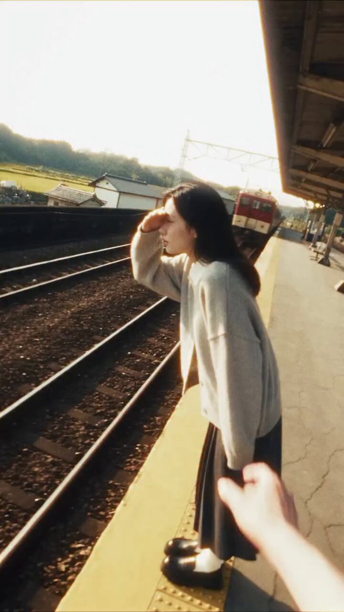

# 日本一日游 POV 旅行蒙太奇：站台、金色草地、拉面与好奇小鹿（15 秒 9:16）

- 原帖链接：https://x.com/KrishnaBio1/status/2121794817835282805
- 作者：KrishnaG（@KrishnaBio1）
- 时间：2026-11-15 10:38 (UTC+8 / Asia/Taipei)
- 互动摘要：点赞 161 · 转发 25 · 回复 45 · 引用 4 · 书签 82 · 浏览 6186（采集快照：2026-11-17 19:49 UTC+8）
- 模型/工具：Seedance 2.5（视频）
- 标签：真人
- 媒体路径：
  - `media/video-stills/2121794817835282805_still.jpg`（视频封面截图，）
  - 视频本体未入库，仅保留原帖链接：https://x.com/KrishnaBio1/status/2121794817835282805
- 入库日期：2026-11-17
- prompt 来源：https://x.com/KrishnaBio1/status/2121794819093664075
- 备注：prompt 在作者自回复（2121794819093664075），末尾一条 t.co 短链未收录。prompt 明确写角色为 20 出头的成年女性（an adult），整体为非性化的旅行短片。视频仅保留原帖链接。

## prompt 原文

```text
Ultra-realistic first-person cinematic Japanese slice-of-life travel montage, 9:16 vertical, 15 seconds, 24fps, warm analog film look with dreamy golden-hour sun flares, soft grain, rich natural color, POV and low-angle handheld shots, shallow depth of field, a nostalgic, joyful and free-spirited mood.
👩 CHARACTER: A young Japanese woman in her early 20s (an adult), long dark wavy hair, bright expressive eyes, wearing a school-uniform-inspired outfit: a grey knit cardigan over a white collared shirt, a knee-length navy pleated skirt, white crew socks and black loafers. Cheerful, curious and playful. Keep her face and outfit identical in every shot.
🚆 A sunlit countryside train platform with a small red-and-white train rolling in behind her. She shields her eyes from the sun, then turns to the camera with a startled, delighted look. A friend's hand reaches in from the POV side.
🌾 A green meadow at golden hour. The friend's hand pulls hers, and she laughs as she is tugged forward, her hair and cardigan flying in the wind. Low-angle POV, wide-angle lens, sun flare across the frame.
📚 She playfully peeks through a gap between manga volumes on a shelf, eyes wide and smiling. Quick cut to a close-up of ramen noodles lifted with chopsticks from a steaming bowl, warm light glowing through the steam.
🏮 A narrow lantern-lit alley with parked bicycles at dusk. She glances over her shoulder with a soft smile. Cut to a small bookstore where she sits on a low stool, flipping through a magazine, lost in a quiet moment.
🦌 A grassy park at sunset. A gentle deer walks up to the lens and sniffs the camera, its curious face filling the frame, a second deer grazing behind. She stands in the golden light with her hair glowing and says softly: "Hello there."
🌃 A busy city crossing at dusk with glowing signs and passing commuters, motion blur and city bokeh. She walks quickly, turns back toward the camera and laughs: "Come on, hurry up!"
🌇 Close-up of her black loafers stepping to the yellow tactile line at the platform edge. Final shot: she runs across the golden meadow with her arms stretched wide, deer wandering around her, the sun setting low behind the hills. Slow-motion finish, fade out.
🎧 AUDIO: Distant train rumble and chimes, birdsong, a soft breeze, steaming broth sounds, light laughter, a warm lo-fi piano-and-guitar melody, clear natural English dialogue.
🎬 STYLE: Realistic wholesome travel film, natural movement, warm golden color grading, family-friendly and non-graphic, consistent face and outfit, no text, no subtitles, no logos, no watermark.
```

---

个人学习归档，非商业。prompt 与媒体版权归原作者 @KrishnaBio1，引用请回到原帖。
