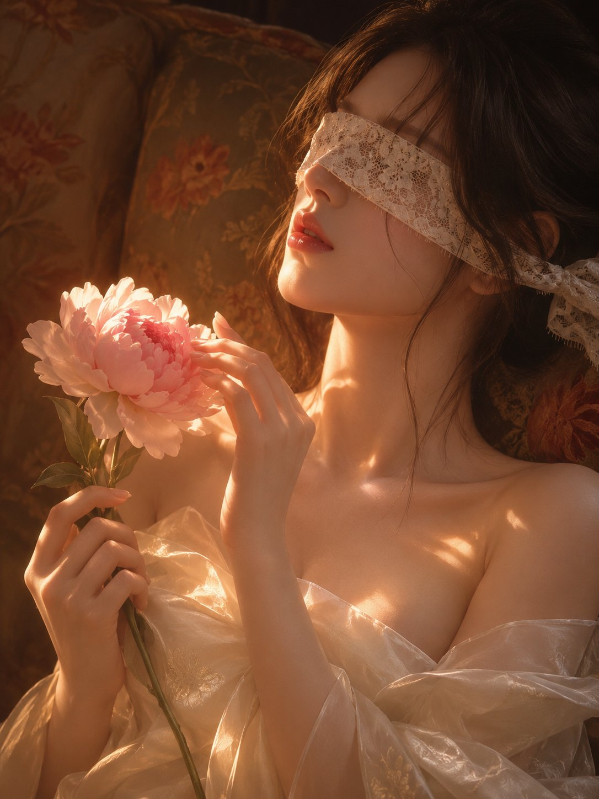

# 蕾丝蒙眼、手抚芍药：东方电影感 85mm 美术人像（明确 25 岁成年女性）

- 原帖链接：https://x.com/ThiThaoTri17219/status/2121947367847112771
- 作者：Thi | Cinematic AI Art（@ThiThaoTri17219）
- 时间：2026-11-15 20:44 (UTC+8 / Asia/Taipei)
- 互动摘要：点赞 23 · 转发 2 · 回复 8 · 引用 1 · 书签 4 · 浏览 586（采集快照：2026-11-17 09:03 UTC+8）
- 模型/工具：未注明
- 标签：真人
- 媒体路径：
  - `media/images/2121947367847112771_1.jpg`（）
- 入库日期：2026-11-17
- prompt 来源：https://x.com/ThiThaoTri17219/status/2121947367847112771
- 备注：prompt 在正文（「prompt 👇」之后），明确设定为 25 岁成年女性；画面为露肩丝裙的唯美人像，无露骨内容。原样摘录。

## prompt 原文

```text
Native 3:4 vertical, ultra-high-resolution photorealistic Eastern cinematic fine-art portrait, intimate 85mm photography.

A breathtakingly beautiful 25-year-old adult East Asian woman with refined natural Chinese facial features, delicate oval face, luminous fair skin, softly parted rose lips, slender neck, narrow shoulders and elegant natural feminine proportions. Dark-brown hair loosely gathered with a few soft strands framing her cheek.

She reclines gently against a muted antique tea-brown brocade cushion, wearing an exquisite ivory silk dress with a softly draped off-shoulder neckline and translucent organza layers. Naturally fitted, sensual yet sophisticated.

A single delicate ivory floral lace ribbon is tied behind her head, covering both eyes. Her face turns naturally three-quarters toward the warm window light, lips slightly parted as though remembering something.

She holds one large blush-pink peony near her chin. Her RIGHT hand gently supports its stem beneath the bloom, while her LEFT fingertips barely touch a single outer petal. Both hands remain clearly visible, with five slender, anatomically correct fingers on each hand, relaxed wrists and natural proportions.

A narrow beam of late-afternoon amber sunlight illuminates her lips, collarbones, the peony and the exact point where her fingertips touch the petals. Rich tea-brown shadows, delicate highlights, realistic silk folds, subtle film grain, restrained halation.

Emotion: she recognizes the familiar flower by touch alone — a fleeting moment of private tenderness, quiet anticipation and unspoken longing. Unposed, cinematic, deeply intimate.

Upper-body close portrait with both hands fully inside the frame. Minimal visual clutter, authentic skin texture, no text, no collage, no artificial plastic skin, no exaggerated anatomy.
```

---

个人学习归档，非商业。prompt 与媒体版权归原作者 @ThiThaoTri17219，引用请回到原帖。
