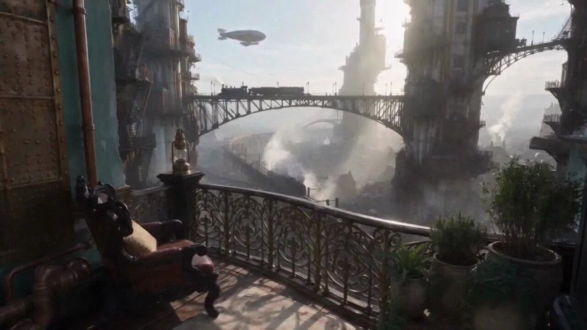

# Seedance 2.5 出 480p、再用 Kling 4.0 按原镜头重制为 1080p 的视频「remaster」prompt

- 原帖链接：https://x.com/antibokeh_/status/2122009890436636795
- 作者：AntiBokeh（@antibokeh_）
- 时间：2026-11-16 00:52 (UTC+8 / Asia/Taipei)
- 互动摘要：点赞 546 · 转发 31 · 回复 39 · 引用 4 · 书签 847 · 浏览 25084（采集快照：2026-11-17 09:03 UTC+8）
- 模型/工具：Seedance 2.5（480p 初稿）+ Kling 4.0（1080p 重制；作者标注）
- 标签：其它
- 媒体路径：
  - `media/video-stills/2122009890436636795_still.jpg`（视频封面截图，）
  - 视频本体未入库，仅保留原帖链接：https://x.com/antibokeh_/status/2122009890436636795
- 入库日期：2026-11-17
- prompt 来源：https://x.com/antibokeh_/status/2122009901966774470（作者自回复）
- 备注：prompt 在作者自回复（https://x.com/antibokeh_/status/2122009901966774470），为把 Seedance 2.5 的 480p 成片作为 video 1、配一张场景静帧 image 1 交给 Kling 4.0 重制成 1080p 的视频到视频 prompt。视频本体未入库，仅保留原帖链接。原样摘录。

## prompt 原文

```text
remaster video 1 as a clean, photorealistic 1080p shot. video 1 is the master for everything that happens: same camera path, same timing, same framing, every movement at the same moment and speed. do not add, remove or reorder anything. first and last frame must match video 1.

video 1 is a low-res, noisy source. do not copy its noise, blur, compression or waxy skin. rebuild every surface with real detail, using image 1 as the true look of the place.

image 1 is a clean still of the set. it's what stops kling from inventing its own room.
```

---

个人学习归档，非商业。prompt 与媒体版权归原作者 @antibokeh_，引用请回到原帖。
