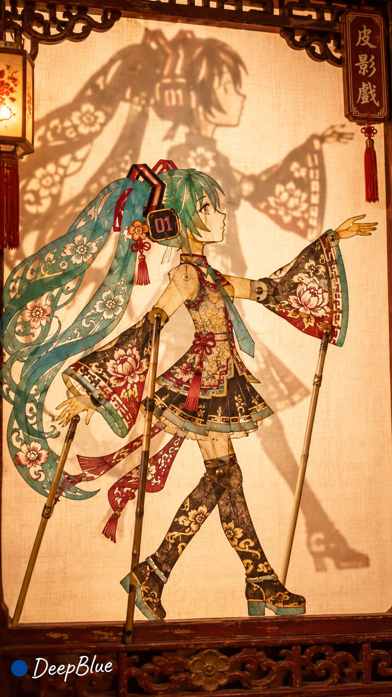
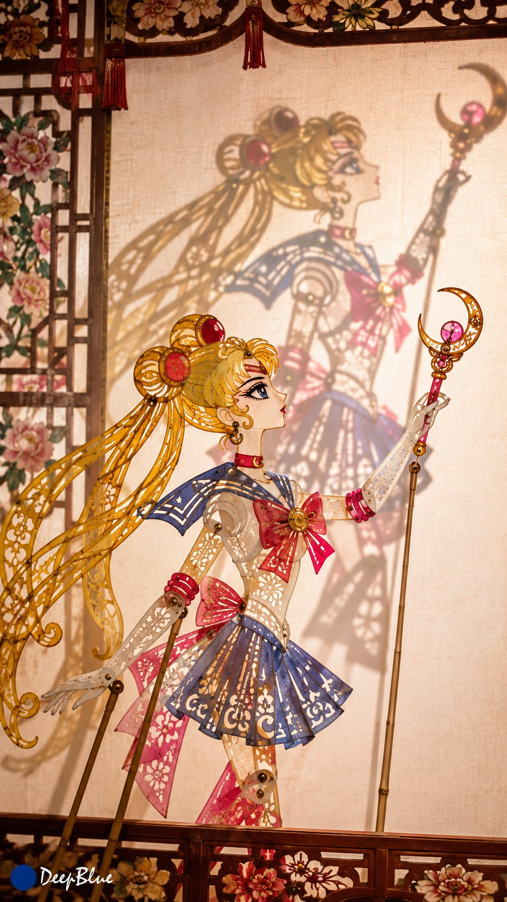
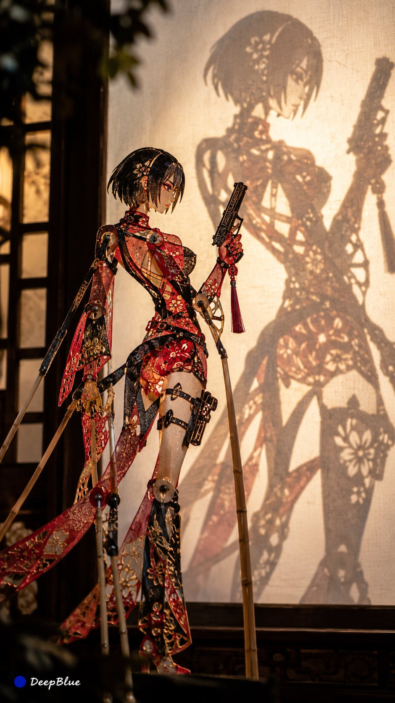
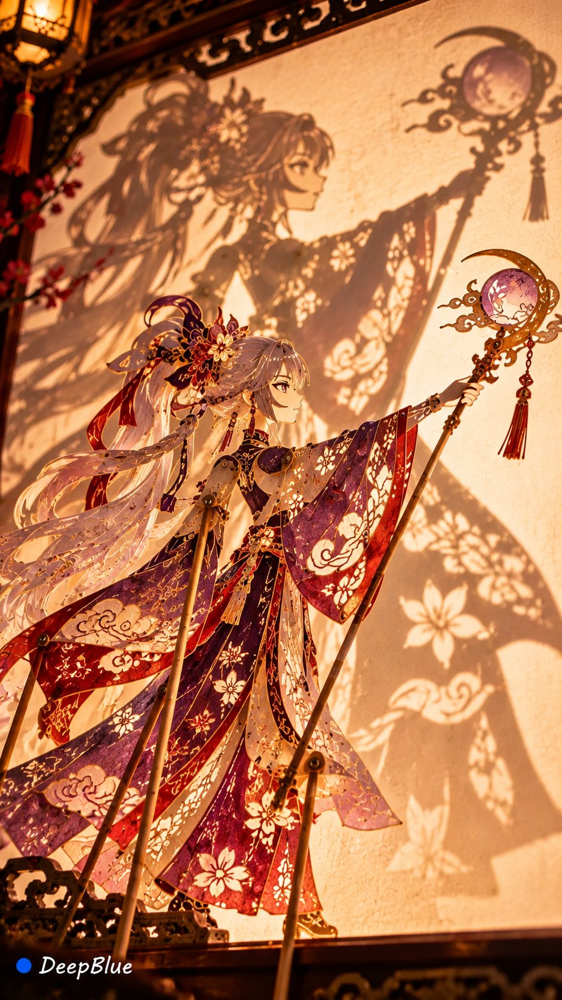
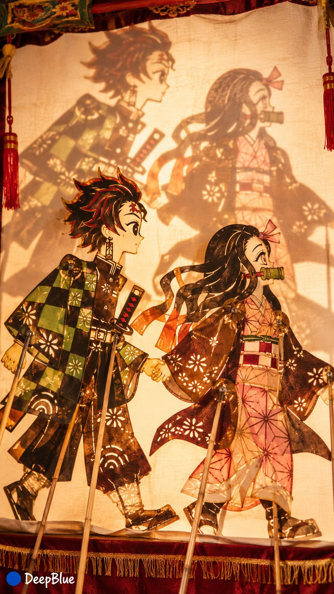
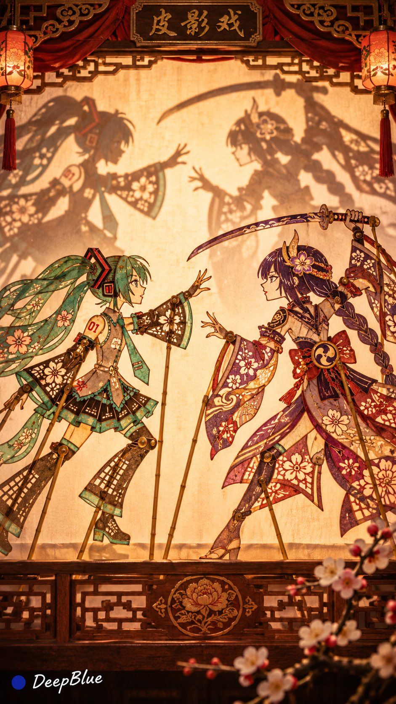
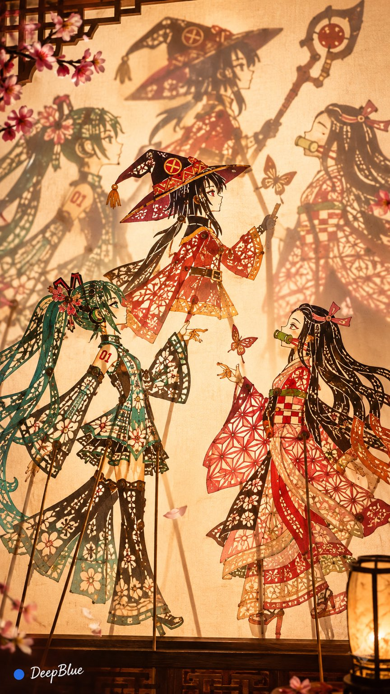
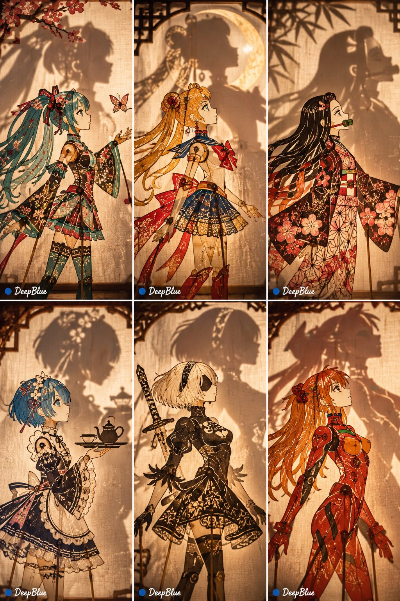

# 中国传统皮影戏 × 经典二次元角色：彩绘皮影实体与幕布投影同框（中文结构化 prompt）

- 原帖链接：https://x.com/DeepBlueX0/status/2122167710326898859
- 作者：DeepBlue深藍（@DeepBlueX0）
- 时间：2026-11-16 11:19 (UTC+8 / Asia/Taipei)
- 互动摘要：点赞 26 · 转发 4 · 回复 0 · 引用 0 · 书签 15 · 浏览 957（采集快照：2026-11-17 09:03 UTC+8）
- 模型/工具：GPT Image 2.6（作者标注）
- 标签：二次元
- 媒体路径：
  - `media/images/2122167710326898859_1.jpg`（）
  - `media/images/2122167710326898859_2.jpg`（）
  - `media/images/2122167710326898859_3.jpg`（）
  - `media/images/2122167710326898859_4.jpg`（）
  - `media/images/2122167710326898859_5.jpg`（）
  - `media/images/2122167710326898859_6.jpg`（）
  - `media/images/2122167710326898859_7.jpg`（）
  - `media/images/2122167710326898859_8.jpg`（）
- 入库日期：2026-11-17
- prompt 来源：https://x.com/DeepBlueX0/status/2122167710326898859
- 备注：prompt 在正文（长帖），从「經典二次元角色」起至「n=9」止原样摘录；prompt 明确要求选择「成年角色」。帖内 8 张图（含 1 张拼图）全部入库。prompt 中的「DeepBlue」署名为作者自己的署名要求，原样保留。

## prompt 原文

```text
經典二次元角色 × 中國傳統皮影 × 平面彩繪透雕 × 雙生光影 × 真實工藝攝影。

【角色】
每張獨立選擇一位或多位經典動漫、遊戲成年角色，保留標誌性髮型、服裝、配色與武器。自由探索單人、群像及角色互動。

【皮影工藝】
嚴格採用中國傳統皮影造型，以陝西皮影為主要參考。角色由薄而平整的半透明彩繪獸皮雕刻而成，呈現傳統側面人物、戲曲化五官、精細刀刻紋樣、鏤空衣飾、活動關節與竹製操縱桿。所有部件保持真實平面皮革結構，無立體人體、雕塑或模型質感。

【雙生光影】
彩繪皮影實體與暖白幕布投影同框，燈光形成清晰的放大影像。實體與影子輪廓、姿態及主要孔紋對應，呈現傳統皮影特有的彩色透光、深色線條與鏤空亮紋。

【創作與攝影】
每張獨立變化角色、造型、動作、場景、光線及構圖。突出真實非遺工藝、皮革纖維、刀刻痕跡與光影戲劇性，保留中國民間藝術韻味。畫面簡潔，適度留白。

嚴格9:16直式獨立單圖。

左下署名：深藍色實心圓點，後接白色自然手寫體「DeepBlue」。

n=9
```

---

个人学习归档，非商业。prompt 与媒体版权归原作者 @DeepBlueX0，引用请回到原帖。
