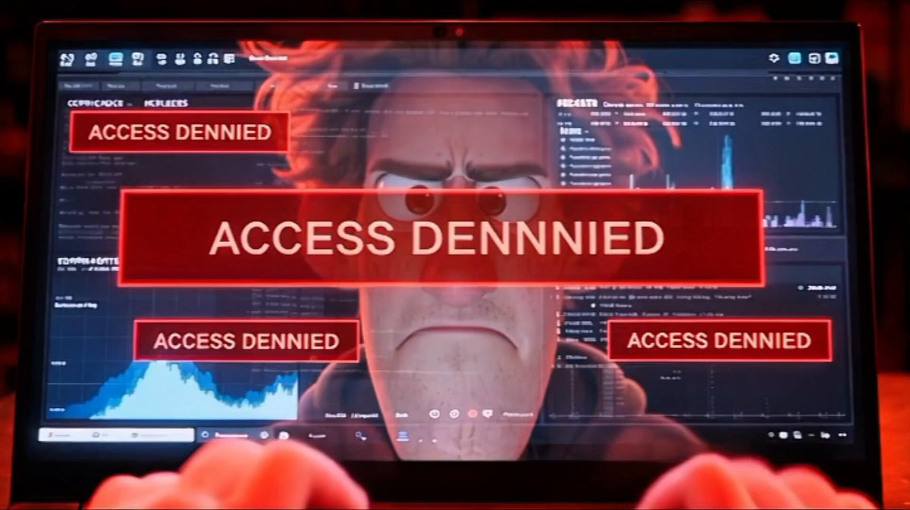

# 「五星级通缉犯」：3D CGI 喜剧惊悚续接镜头，实验室 + 新闻闪回 20 秒分镜脚本

- 原帖链接：https://x.com/_YasirNFT/status/2122231548866900071
- 作者：Yasir | AI Video Creator（@_YasirNFT）
- 时间：2026-11-16 15:33 (UTC+8 / Asia/Taipei)
- 互动摘要：点赞 37 · 转发 5 · 回复 22 · 引用 0 · 书签 1 · 浏览 878（采集快照：2026-11-17 19:49 UTC+8）
- 模型/工具：Seedance 2.5 + GPT Image 2.5（视频；作者注明在 @sumistudio_ai 制作）
- 标签：其它
- 媒体路径：
  - `media/video-stills/2122231548866900071_still.jpg`（视频封面截图，）
  - 视频本体未入库，仅保留原帖链接：https://x.com/_YasirNFT/status/2122231548866900071
- 入库日期：2026-11-17
- prompt 来源：https://x.com/_YasirNFT/status/2122231847392297022
- 备注：prompt 在作者自回复（2122231847392297022），需配 @video1 / @image1–4 / @audio1–2 参考素材，原样摘录。视频仅保留原帖链接。

## prompt 原文

```text
STYLE
Premium stylized 3D CGI animated comedy-thriller. Exaggerated caricatured features, expressive eyes and eyebrows, elastic facial expressions, detailed hair, realistic clothing and props, smooth cinematic shading, shallow depth of field, dynamic camera movement and polished feature-film quality. 
REFERENCES

- @video1: Continue directly from its final frame, preserving character positions, poses, expressions, lighting and camera angle.
- @image1: Benny's underground lab. Match the concrete walls, pipes, fluorescent lights, centre table, computer (monitor and keyboard)
- @image2: Red breaking-news studio. Reporter on the left: brown shoulder-length bob, brown eyes, pearl jewellery, navy blazer and white top, holding a black microphone. On the right, the news poster featuring Mr. Bubble's photo, red MOST WANTED stamp, INTERNATIONAL MOST WANTED, MR. BUBBLE and $1,000,000 REWARD. Preserve the layout and text.
- @image3: Gus. Very tall and lanky, long neck and face, huge chin, bulbous nose, pink ears, wide eyes, messy orange hair, gray hoodie, dark navy skinny jeans and worn red sneakers. Height 1.60 m.
- @image4: Benny. Short and stocky, curly dark hair in a bun, thick black mustache, light-blue short-sleeve shirt, brown belt, dark-blue jeans and white sneakers. Height 1.55 m.
- @audio1: Match Benny's reference voice, tone and accent.
- @audio2: Match Gus's reference voice, tone and accent.
- Reporter: Mid-pitched adult female voice, neutral American accent, fast, urgent and alarmed.

Never redesign characters or change their voices.

CONTINUITY
Continue immediately from @video1 without a gap or reset. Shots 1–3 and 5 take place at the lab's centre table. Gus remains in front of the computer from Shot 1. Maintain the small height difference between Gus (1.60 m) and Benny (1.55 m). Shot 4 is exclusively the news flashback. In Shot 5, Benny's position and camera angle must match Shot 3 exactly.

SCENES (20 SECONDS)

Shot 1 (0–4s) – Immediate Panic
Continue from the exact final frame of @video1. Benny and Gus rush toward the computer in panic, both visible.
Benny (shouting): "The vaccine formula is stolen!"
Gus: "Let me see!"
Gus stops at the computer and rapidly types, searching security files and system records.

Shot 2 (4–8s) – The Discovery
Tight close-up of Gus's face, hands and computer screen. Security alerts, encrypted files, codes and system records rapidly appear.
Benny: "We're not the only ones with this now!"
Gus: "Who is this?"

Shot 3 (8–10s) – Benny Thinks
Close-up of Benny. He puts one hand on his head, staring intensely at the screen. Slowly push in as he tries to remember something.

Shot 4 (10–16s) – Breaking News Flashback
Cut to @image2 as a memory in Benny's mind, with a soft dreamy glow and vignette. Preserve the reporter and poster layout exactly. The bottom ticker scrolls.
Reporter (urgent): "Mr. Bubble is wanted internationally. One million dollars for information on his whereabouts!"
Slowly push in toward Mr. Bubble's photograph.

Shot 5 (16–20s) – The Realisation
Cut back to Benny in exactly the same position and camera angle as Shot 3.
Benny: "I think it's Mr. Bubble!"
His eyes widen and jaw drops.
Cut immediately to Gus's shocked close-up.
Gus: "OH MY GOD! That's a five-star criminal!"
Hold on Gus's shocked expression with a dramatic impact sound.

CAMERA
No establishing shot. Medium two-shot, tight computer close-up, slow push-in on Benny, steady full-frame news broadcast, matching Benny close-up, then fast cut to Gus. Motivated cinematic cuts only. No random jumps or black screens.

AUDIO
No music or ambience. Dialogue and sound effects only

NEGATIVE CONSTRAINTS
No music, background ambience, subtitles, extra characters, character redesigns, voice changes, zombies, villain appearing physically in the lab, blood, gore or unwanted scene transitions. No changes to the starting positions from @video1. On-screen text only on the computer and the referenced news graphic.
```

---

个人学习归档，非商业。prompt 与媒体版权归原作者 @_YasirNFT，引用请回到原帖。
