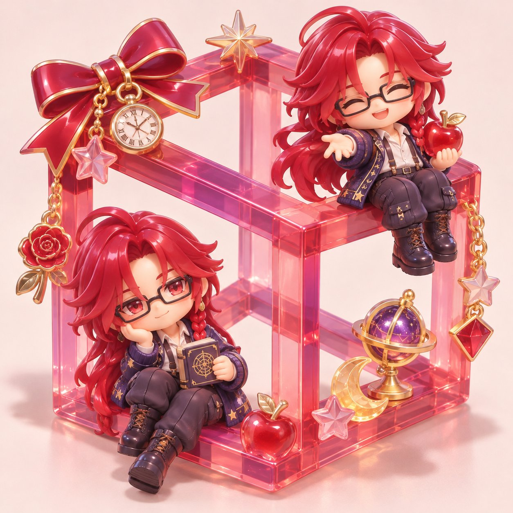
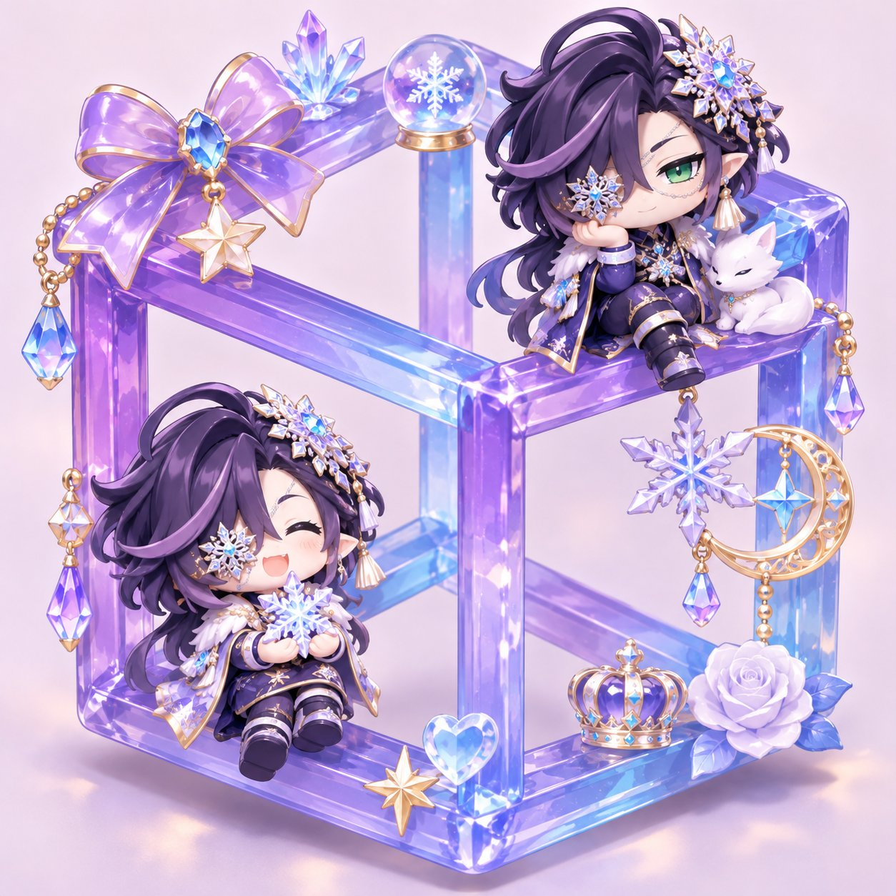
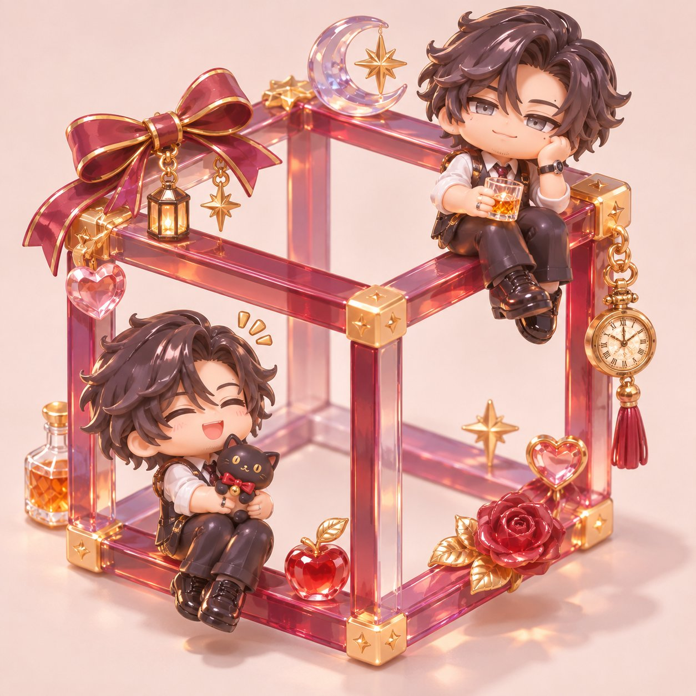

# 内克尔立方体错视「うちの子のトイキューブ」：2 头身软胶小手办 + 平成复古扭蛋风（#のらるプロンプト）

- 原帖链接：https://x.com/irohachang77/status/2122281662663057797
- 作者：のらる（@irohachang77）
- 时间：2026-11-16 18:52 (UTC+8 / Asia/Taipei)
- 互动摘要：点赞 38 · 转发 8 · 回复 1 · 引用 6 · 书签 18 · 浏览 1271（采集快照：2026-11-17 09:03 UTC+8）
- 模型/工具：未注明（角色参考图驱动的通用 prompt）
- 标签：二次元
- 媒体路径：
  - `media/images/2122281662663057797_1.jpg`（）
  - `media/images/2122281662663057797_2.jpg`（）
  - `media/images/2122281662663057797_3.jpg`（）
- 入库日期：2026-11-17
- prompt 来源：https://x.com/irohachang77/status/2122281696179757553（作者自回复）
- 备注：prompt 在作者自回复（https://x.com/irohachang77/status/2122281696179757553），需上传一张角色图（「添付キャラ」）。首行「🧸 うちの子のトイキューブ」为 prompt 标题，一并保留。3 张示例图全部入库。原样摘录。

## prompt 原文

```text
🧸 うちの子のトイキューブ

添付キャラをモチーフに、ネッカー立方体を使った可愛いトリックアートを制作。

同じキャラを2頭身のソフビ製ミニフィギュアにして必ず2体配置。1体は右上、もう1体は左下の辺に腰掛け、異なるポーズと表情。

立方体はキャラの色を反映した半透明のプラスチック製。ハート・星・リボン・象徴モチーフのチープな玩具チャームで装飾。

平成レトロ×カプセルトイ風。丸みのある造形、シンプルな塗装、控えめなツヤ。

奥行きが反転して見える錯視構造。背景は淡色、柔らかな影。

正方形・全体構図・文字ロゴなし。
```

---

个人学习归档，非商业。prompt 与媒体版权归原作者 @irohachang77，引用请回到原帖。
