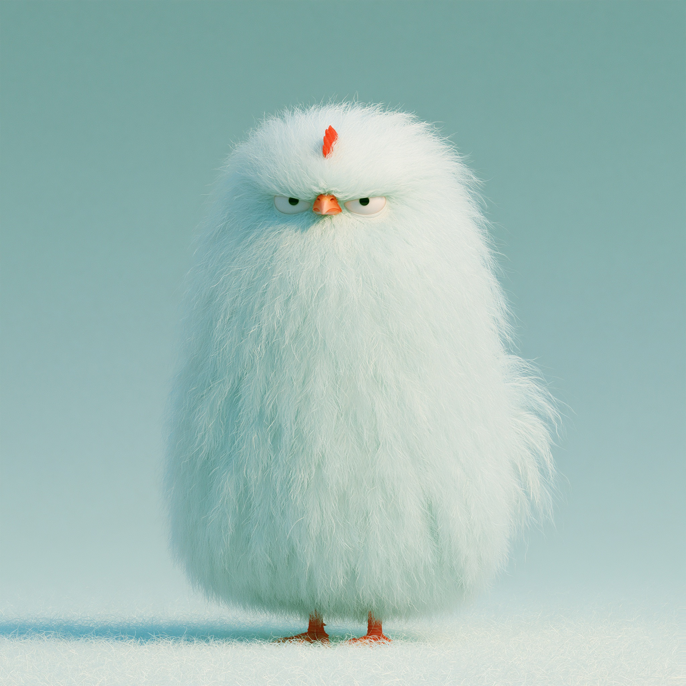

# 毛茸茸公鸡怪兽（Midjourney v8.2 + sref 3486792880）

- 原帖链接：https://x.com/michaelrabone/status/2122298644422660096
- 作者：Michael Rabone（@michaelrabone）
- 时间：2026-11-16 20:00 (UTC+8 / Asia/Taipei)
- 互动摘要：点赞 37 · 转发 0 · 回复 5 · 引用 0 · 书签 21 · 浏览 1202（采集快照：2026-11-17 19:49 UTC+8）
- 模型/工具：Midjourney v8.2
- 标签：其它
- 媒体路径：
  - `media/images/2122298644422660096_1.jpg`（）
  - `media/images/2122298644422660096_2.jpg`（）
- 入库日期：2026-11-17
- prompt 来源：https://x.com/michaelrabone/status/2122298644422660096
- 备注：主帖首行「Midjourney --sref 3486792880」为标题，prompt 取其后两行原样摘录。

## prompt 原文

```text
Fluffy Rooster Monster --sref 3486792880
--ar 1:1 --sw 100 --stylize 250 --hd --v 8.2
```

---

个人学习归档，非商业。prompt 与媒体版权归原作者 @michaelrabone，引用请回到原帖。
