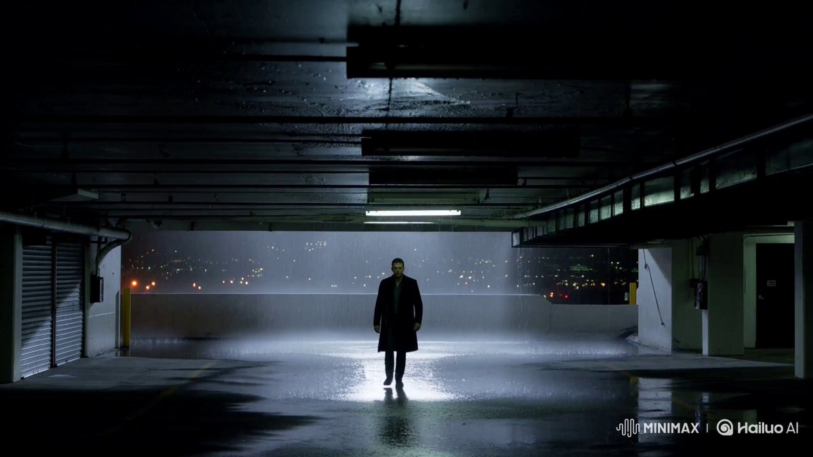

# 夜间韩国小吃街动作喜剧：黑衣女子突袭栗色飞行夹克男的 9:16 视频 prompt

- 原帖链接：https://x.com/RafeAiTech/status/2122331971112292584
- 作者：Rafe Ai（@RafeAiTech）
- 时间：2026-11-16 22:12 (UTC+8 / Asia/Taipei)
- 互动摘要：点赞 42 · 转发 3 · 回复 65 · 引用 0 · 书签 0 · 浏览 17320（采集快照：2026-11-17 19:49 UTC+8）
- 模型/工具：Seedance 2.5（视频）
- 标签：真人
- 媒体路径：
  - `media/video-stills/2122331971112292584_still.jpg`（视频封面截图，）
  - 视频本体未入库，仅保留原帖链接：https://x.com/RafeAiTech/status/2122331971112292584
- 入库日期：2026-11-17
- prompt 来源：https://x.com/RafeAiTech/status/2122331971112292584
- 备注：prompt 直接写在主帖正文（长帖）中，自「AI Video Prompt」起原样摘录。视频仅保留原帖链接。

## prompt 原文

```text
AI Video Prompt 

Cinematic Korean Street Food Market Action Scene | 9:16 | 4K | Ultra Realistic

Create a realistic cinematic action-comedy video set in a busy Korean street food market at night. Colorful Korean signs, glowing hanging lights, steaming food stalls, and people walking in the background.

A beautiful young woman wearing a fitted black outfit suddenly performs a playful martial arts move toward a muscular man wearing a maroon bomber jacket and black pants. The man reacts with surprise, quickly turns around, and tries to dodge her unexpected move. The woman maintains her balance and continues with a fast, dramatic action movement.

Camera & Motion:

Start with a handheld cinematic camera behind the woman.

Follow the action smoothly as she moves.

Capture the man's surprised reaction.

Add realistic body movements and natural clothing physics.

Use a slight slow-motion effect during the action.

Finish with a dynamic cinematic camera movement.

Visual Quality:

Ultra-realistic human movements.

Authentic Korean street market atmosphere.

Natural facial expressions.

Cinematic night lighting.

Professional action movie cinematography.

Realistic physics and smooth motion.

No face distortion, no extra limbs, no flickering.

No text, subtitles, logos, or watermark
```

---

个人学习归档，非商业。prompt 与媒体版权归原作者 @RafeAiTech，引用请回到原帖。
