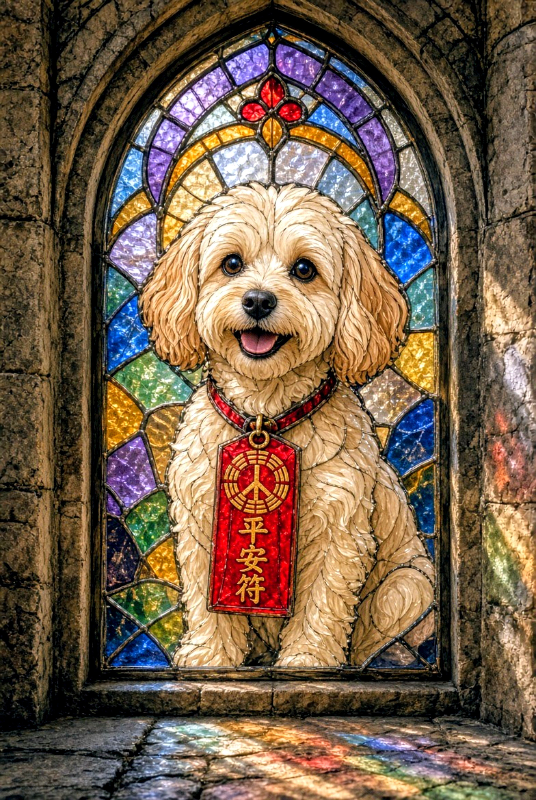
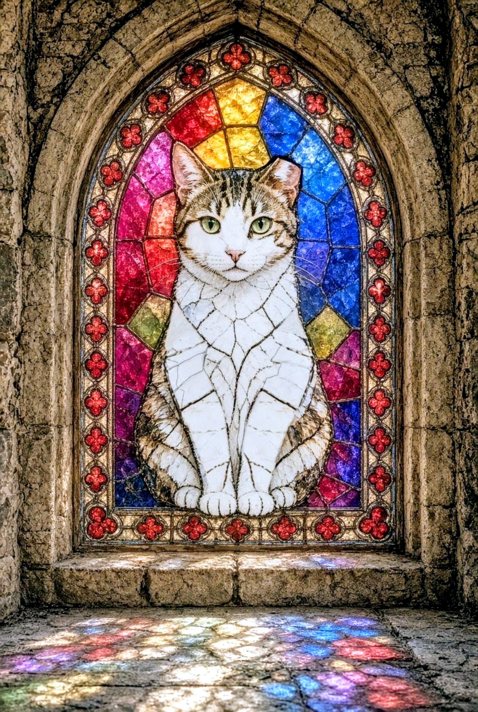
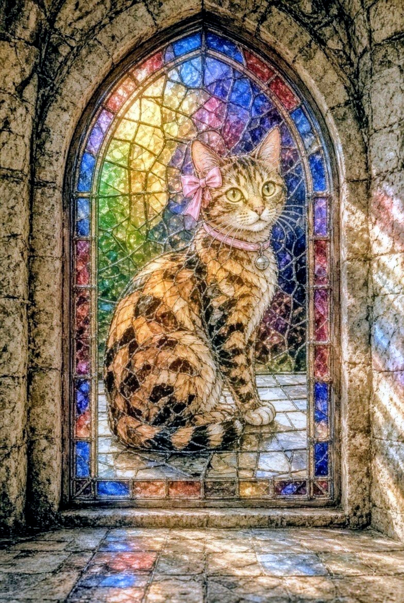
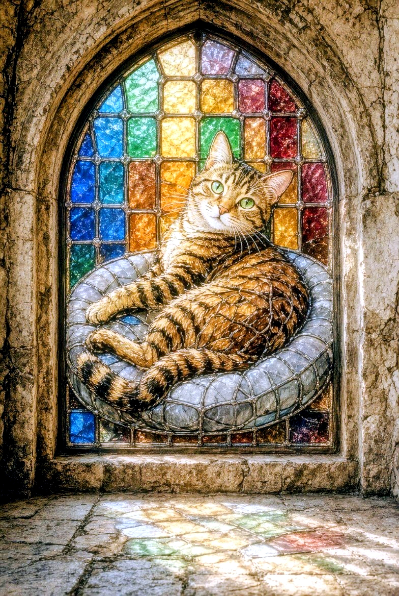
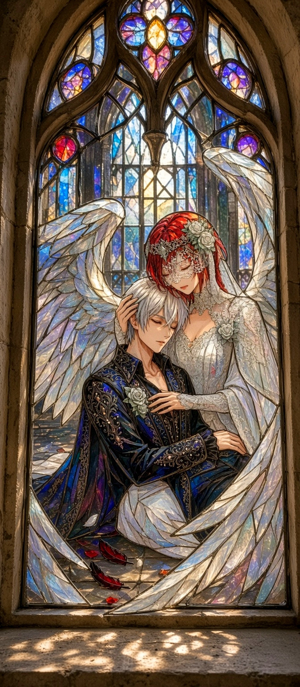
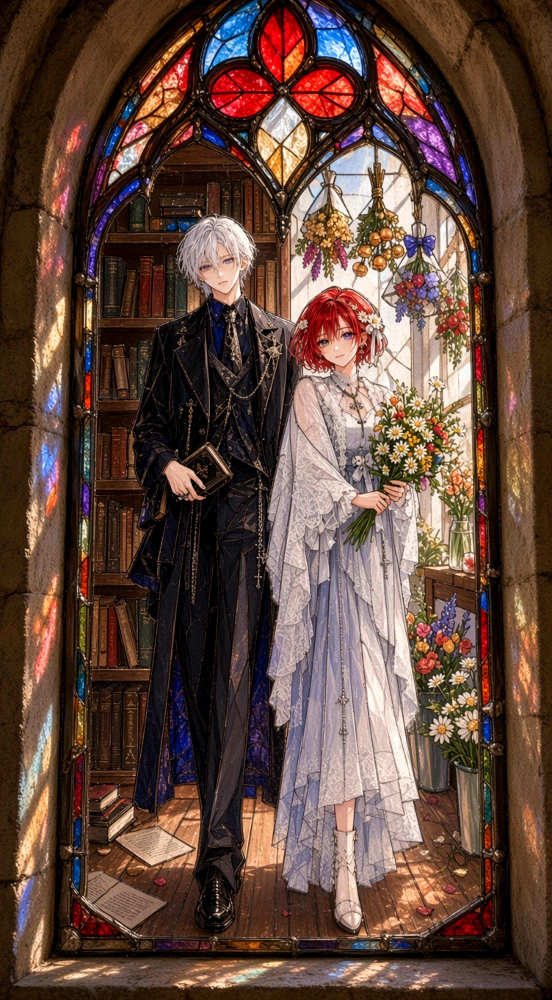
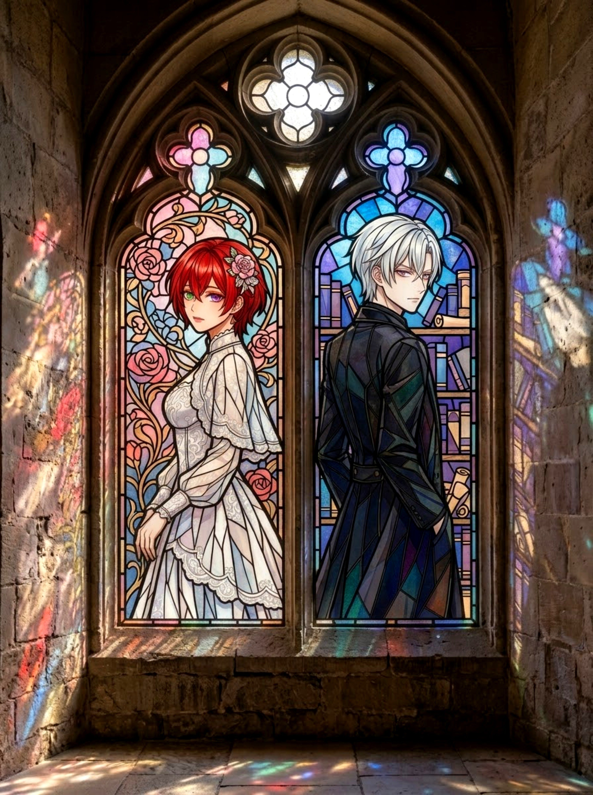

# 变身哥特教堂彩绘玻璃窗：「PHOTOGRAPHIC STAINED GLASS ARTWORK」图生图 prompt（7 段 ALT）

- 原帖链接：https://x.com/aphpasta/status/2122525665924915523
- 作者：砂夜李子@斯巴拉西就是口號୧(＾ 〰 ＾)୨（@aphpasta）
- 时间：2026-11-17 11:02 (UTC+8 / Asia/Taipei)
- 互动摘要：点赞 7 · 转发 2 · 回复 2 · 引用 0 · 书签 2 · 浏览 249（采集快照：2026-11-17 19:49 UTC+8）
- 模型/工具：未注明（图生图，需上传原图）
- 标签：二次元
- 媒体路径：
  - `media/images/2122525665924915523_1.jpg`（）
  - `media/images/2122525665924915523_2.jpg`（）
  - `media/images/2122525665924915523_3.jpg`（）
  - `media/images/2122525665924915523_4.jpg`（）
  - `media/images/2122525665924915523_5.jpg`（）
  - `media/images/2122525665924915523_6.jpg`（）
  - `media/images/2122525665924915523_7.jpg`（）
- 入库日期：2026-11-17
- prompt 来源：https://x.com/aphpasta/status/2122525665924915523
- 备注：作者注明 prompt 在评论区或 ALT，阅读顺序 1>2>3>4>5>6>7；按图 1–7 的 ALT 原样摘录，每段前「[图N]」为本仓库所加序号标注，非原文。示例图含宠物与动漫角色两类（prompt 面向动漫原图改彩绘玻璃），标签按二次元记。

## prompt 原文

```text
[图1] PHOTOGRAPHIC STAINED GLASS ARTWORK

【Strict Lock on Original Image】

Use the uploaded image as the sole and non-negotiable visual reference.

Fully preserve the identity, appearance, facial features, hairstyle, hair color, eye color, body proportions, clothing, and accessories of all characters.

Strictly retain the original number of characters, their positions, proportions, poses, actions, gestures, expressions, gaze directions, interactions, composition, and cropping range.

[图2] Do not add, remove, replace, or redesign any characters, and do not arbitrarily alter the content of the original image.

This task is to transform the original image into a real stained-glass craft artwork, not to recreate it as an illustration.

1. Physical Artwork and Architectural Setting

Museum-quality architectural photography. Completely transform the original image into a real, traditional Gothic stained-glass craft piece installed inside an ancient stone cathedral.

Arrange one or more Gothic pointed-arch windows naturally according to the original composition.

[图3] Pair them with rough stone walls showing cracks, weathering, and age marks, thick window frames, and a stone floor.

2. Authentic Stained-Glass Craftsmanship

The entire work employs traditional hand-leaded stained-glass technique.

All characters’ faces, skin, eyes, hair, clothing, and accessories are entirely composed of irregularly hand-cut colored glass pieces.

Dark H-shaped lead cames tightly wrap the edges of every glass piece. At every intersection and corner, the lead joints are hand-soldered with tin-lead alloy solder.

[图4] Solder joints are clearly visible: each crossing or corner has a slightly raised, irregularly rounded solder blob with a metallic sheen and subtle flow texture. Some solder points show faint oxidation marks or residual flux traces, reflecting genuine hand-soldering imperfections.

The lead cames themselves have a matte grayish-black surface with slight oxidation, tool marks, and fine wrinkles from hand-bending. Lead thickness is uneven in places due to manual pressing and shaping.

Glass edges are slightly irregular from hand-cutting and sit tightly against the inner channels of the lead. Fine contact traces between glass and lead are visible at the seams.

[图5] The overall structure conveys real three-dimensional thickness and weight. Characters and background must fuse into one complete glass artwork; there must be no separation between ordinary anime illustration and a glass background.

Prohibit perfectly symmetrical, overly clean, or digital-looking lead lines. Retain the natural irregularity and material authenticity of handcrafted soldering.

3. Natural Sunlight and Optical Effects

Strong natural sunlight streams directly through the glass from behind the entire work.

Produce realistic light refraction, colored caustic light patterns, and soft geometric shadows projected onto the stone walls, window frames, and floor.

[图6] Present overlapping translucent effects of gem-like colors—red, blue, purple, gold, green—bright, vivid, luxurious, and natural.

4. Physical Artwork Photography

Photograph the finished physical stained-glass piece head-on in a high-end museum and architectural photography style.

Clearly show glass thickness, lead structure, surface reflections, material textures, and the depth of the architectural space.

Include natural light fall-off, realistic environmental shadows, sharp details, and appropriate depth of field.

The work must look like a genuine, completed stained-glass artwork installed inside an ancient cathedral, not a digital illustration.

5. Image Restrictions

Preserve the recognizability of the original characters and the original composition; do not redesign the figures.

Prohibit separation of characters from the glass background, plastic-looking skin, flat anime rendering, ordinary illustration texture, fake glass filters, excessive glow, or overexposure.

[图7] Colors should naturally match the original character designs while maintaining the transparency of glass and authentic craft details.
```

---

个人学习归档，非商业。prompt 与媒体版权归原作者 @aphpasta，引用请回到原帖。
