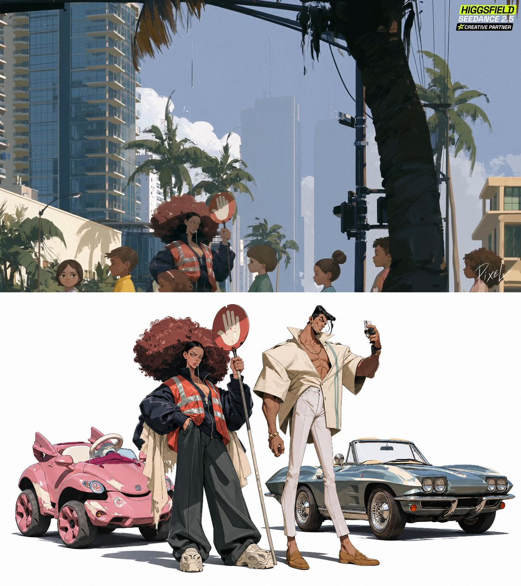

# 学校路口的交通协管员 Barb 与网红司机：水粉 2.5D 卡通物理喜剧（视频 + MJ 角色/场景 + GPT 设定稿全套 prompt）

- 原帖链接：https://x.com/itsPixieVerse/status/2122616282982011020
- 作者：PIXEL（@itsPixieVerse）
- 时间：2026-11-17 17:02 (UTC+8 / Asia/Taipei)
- 互动摘要：点赞 9 · 转发 2 · 回复 4 · 引用 0 · 书签 9 · 浏览 421（采集快照：2026-11-17 19:49 UTC+8）
- 模型/工具：Seedance 2.5（视频）+ Midjourney v8.2 + GPT Image 2.6（作者注明在 @higgsfield 制作）
- 标签：其它
- 媒体路径：
  - `media/video-stills/2122616282982011020_still.jpg`（视频封面截图，）
  - 视频本体未入库，仅保留原帖链接：https://x.com/itsPixieVerse/status/2122616282982011020
- 入库日期：2026-11-17
- prompt 来源：https://x.com/itsPixieVerse/status/2122616302212919535
- 备注：作者把三套 prompt 分三条自回复发出：Seedance 2.5 视频分镜（2122616302212919535）、Midjourney 角色/道具/场景（2122616287906148690）、GPT Image 2.6 角色设定稿（2122616293555949873）；按此顺序原样摘录，每段前「[自回复 ID]」为本仓库所加标注，非原文。自回复中的参考图未入库。视频仅保留原帖链接。

## prompt 原文

```text
[自回复 2122616302212919535]
Seedance 2.5 Prompts:

#1: (20sec)
Cinematic 2.5D animation in the style of fully painterly rendering, characters and environments look like gouache concept-art paintings in motion, visible brush texture on skin, cloth and buildings, flat posterized color blocks with hard-edged light shapes, matte finish, soft filmic volumetric lighting, shallow depth of field. NOT flat 2D cartoon, NO bold black outlines, NO cel-shading, NOT glossy CGI, NOT Unreal Engine, NO photorealism, no plastic skin.

REFERENCES: @[Image 1](image_1) is the crossing guard, @[Image 2](image_2) is the driver, @[Image 4](image_4) is his car, @[Image 5](image_5) is the pink toy car, @[Image 3](image_3) is the location, palette and light. Match each exactly whenever visible.

FORMAT: 16:9, 24fps, 20 seconds, 15 shots. Fast viral meme-edit rhythm: hard cuts landing on the beat, most shots one second or less.

TONE: Slapstick comedy played completely straight. Barb never shows emotion beyond one eye twitch; Tristan is smug until the very last shot.

CARTOON PHYSICS: The rendering stays painterly 2.5D, but motion and acting go full cartoon: exaggerated squash and stretch, smear frames on fast moves, eyes bulging, sweat drops flying off in arcs, hair moving with exaggerated weight and inertia, impossible speeds played as if completely normal.

ON-SCREEN TEXT STYLE: Text appears only where a shot lists TEXT, spelled exactly as written. POP text is huge bold white condensed sans-serif capitals with a hard black drop shadow, a flat graphic overlay on top of the painting, crisp and legible. TYPE text is small white lowercase in the lower third. No other text, logos or lettering anywhere in frame.

TEXT MOTION:
- POP: the words pop in one at a time on the beat with a small bounce.
- TYPE: letters appear one at a time like typing.

EDIT MOVES:
- JUMP CUT: same locked framing, time skips, the subject is suddenly in a new position.
- CRASH ZOOM: a sudden snap punch-in toward the face.
- SPEED RAMP: slow motion that snaps into full speed.
- WHIP PAN: a fast blurred pan that carries the cut.

CHARACTER (@[Image 1](image_1)): A tall broad-shouldered adult woman in her late 40s with a heavy-lidded unimpressed stare and a silver whistle on a cord between her lips, wearing a navy zip-up jacket under a hot-pink hi-vis vest with silver reflective bands, wide charcoal trousers and chunky white sneakers, carrying a round hot-pink lollipop paddle sign with a white palm-hand symbol, elongated stylized tall proportions, painterly matte skin with chunky brush-stroke shading.

BARB'S HAIR: a huge glossy chestnut blow-dry in shots 1-4. From shot 5 on, a flat soaked mop hanging over half her face.

CHARACTER (@[Image 2](image_2)): A tall adult man in his late 20s with a gravity-defying glossy black pompadour as tall as his face, one raised eyebrow and a smug half-smile, wearing a thin gold chain, a cream short-sleeve open-collar shirt with one mint stripe, slim white trousers and tan loafers, elongated stylized tall proportions, painterly matte skin with chunky brush-stroke shading.

VEHICLES: @[Image 4](image_4) is a long low pale silver-blue convertible with the top down, painted as flat blue-grey and slate shapes with cream brush-stroke highlights, matte, never mirror-glossy. @[Image 5](image_5) is a child's hot-pink electric ride-on toy convertible with chunky plastic wheels and sticker headlights, painted as flat pink and magenta shapes, matte.

KID: a small boy of about six in a yellow raincoat, calm and serious.

KEY LIGHT (every shot): Bright clean morning sun just after rain, low from behind the subject at camera-left, cool pale-blue sky fill from the camera side, crisp hard-edged shadow shapes, wet asphalt catching the light as flat cream reflections.

ATMOSPHERE: light morning mist thickens with distance, far towers and the sea about 60% dissolved, depth carried by atmospheric falloff and value separation rather than lens blur.

PALETTE: rain-washed teal, cream, slate asphalt and pale sky blue, fresh and slightly muted. Hot pink appears only on her vest, her paddle and the toy car.

MOTION: weighty natural character animation, cloth and hair reacting to wind and momentum, follow-through and overlapping action.

SHOTS
1 | 0.0-1.6s | Low-angle medium, slow motion. FG a palm trunk cropped at the frame edge / MG @[Image 1](image_1) at the zebra crossing raising her paddle, the huge glossy blow-dry glowing like a halo in the sun, small kids crossing in front of her / BG towers and sea in haze. TEXT POP: "FRESH" then "BLOW-DRY"
2 | 1.6-2.4s | Macro. FG paddle edge / MG her fingers smoothing one perfect curl / BG sky. TEXT TYPE: "2 hours at the salon"
3 | 2.4-3.4s | WHIP PAN left down the boulevard. FG wet palm fronds / MG @[Image 4](image_4) speeding toward the crossing, @[Image 2](image_2) driving one-handed while filming himself on his phone / BG towers.
4 | 3.4-5.6s | SPEED RAMP, low wide at curb height. FG a huge puddle at the edge of the crossing / MG @[Image 4](image_4)'s front wheel slicing into it, a giant painted wave of water rising in slow motion and arching over @[Image 1](image_1), who does not move at all / BG the sun. The wave lands at full speed.
5 | 5.6-6.8s | Medium, locked. FG crossing-light pole / MG @[Image 1](image_1) soaked and dripping; a beat of stillness, then the blow-dry deflates in one slow comic droop into a flat wet mop over half her face / BG the roadster shrinking down the road. TEXT TYPE: "oh."
6 | 6.8-7.6s | Close-up, tracking. FG windscreen frame / MG @[Image 2](image_2) laughing into his phone camera and blowing it a kiss / BG palms streaking by.
7 | 7.6-8.4s | Two CRASH ZOOMS onto @[Image 1](image_1)'s one visible eye through the wet hair, the eyelid twitching, water dripping off her nose. FG wet strands / BG haze.
8 | 8.4-10.0s | Medium. FG pavement edge / MG @[Image 1](image_1) slowly turning her head toward the kid sitting in @[Image 5](image_5) on the pavement; the kid looks up at her, a beat, then climbs out solemnly and steps aside with one small grave nod / BG school wall.
9 | 10.0-11.4s | Medium, locked, two JUMP CUTS: @[Image 1](image_1) folding herself into @[Image 5](image_5) / jump cut, crammed in with her knees up by her ears, paddle upright like a lance / jump cut, pulling the whistle cord tight. FG pavement / BG school wall. TEXT POP: "TOP SPEED:" then "5 KM/H"
10 | 11.4-12.2s | Macro. FG the toy's plastic bumper / MG her white sneaker stamping the tiny pedal, the plastic wheels spinning, smoke and sparks pouring off them / BG wet asphalt.
11 | 12.2-14.0s | Low wide, locked. FG a puddle / MG @[Image 5](image_5) launching at impossible cartoon speed, leaving a hot-pink smear and a burst ring of spray, the kid's raincoat hood blown back, a flock of pigeons blasted into the air / BG crossing and palms.
12 | 14.0-16.0s | Side-on tracking alongside @[Image 4](image_4) down the palm boulevard. FG palm trunks whipping past the lens / MG @[Image 2](image_2) relaxed, one arm on the door, singing along, pompadour bouncing / BG the sea glittering.
13 | 16.0-17.2s | Macro. FG door edge / MG the chrome side mirror with a tiny pink dot far behind in its reflection / BG road blur.
14 | 17.2-18.2s | Close-up. FG windscreen frame / MG @[Image 2](image_2) glancing at the mirror, looking away, smirking / BG palms.
15 | 18.2-20.0s | Macro, the same mirror. FG door edge / MG the pink dot is now @[Image 5](image_5) right behind him, @[Image 1](image_1) filling the mirror, wet hair streaming flat behind her, paddle raised, whistle between her lips / BG road blur. The part ends on: the mirror filled with her.

AUDIO: Shots 1-3: a sweet, light morning: birds, children chattering, a gentle ukulele tune. Shot 4: the ukulele cuts on a huge whoosh and a giant water crash. Shot 5: dead silence apart from dripping, then a sad deflating trombone slide as the hair droops. Shot 6: his car stereo blasting smooth yacht-rock. Shot 7: a tense tremolo string sting and two zoom whooshes. Shot 8: silence and one gust of wind. Shot 9: a deep boom stinger on each POP. Shot 10: a whiny electric toy motor that suddenly turns into a roaring jet engine. Shot 11: a sonic boom and a burst of pigeon wings. Shots 12-14: his smooth yacht-rock returns, relaxed. Shot 15: underneath the yacht-rock, a tinny electronic toy-car jingle, faint at first and getting louder, then a dramatic dun-dun-DUN stinger on the last frame. No dialogue.

------------

#2: (20Sec)
Cinematic 2.5D animation in the style of fully painterly rendering, characters and environments look like gouache concept-art paintings in motion, visible brush texture on skin, cloth and buildings, flat posterized color blocks with hard-edged light shapes, matte finish, soft filmic volumetric lighting, shallow depth of field. NOT flat 2D cartoon, NO bold black outlines, NO cel-shading, NOT glossy CGI, NOT Unreal Engine, NO photorealism, no plastic skin.

REFERENCES: Continue from this exact frame: @[Image 6](image_6). @[Image 1](image_1) is the crossing guard, @[Image 2](image_2) is the driver, @[Image 4](image_4) is his car, @[Image 5](image_5) is the pink toy car, @[Image 3](image_3) is the location, palette and light. Match each exactly whenever visible.

FORMAT: 16:9, 24fps, 20 seconds, 13 shots. Fast viral meme-edit rhythm: hard cuts landing on the beat, most shots one second or less.

TONE: Slapstick chase comedy played completely straight. Barb stays deadpan the entire time and never strains; Tristan's panic gets bigger in every shot.

CARTOON PHYSICS: The rendering stays painterly 2.5D, but motion and acting go full cartoon: exaggerated squash and stretch, smear frames on fast moves, eyes bulging out of the head, jaws dropping past normal anatomy, faces stretching like taffy, sweat drops flying off in arcs, hair moving with exaggerated weight and inertia, a toy car keeping pace with a sports car as if completely normal.

ON-SCREEN TEXT STYLE: Text appears only where a shot lists TEXT, spelled exactly as written. SLAM text is huge bold white condensed sans-serif capitals with a hard black drop shadow, a flat graphic overlay on top of the painting, crisp and legible. TYPE text is small white lowercase in the lower third. No other text, logos or lettering anywhere in frame.

TEXT MOTION:
- SLAM: the word punches in from oversized to full frame width in three frames, with a hard screen shake.
- TYPE: letters appear one at a time like typing.

EDIT MOVES:
- JUMP CUT: same locked framing, time skips, the subject is suddenly in a new position.
- CRASH ZOOM: a sudden snap punch-in toward the face.
- SPEED RAMP: slow motion that snaps into full speed.
- FREEZE FRAME: the image stops dead and holds.

CHARACTER (@[Image 1](image_1)): A tall broad-shouldered adult woman in her late 40s with a heavy-lidded unimpressed stare and a silver whistle on a cord between her lips, wearing a navy zip-up jacket under a hot-pink hi-vis vest with silver reflective bands, wide charcoal trousers and chunky white sneakers, carrying a round hot-pink lollipop paddle sign with a white palm-hand symbol, elongated stylized tall proportions, painterly matte skin with chunky brush-stroke shading.

BARB'S HAIR: a flat soaked chestnut mop over half her face in every shot, streaming straight back behind her at speed.

CHARACTER (@[Image 2](image_2)): A tall adult man in his late 20s with a gravity-defying glossy black pompadour as tall as his face, one raised eyebrow and a smug half-smile, wearing a thin gold chain, a cream short-sleeve open-collar shirt with one mint stripe, slim white trousers and tan loafers, elongated stylized tall proportions, painterly matte skin with chunky brush-stroke shading.

VEHICLES: @[Image 4](image_4) is a long low pale silver-blue convertible with the top down, painted as flat blue-grey and slate shapes with cream brush-stroke highlights, matte, never mirror-glossy. @[Image 5](image_5) is a child's hot-pink electric ride-on toy convertible with chunky plastic wheels and sticker headlights, painted as flat pink and magenta shapes, matte. Barb sits crammed in it with her knees up by her ears.

KEY LIGHT (every shot): Bright clean morning sun just after rain, low from behind the subject at camera-left, cool pale-blue sky fill from the camera side, crisp hard-edged shadow shapes, wet asphalt catching the light as flat cream reflections.

ATMOSPHERE: light morning mist thickens with distance, far towers and the sea about 60% dissolved, depth carried by atmospheric falloff and value separation rather than lens blur.

PALETTE: rain-washed teal, cream, slate asphalt and pale sky blue, fresh and slightly muted. Hot pink appears only on her vest, her paddle and the toy car.

MOTION: weighty natural character animation, cloth and hair reacting to wind and momentum, follow-through and overlapping action.

PEOPLE: a few everyday drivers and bus passengers in the background, staring.

SHOTS
1 | 0.0-1.4s | Close-up, locked, a TRIPLE TAKE in two JUMP CUTS: @[Image 2](image_2) looks at the mirror / jump cut, looks forward / jump cut, snaps back to the mirror with his eyes huge. FG windscreen frame / BG palms.
2 | 1.4-2.4s | CRASH ZOOM. His eyes bulge out of his head cartoon-style and the pompadour springs straight up in fright like a startled cat. FG windscreen edge / BG sky. TEXT SLAM: "BRO."
3 | 2.4-3.4s | Macro. FG dashboard / MG his hand slamming the gear lever forward, his loafer flooring the pedal, the speedometer needle whipping to the end of the dial / BG cabin.
4 | 3.4-6.0s | SPEED RAMP into full speed, low tracking wide. FG road markings streaking / MG @[Image 4](image_4) roaring down the boulevard flat out, and glued to its rear bumper @[Image 5](image_5), plastic wheels a pink blur, @[Image 1](image_1) completely deadpan, whistle between her lips, wet hair streaming straight back, paddle raised like a lance / BG palms smearing past.
5 | 6.0-7.0s | Close-up. FG headrest / MG @[Image 2](image_2) looking back over his shoulder, his jaw dropping cartoonishly down to his chest, sweat drops flying off in arcs / BG her pink shape right behind. TEXT SLAM: "HOW."
6 | 7.0-9.2s | FPV chase camera low behind both vehicles: @[Image 4](image_4) swerves between a bus and a delivery van; @[Image 5](image_5) tips up onto two wheels, squeezes through the gap under the van's belly and pops out the other side still glued to his bumper, sparks spraying.
7 | 9.2-10.4s | Side-by-side medium. FG his door / MG @[Image 5](image_5) pulling level with his door; @[Image 1](image_1) turns to him with zero expression and blows the whistle, and the blast flattens his pompadour backward like a gale / BG the sea.
8 | 10.4-11.4s | CRASH ZOOM: his face stretching like taffy in a silent scream. FG door frame / BG blur. TEXT TYPE: "she's not even trying"
9 | 11.4-13.0s | Wide, locked. FG a palm trunk / MG @[Image 5](image_5) shooting ahead, spinning a perfect 180 in the middle of the road to face him and stopping dead; @[Image 1](image_1) stands up out of it with the paddle raised high / BG towers.
10 | 13.0-14.2s | Low angle at bumper height. FG wet asphalt / MG @[Image 4](image_4) slamming the brakes, tyres smoking, nose diving, stopping a hand's width from her paddle with its front wheels sitting in a huge puddle / BG her legs and the paddle.
11 | 14.2-15.4s | Medium, locked. FG windscreen frame / MG the car has stopped but his pompadour keeps going by inertia, stretching forward and flopping down over his face with a wet slap / BG palms. TEXT TYPE: "physics."
12 | 15.4-17.6s | THE PAYBACK, SPEED RAMP. @[Image 1](image_1) sits back down in @[Image 5](image_5), looks at the puddle, looks at him, and floors it straight at him through the puddle, swerving away at the last instant: a colossal cartoon wave taller than the car rises in slow motion and crashes down on @[Image 2](image_2) at full speed.
13 | 17.6-20.0s | RESOLVE, medium, locked. FG crossing-light pole / MG @[Image 2](image_2) soaked in his seat, his pompadour now a flat wet mop over half his face exactly like hers was, while @[Image 5](image_5) putters slowly past at walking pace and @[Image 1](image_1) gives him one small nod / BG the sea. At 18.4s, FREEZE FRAME held to the end. TEXT TYPE on the freeze: "karma: 5 km/h"

AUDIO: Shot 1: the tinny electronic toy-car jingle playing loud right behind him, his yacht-rock cut dead. From shot 2: a frantic surf-rock chase track with twangy guitar, galloping drums and cartoon brass stabs at about 170 BPM, every cut landing on a beat, a deep boom stinger on each SLAM. Under the whole chase, the whiny toy motor screams like a jet engine. Spot sounds: eye-pop boing and hair spring (2), gearbox crunch and engine scream (3), sparks and a metal scrape (6), an ear-splitting whistle shriek (7), tyre screeches (9, 10), a wet slap as the hair flops (11), a colossal wave crash (12). The chase music stops dead on the brakes in shot 10. Shot 13: only dripping water and the tinny toy jingle fading as she putters away, then a camera shutter click on the freeze frame. No dialogue.

[自回复 2122616287906148690]
Midjourney Prompts: 

Barb: Barb, a school crossing guard in a modern seaside city, fresh from the salon on a morning after rain. Extremely tall adult woman, late 40s, broad shot-putter shoulders, warm beige skin, a huge glossy chestnut blow-dry twice the size of her head, heavy-lidded unimpressed stare, a silver whistle on a cord between her lips. Wears a navy zip-up jacket, a hot-pink hi-vis vest with silver reflective bands, wide charcoal trousers, chunky white orthopaedic sneakers. One fist holds a round hot-pink lollipop paddle sign with a white palm-hand symbol, upright like a lance. Weight on one leg, three-quarter view, full body. Palette: navy, charcoal, cream; hot-pink accents. Stylized 2D painterly character concept, digital illustration, flat color blocks, artistic thin rough lines, rough random brush work on the edges, graphic fashion silhouette, elongated believable anatomy, angular facial planes, broad opaque brushwork, faceted values, crisp shapes, tactile materials, floor shadow, clean-white background

----

Tristan: Tristan, a lifestyle influencer who films himself while he drives, in a modern seaside city. Extremely tall adult man, late 20s, light tan skin, a gravity-defying glossy black pompadour as tall as his face, one eyebrow permanently raised, smug half-smile, thin gold chain. Wears a cream short-sleeve open-collar shirt with one mint stripe, slim white trousers, tan loafers with bare ankles. One hand holds up a phone on a small gimbal, filming himself. Weight on one leg, chin tilted toward the phone, three-quarter view, full body. Palette: cream, white, silver-blue, charcoal. Stylized 2D painterly character concept, digital illustration, flat color blocks, artistic thin rough lines, rough random brush work on the edges, graphic fashion silhouette, elongated believable anatomy, angular facial planes, broad opaque brushwork, faceted values, crisp shapes, tactile materials, floor shadow, clean-white background

------

Toy car: A child's hot-pink electric ride-on toy convertible, small enough for a six-year-old, parked alone on a pavement. Rounded moulded plastic body, chunky plastic wheels with grey treads, round sticker headlights, a tiny clear plastic windscreen, a white plastic steering wheel, a little white seat, empty. Hot-pink body painted as flat pink and deep magenta shapes with cream brush-stroke highlights, matte. Front three-quarter view, whole toy in frame. Palette: hot pink, white, grey. Stylized 2D painterly vehicle concept, digital illustration, flat color blocks, artistic thin rough lines, rough random brush work on the edges, broad opaque brushwork, faceted values, crisp shapes, tactile materials, floor shadow, clean-white background

------

Roadster: A long low 1960s-style convertible grand tourer, an influencer's pride and joy, always driven with the top down. Long hood, short rear deck, slim chrome bumpers, round headlamps, plain unbadged body, cream interior, empty cabin. Pale silver-blue body painted as flat blue-grey and slate shapes with cream brush-stroke highlights, matte, chrome wire wheels. Front three-quarter view from the driver's side, whole car in frame. Palette: silver-blue, slate, cream, chrome grey. Stylized 2D painterly vehicle concept, digital illustration, flat color blocks, artistic thin rough lines, rough random brush work on the edges, broad opaque brushwork, faceted values, crisp shapes, tactile materials, floor shadow, clean-white background

------

Boulevard: Wide palm-lined boulevard in a modern seaside city, outside a primary school where a crossing guard works every morning. A zebra crossing, wet asphalt with huge rain puddles reflecting the sky, glass apartment towers, a low school wall, tall palms, the sea at the far end. Completely empty, no characters, no vehicles. Bright clean morning just after rain, low sun from behind camera-left, long shadows, wet sparkle on the road, light mist. Looking down the boulevard from the crossing, extreme wide establishing shot, deep space, strong foreground silhouette of a palm trunk and a crossing-light pole, midground zebra crossing and puddles, background towers and sea dissolved in haze. Palette: rain-washed teal, cream, slate asphalt, pale sky blue. Stylized 2D painterly environment concept, digital illustration, flat color blocks, artistic thin rough lines, rough random brush work on the edges, broad opaque brushwork, faceted values, crisp shapes, tactile materials, atmospheric depth

[自回复 2122616293555949873]
GPT Image 2.6 Prompts:

Barb:
Create a premium, organic studio CHARACTER CONCEPT DESIGN SHEET in a 16:9 widescreen layout on a pure solid white background. THE ATTACHED REFERENCE IMAGE DEFINES THE ART STYLE — treat it as a strict style bible and reproduce its exact rendering technique in every figure on this sheet.

[STYLE — MIRROR THE REFERENCE EXACTLY]: Replicate the reference image's rendering verbatim: painterly matte digital gouache with flat posterized color blocks, shapes defined purely by value and color cuts with NO outlines and NO lineart of any kind, hard-edged brush shapes, muted desaturated palette identical to the reference, identical overall brightness and contrast (light, airy, pure white background — do NOT darken). Every study — the centerpiece, turnarounds, poses, head studies, and floating detail cutouts — must look like it was painted by the same artist, in the same file, as the reference image.

[STYLE PROHIBITIONS — ABSOLUTE]: no outlines, no ink lines, no graphite lines, no cel-shading, no anime style, no 3D render look, no soft volumetric shading, no glossy highlights, no photorealism.

[TEXT & UI PROHIBITIONS — STRICT]: ABSOLUTELY ZERO METADATA BLOCKS, ZERO DESCRIPTIVE TEXT, ZERO HANDWRITTEN LABELS, ZERO ANNOTATIONS, ZERO CAPTIONS, ZERO NUMBERED BULLETS, ZERO PANEL BORDERS, ZERO FRAMING BOXES, ZERO GRID LINES. The background must be completely seamless pure white. The ONLY text allowed on the entire sheet is the character's Name in clean, bold, heavy typography in one corner. Nothing else.

[PROPORTIONS]: Match the reference's exact body proportions across all figures — elongated fashion-illustration anatomy (9–10 heads tall, small head, long slender limbs, narrow waist).

[SUBJECT_DESCRIPTION]: BARB, an adult woman in her late 40s who works as a school crossing guard. Broad shot-putter shoulders, a huge glossy chestnut blow-dry twice the size of her head, heavy-lidded unimpressed stare, a silver whistle on a cord between her lips. Navy zip-up jacket, hot-pink hi-vis vest with silver reflective bands, wide charcoal trousers, chunky white orthopaedic sneakers. She carries a round hot-pink lollipop paddle sign with a white palm-hand symbol.

Composition & Layout (Organic Studio Spread on Seamless White):

1. TOP CORNER: MINIMAL TITLE
- Bold, heavy, clean typography of the name "BARB" ONLY. No subtitles, no role tags, no metadata boxes.

2. TURNAROUND STANCES (Left / Center-Left):
- Full-body neutral stance holding the paddle upright, and a full-body back view showing the vest's reflective bands and the back of the big blow-dry. Floating naturally on white with subtle contact shadows under the feet. Zero labels.

3. HEAD & EXPRESSION STUDIES (Top Area):
- 3 close-up head studies: front three-quarter deadpan stare with the fresh blow-dry and the whistle between her lips; the same face soaked, the hair collapsed into a flat wet mop over half her face with one visible eye twitching; blowing the whistle hard with puffed cheeks. No borders or circular crops.

4. EVERYDAY POSES (Center & Right):
- 4 full-body poses: raising the paddle high to stop traffic; crammed into a tiny unseen ride-on toy car with her knees up by her ears and the paddle upright like a lance; standing tall with the paddle raised above her head; walking away with soaked hair dripping, completely unbothered. No pose labels.

5. FLOATING GEAR & DETAIL CUTOUTS (Far Right):
- 4 isolated cutouts with no boxes: the hot-pink lollipop paddle sign, the silver whistle on its cord, the folded hot-pink hi-vis vest, the chunky white sneakers. Zero labels, zero pointers, zero text.

The entire sheet must read as a pristine, high-end visual development spread with pure artwork floating seamlessly across a clean white page, completely free of clutter, with only the character's name anchored at the top.
```

---

个人学习归档，非商业。prompt 与媒体版权归原作者 @itsPixieVerse，引用请回到原帖。
