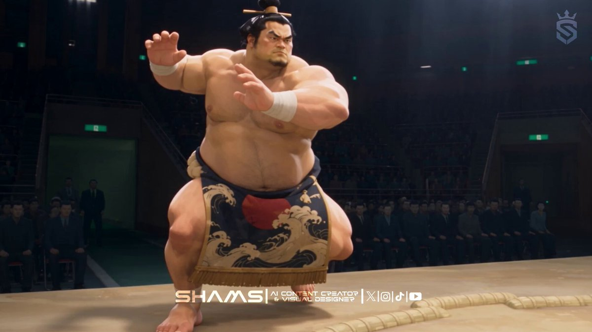

# 相扑冠军 vs 咏春拳师（帖题「Sumo Champion Vs IP Man」）：相扑土俵内的 25 秒卡通渲染 3D 动画对打（GPT Image 设定稿 + Seedance 分镜 prompt）

- 原帖链接：https://x.com/ShamsAmin56/status/2122367147515289658
- 作者：Shams（@ShamsAmin56）
- 时间：2026-11-17 00:32 (UTC+8 / Asia/Taipei)
- 互动摘要：点赞 79 · 转发 5 · 回复 35 · 引用 0 · 书签 21 · 浏览 1945（采集快照：2026-11-18 09:05 前后 UTC+8）
- 模型/工具：Seedance 2.5（视频）+ GPT Image 2.6（角色设定稿），作者注明在 Lovart_ai 制作
- 标签：二次元
- 媒体路径：
  - `media/video-stills/2122367147515289658_still.jpg`（视频封面截图，）
  - 视频本体未入库，仅保留原帖链接：https://x.com/ShamsAmin56/status/2122367147515289658
- 入库日期：2026-11-18
- prompt 来源：https://x.com/ShamsAmin56/status/2122367155945804009、https://x.com/ShamsAmin56/status/2122367161712902264
- 备注：主帖写「Prompt in replies」，两段 prompt（GPT Image 2.6 角色设定稿、Seedance 2.5 视频分镜）在作者自回复，原样摘录。画风为 cel-shaded 3D anime，标签按二次元记。内容为武术对打，prompt 只写拳掌接触、格挡与推挡，无流血或伤势描写，非暴力血腥。帖题提到「IP Man」，prompt 正文只写「WING CHUN MASTER」。视频仅保留原帖链接。

## prompt 原文

```text
GPT Image 2.6 Sheet:

CHARACTER REFERENCES

C1: Uploaded Character Sheet 1
C2: Uploaded Character Sheet 2

OBJECTIVE
Create ONE spectacular, aggressive, cinematic VS battle thumbnail featuring both uploaded characters confronting each other face-to-face.

STRICT CHARACTER IDENTITY LOCK
Use the uploaded character sheets as the exclusive visual references for each character's facial anatomy, hairstyle, body proportions, clothing, accessories, colors, and distinctive features.

Do not swap identities, redesign costumes, or alter recognizable facial characteristics.

RENDER STYLE — STRICT LOCK
Premium cinematic 3D cel-shaded anime, sophisticated sculpted 3D anatomy, sharp expressive ink outlines, dramatic layered cel shading, hand-painted surface textures, angular facial planes, rich color separation, and high-end Japanese fighting-game promotional artwork.

Strong dimensional depth, detailed fabric and skin materials, cinematic shadow transitions, and stylized anime facial rendering.

NOT photorealism, flat 2D illustration, plastic CGI, or generic cartoon rendering.

AGGRESSIVE VS COMPOSITION
C1 occupies the LEFT third, facing RIGHT.
C2 occupies the RIGHT third, facing LEFT.

Both characters aggressively stare directly into each other's eyes.

Intense facial expressions, furrowed brows, clenched jaws, powerful fighting poses.

Dynamic three-quarter profile camera angles.

Enlarged upper-body portraits with faces dominating the composition.

Maintain accurate relative body proportions and size differences.

Strong visual confrontation without overlapping faces.

CINEMATIC ENVIRONMENT
Automatically design an epic battle environment appropriate to both characters and their fighting disciplines.

Atmospheric smoke, floating dust, sparks, directional lighting, volumetric haze, cinematic depth, dramatic shadows, and subtle background motion blur.

Keep both faces exceptionally sharp.

TITLE & TYPOGRAPHY
Position powerful custom typography within the central negative space:

[CHARACTER ONE NAME]
VS
[CHARACTER TWO NAME]

Use bold distressed brush lettering, aggressive fighting-game typography, strong visual hierarchy, red-and-white contrast, subtle dimensional extrusion, and dramatic shadow separation.

The VS symbol must be visually striking with fiery orange-red energy.

Optional authentic cultural typography as secondary graphic accents.

COLOR GRADING
Deep charcoal shadows, warm amber highlights, intense crimson accents, cinematic contrast, rich skin tones, and carefully controlled rim lighting.

FINAL QUALITY
Professional AAA fighting-game key art, premium anime promotional thumbnail, exceptional facial detail, aggressive composition, readable typography, powerful silhouettes, and striking cinematic presentation.

STRICT RULES
Exactly TWO characters. Both facing each other. No duplicate faces, no additional fighters, no costume alterations, no distorted anatomy, no unreadable titles, no watermarks.

16:9 landscape, thumbnail-ready composition.
```

```text
Seedance 2.5:

Cinematic anime clip, 25 seconds. A packed traditional Japanese sumo arena at night: a large circular clay fighting platform (dohyō) under bright white overhead lights, a dark silhouetted crowd, flashbulbs popping, light atmospheric haze. The entire fight happens inside the sumo ring.

C1: WING CHUN MASTER, BLACK TRADITIONAL KUNG FU DRESS, WHITE CUFFS, BLACK TROUSERS AND BLACK SHOES:

C2: MASSIVE JAPANESE SUMO WRESTLER, BLACK DECORATED MAWASHI WITH GOLD ROPE DETAILS, BARE CHEST, BARE FEET AND TRADITIONAL TOPKNOT: Use uploaded sumo character sheet. Extremely powerful, heavyweight fighting style. Wide low stance, explosive forward charges, heavy open-palm thrusts, powerful shoves, body pressure, arm grabs, clinches, balance disruption and forceful attempts to push the opponent outside the ring. Maintain realistic heavyweight momentum and mass.

Both fighters are equally competitive, both landing clean techniques. Every blocked strike visibly contacts the defender's arm or guard. Missed strikes pass through empty air. Wing Chun master uses timing, angles and redirection against the sumo wrestler's superior mass.

0:00–0:03 — Low tracking shot: the sumo wrestler explodes forward with a powerful palm thrust. The Wing Chun master redirects it using Tan Sau and immediately lands three rapid centerline chain punches. Whip pan: the sumo wrestler absorbs the attack and drives forward with a heavy shoulder shove.

0:03–0:06 — Circling shot: the Wing Chun master takes compact angular steps, maintaining centerline control. Low angle: the sumo wrestler launches two massive open-palm strikes. Bong Sau deflects the first, Pak Sau redirects the second. Handheld: a rapid palm strike lands on the sumo wrestler's upper chest.

0:06–0:09 — Close-up: a half-second Wing Chun foot adjustment. Dolly in: Pak Sau trapping followed by four lightning-fast straight punches landing in succession. Low angle: the sumo wrestler breaks the trap, grabs the master's forearm and drives him backward with immense body pressure.

0:09–0:13 — Ring-edge wide shot: the sumo wrestler attempts a powerful double-palm shove. The Wing Chun master redirects both arms using Bong Sau and Lan Sau, then steps diagonally away from the ring boundary. Top-down: Jut Sau arm control, a short elbow strike and two rapid centerline punches land before he pivots back toward the center.

0:13–0:17 — Side-on: two heavy sumo palm thrusts are redirected through compact Wing Chun parries. Low angle: the sumo wrestler lands a powerful body shove, forcing the master backward. Over-the-shoulder: another massive palm strike sweeps through empty air as the master angles aside and counters with Pak Sau followed by three precise chain punches.

0:17–0:20 — Handheld: the sumo wrestler secures a brief clinch and attempts to overpower the master. Close tracking: the Wing Chun master uses Lan Sau and Gum Sau to control the arms, breaks the clinch with a short angular step and lands a compact palm strike. The sumo wrestler immediately answers with a heavy two-handed shove.

0:20–0:22 — Overhead circling: the sumo wrestler drives forward with repeated powerful palm thrusts. The Wing Chun master continuously redirects, traps and counters with rapid centerline chain punches. Both fighters maintain constant close-range engagement.

0:22–0:24 — Wide side-on: the sumo wrestler launches one explosive full-body forward shove as the Wing Chun master simultaneously executes a sharp angled step, Pak Sau redirection and powerful centerline palm strike. Both techniques connect, forcing both fighters backward, still standing inside the ring.

0:24–0:25 — Both fighters recover their balance, facing each other in their signature fighting stances. A single deep ceremonial drum strike signals the end. End.

Cinematic cel-shaded 3D anime, semi-realistic CGI, Unreal Engine quality. NOT a 2D cartoon. Both fighters always match their uploaded character sheets. Preserve identical facial identity, hairstyle, anatomy, body proportions, clothing, colors, accessories and hand-painted angular character rendering. Bold flat colors, hard-edge shadows, thick black outlines, film grain.

Two strictly distinct fighting styles: black-dress master uses authentic reference-sheet Wing Chun choreography, precise centerline control, trapping, deflections, chain punches and economical footwork. Sumo wrestler uses heavyweight sumo pressure, explosive charges, palm thrusts, grabs, clinches and powerful shoves.

Impact sounds only when strikes physically connect; missed strikes produce only whooshes. Continuous fighting until 0:24, no resting. Both fighters visible during every exchange. Every shot under one second with constant cinematic camera movement, never static. No slow motion. No boxing gloves, boxing punches, ropes or boxing ring. No supernatural powers, flying attacks or exaggerated wire-fu. Realistic contact, momentum, body weight and reactions. The drum sounds only at 0:24. Chronological beat order always maintained.
```

---

个人学习归档，非商业。prompt 与媒体版权归原作者 @ShamsAmin56，引用请回到原帖。
