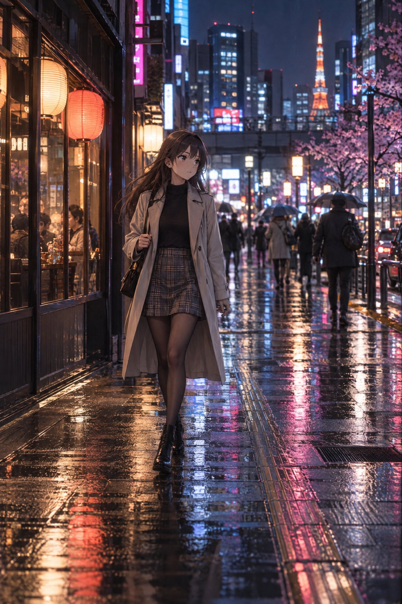

# 「头部动漫 + 身体实写」混合渲染风格 prompt（权重括号写法）

- 原帖链接：https://x.com/NanameNanameumh/status/2122444599549383127
- 作者：𝗇𝖺𝗇𝖺𝗆𝖾（@NanameNanameumh）
- 时间：2026-11-17 05:40 (UTC+8 / Asia/Taipei)
- 互动摘要：点赞 75 · 转发 13 · 回复 1 · 引用 0 · 书签 8 · 浏览 1478（采集快照：2026-11-18 19:44 UTC+8）
- 模型/工具：未注明
- 标签：二次元
- 媒体路径：
  - `media/images/2122444599549383127_1.jpg`（）
- 入库日期：2026-11-18
- prompt 来源：https://x.com/NanameNanameumh/status/2122444600212087197、https://x.com/NanameNanameumh/status/2122444600581169302（作者自回复）
- 备注：prompt 分两条作者自回复（2122444600212087197、2122444600581169302），按顺序拼接原样摘录，作者的「（※長いので下に続きます）」「（※上の続き）」续接标记一并保留。第三条自回复（2122444600811855982）为「フラット化」变体的外链参考，未收录。示例图 1 张入库。

## prompt 原文

```text
((hybrid anime-photorealistic rendering)),
((anime-style head, photorealistic human body)),
stylized 2D anime face, expressive anime eyes, anime hair,
realistic human anatomy, photorealistic skin texture, realistic clothing and materials,
（※長いので下に続きます）
（※上の続き）
distinct visual separation between anime head and realistic body,
natural neck integration,
((anime head, photographic body)).
```

---

个人学习归档，非商业。prompt 与媒体版权归原作者 @NanameNanameumh，引用请回到原帖。
