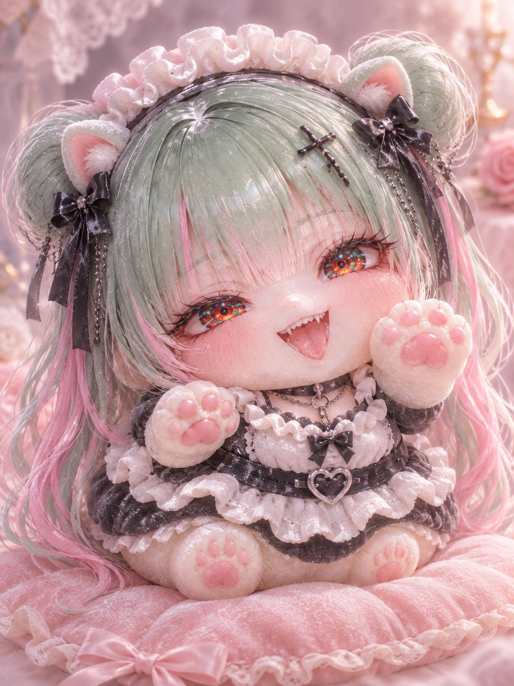
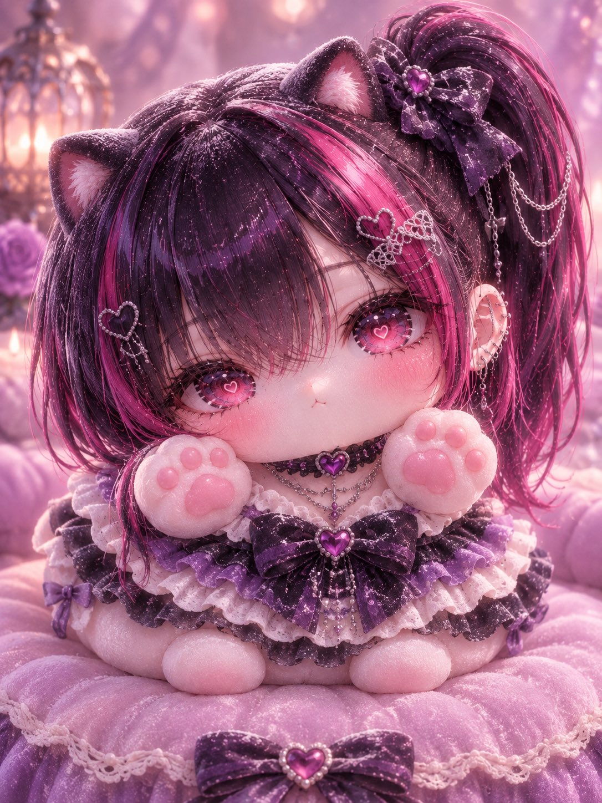
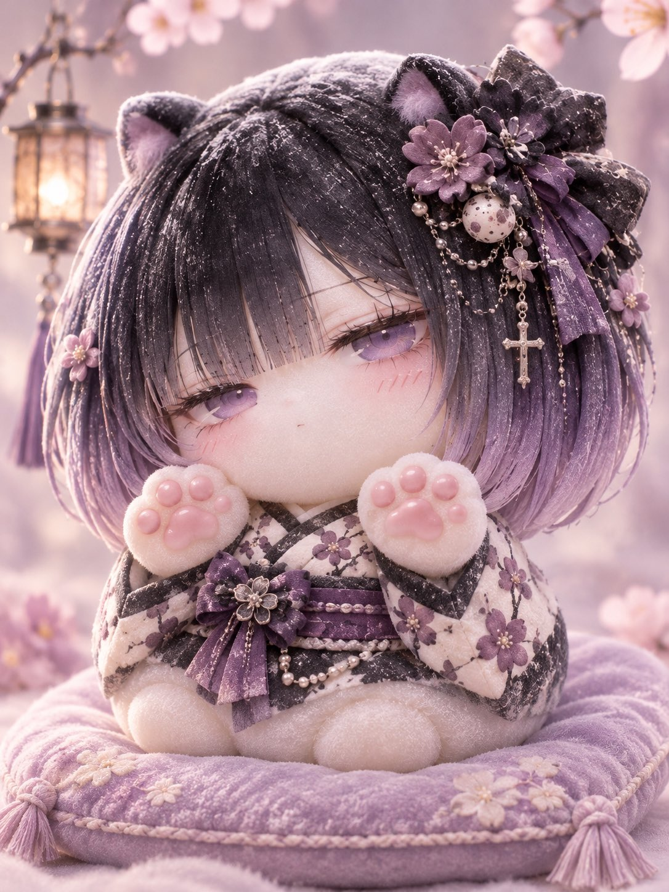
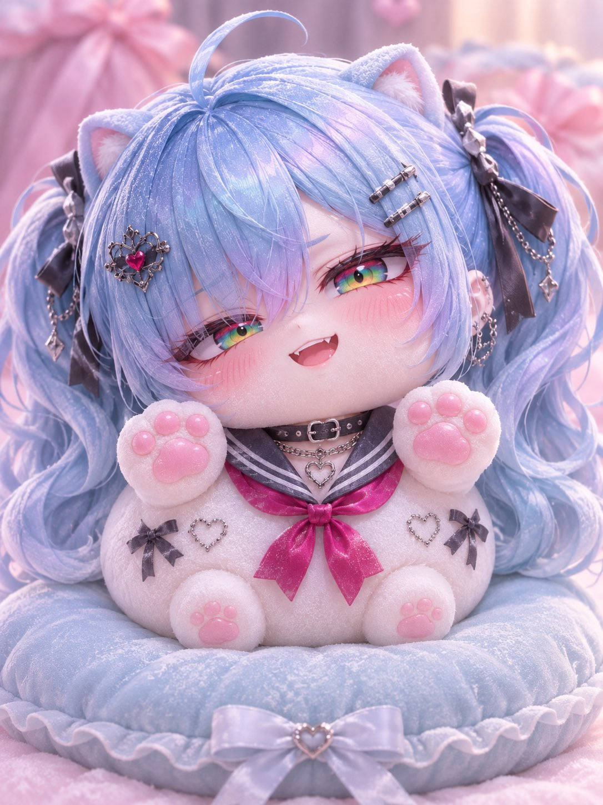

# 肉球猫猫麻薯：把角色变成掌心大小、举起肉垫的 Q 版麻薯小生物（#るんプロンプト 第270弾）

- 原帖链接：https://x.com/ENJU1123PIPI/status/2122472283851702400
- 作者：るんちゃん🦋（@ENJU1123PIPI）
- 时间：2026-11-17 07:30 (UTC+8 / Asia/Taipei)
- 互动摘要：点赞 83 · 转发 26 · 回复 6 · 引用 6 · 书签 9 · 浏览 1888（采集快照：2026-11-18 19:44 UTC+8）
- 模型/工具：未注明（角色参考图驱动的通用 prompt）
- 标签：二次元
- 媒体路径：
  - `media/images/2122472283851702400_1.jpg`（）
  - `media/images/2122472283851702400_2.jpg`（）
  - `media/images/2122472283851702400_3.jpg`（）
  - `media/images/2122472283851702400_4.jpg`（）
- 入库日期：2026-11-18
- prompt 来源：https://x.com/ENJU1123PIPI/status/2122472285193797664（作者自回复）
- 备注：prompt 在作者自回复（2122472285193797664），需上传一张角色图（attached character）。4 张示例图全部入库。原样摘录。

## prompt 原文

```text
Transform the attached character into an irresistibly cute, palm-sized mochi creature. Preserve their recognizable face, hairstyle, hair color, eye color, expression, signature accessories, and personality.

Use 1.5–2-head-tall chibi proportions: an oversized round head, plump cheeks, tiny squishy body, miniature arms, and short rounded feet. Add oversized paw-shaped hands, soft pink or character-matching paw pads, and miniature animal ears integrated naturally into the original hairstyle. Simplify the original outfit into colorful mochi-like decorations.

Create a velvety, powder-dusted mochi surface with delicate translucency, subtle compression wrinkles, and realistic elastic softness. Let the cheeks and body gently flatten under their own weight.

Show the full character sitting on a pastel cushion, raising both paws to display the pads, with a slight head tilt and a charming expression. Cozy pastel background, warm diffused lighting, soft contact shadows, shallow depth of field, and dreamy macro photography.

Premium kawaii 3D rendering, finely detailed textures, beautifully layered irises, rounded silhouette, and convincing squishy volume. Vertical 3:4.

One character only. No text, logos, watermarks, extra limbs, long human proportions, realistic human skin, rigid plastic texture, flat 2D rendering, or excessive animal transformation.
```

---

个人学习归档，非商业。prompt 与媒体版权归原作者 @ENJU1123PIPI，引用请回到原帖。
