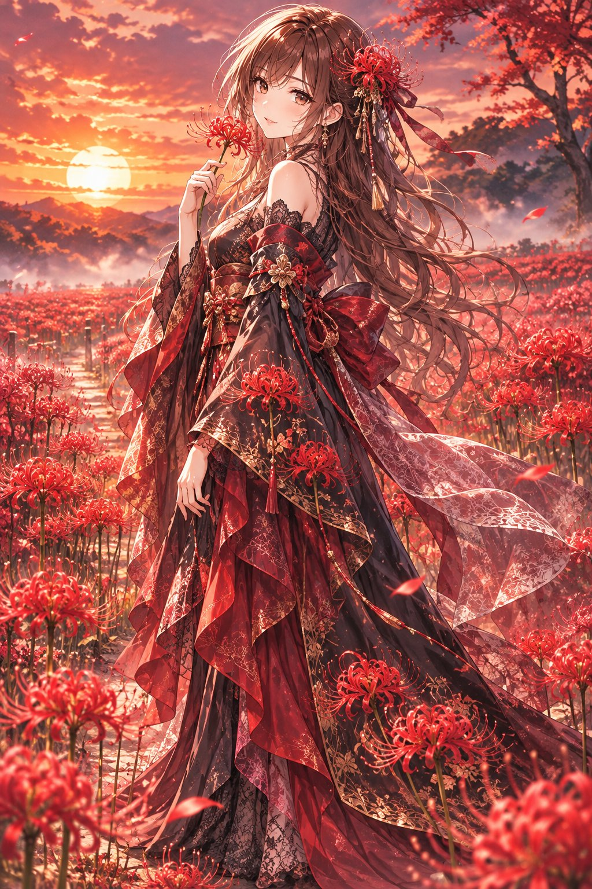
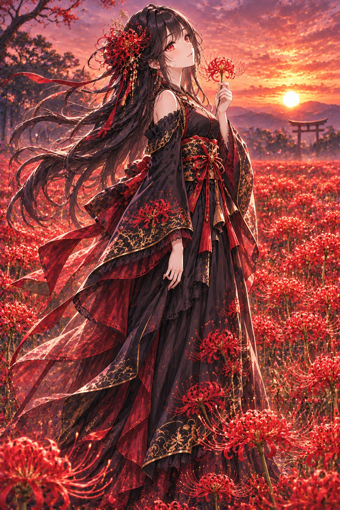
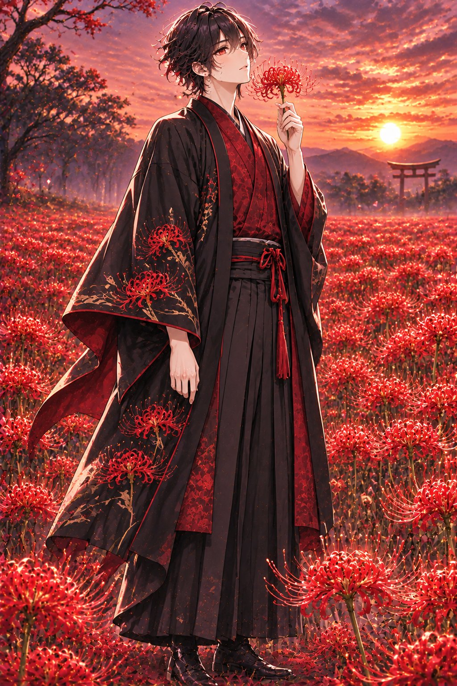

# 彼岸花田的漆黑和装：夕阳下的「彼岸花の少女」与「彼岸花の青年」（动漫插画 prompt 两份）

- 原帖链接：https://x.com/AIXyu1v/status/2122494945110204735
- 作者：ゆき　AIイラストXで収益化（@AIXyu1v）
- 时间：2026-11-17 09:00 (UTC+8 / Asia/Taipei)
- 互动摘要：点赞 86 · 转发 16 · 回复 4 · 引用 13 · 书签 34 · 浏览 4052（采集快照：2026-11-18 09:05 前后 UTC+8）
- 模型/工具：未注明
- 标签：二次元
- 媒体路径：
  - `media/images/2122494945110204735_1.jpg`（）
  - `media/images/2122494945110204735_2.jpg`（）
  - `media/images/2122494945110204735_3.jpg`（）
- 入库日期：2026-11-18
- prompt 来源：https://x.com/AIXyu1v/status/2122494947253493978、https://x.com/AIXyu1v/status/2122494949019296157
- 备注：主帖写「プロンプトはリプ欄に👇 ご自由にお使いください / アレンジも大歓迎」，两份 prompt 在作者自回复。标题虽写「少女」，prompt 原文均明确为「adult Japanese woman / adult Japanese man」，非性化。图 1、图 2 为女性版，图 3 为男性版（按画面判断）。

## prompt 原文

```text
【彼岸花の少女｜Crimson Spider Lily】
Masterpiece anime illustration, full-body portrait of a beautiful adult Japanese woman standing in a vast field of crimson red spider lilies.

Deep crimson, jet black, and warm sunset gold palette. Elegant black and deep-red kimono-inspired dress with flowing sleeves, delicate red spider lily embroidery, subtle black lace, a dark crimson obi, and softly layered translucent fabric.

Long silky black hair flowing gently in the evening breeze, deep ruby eyes, delicate features, and a wistful, fragile expression with a faint melancholic smile.

Standing quietly among blooming red spider lilies, one hand gently touching a flower, the other resting naturally at her side.

Endless field of vivid red spider lilies, narrow countryside path, distant trees, glowing orange sunset, drifting petals, and soft evening mist.

Cinematic sunset lighting, poetic atmosphere, exquisite floral details, graceful natural anatomy, no extra people, no text, no watermark.
```

```text
【彼岸花の青年｜Crimson Spider Lily Prince】
Masterpiece anime illustration, full-body portrait of a handsome adult Japanese man standing in a vast field of crimson red spider lilies.

Deep crimson, jet black, and warm sunset gold palette. Elegant black haori with subtle red spider lily embroidery, fitted deep-crimson kimono, simple black obi, straight black hakama trousers, and polished black boots. Clean masculine silhouette, minimal accessories, no excessive decorations.

Short layered raven-black hair, deep ruby eyes, refined masculine features, and a wistful, melancholic expression with a faint gentle smile.

Standing quietly among blooming red spider lilies, one hand delicately holding a single crimson spider lily, the other resting naturally at his side.

Endless field of vivid red spider lilies, narrow countryside path, distant trees, glowing orange sunset, drifting petals, and soft evening mist.

Cinematic sunset lighting, poetic atmosphere, exquisite floral details, graceful natural anatomy, no extra people, no text, no watermark.
```

---

个人学习归档，非商业。prompt 与媒体版权归原作者 @AIXyu1v，引用请回到原帖。
