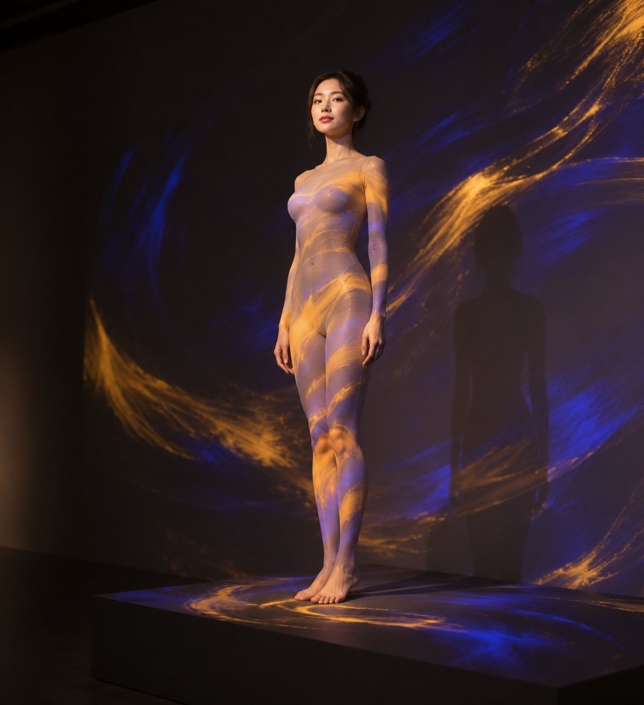

# 「灯光人体彩绘」：投影光绘在成年女性肤色连体舞衣上的当代艺术展现场照（框架 + 实战两段 prompt）

- 原帖链接：https://x.com/huahuansfw1/status/2122510035301380604
- 作者：花花要AI性自由（@huahuansfw1）
- 时间：2026-11-17 10:00 (UTC+8 / Asia/Taipei)
- 互动摘要：点赞 834 · 转发 27 · 回复 8 · 引用 1 · 书签 422 · 浏览 51086（采集快照：2026-11-18 09:05 前后 UTC+8）
- 模型/工具：GPT 生图（作者标签 #GPT #image2，未注明具体版本）
- 标签：真人
- 媒体路径：
  - `media/images/2122510035301380604_1.jpg`（）
- 入库日期：2026-11-18
- prompt 来源：https://x.com/huahuansfw1/status/2122510035301380604
- 备注：prompt 在主帖正文，分「框架提示词」（带【】占位符，可替换）与「实战提示词」两段，均原样摘录。尺度说明：prompt 明确写「虚构的成年女性」、「完全不透明、完整遮盖胸部和下身的无缝肤色连体舞衣」、「画面不出现真实裸体」；成图为成年女性肤色连体衣 + 光影投影的裸感视觉错觉，属成人向但无真实裸露，按「明显成年」规则收录。

## prompt 原文

框架提示词：

```text
舞台以【背景明暗与底色】为基底，让未被照亮的区域保持深度和留白。
一组【主色】的【光影图案】从【投射方向】进入画面，形成清晰、鲜明的视觉节奏。
同一组图案连续落在【背景表面】、人物身体和【地面或道具】上；它们共享相同的方向、尺度与间距，让人物确实处于这套舞台灯光之中。
图案在平面上保持原有形状，经过各个身体部位，如脸部、肩背、腰腿与衣料时随曲面自然变化；亮区呈现真实的受光颜色，暗区保留身体和服装的立体感。
人物对光线产生合理遮挡与影子，【服装材质或饰物】捕捉局部反光，使投影、人物和空间形成同一个可信的现场。
最后用少量【辅助色与补光方式】照清脸和眼神，但不冲淡主投影。保留真实舞台摄影的明暗层次；避免全图套色、皮肤彩绘感，以及只有背景有图案、人物没有受光的效果。
```

实战提示词：

```text
创作一张当代艺术展中的现场摄影作品，不是海报，不要文字。展厅墙面与低矮展台均为哑光深色。一位虚构的成年女性独自站在展台上，她就是光影装置的主体。镜头从略偏侧面的观展角度拍摄，呈现完整人物与周围留白；她自然站立，神情平静而自信。

她穿完全不透明、完整遮盖胸部和下身的无缝肤色连体舞衣。面料贴合身体，远看隐入肤色；肩部和腰侧只有几道极细的银色珠饰。画面不出现真实裸体。

隐藏的投影设备将大幅靛蓝与暖金抽象笔触投射在墙面、舞衣、手臂和双腿上。同一笔触从墙面延伸到人物，随身体曲面弯折，再落回展台。从镜头角度看，彩色光形与肤色舞衣融合，形成仿佛以光完成人体彩绘的错觉。投影确实照在人物身上；人物遮挡光线，在墙面留下合理的柔和影子。

脸部必须明亮、清晰，是整张照片的第一视觉焦点。 在镜头左前方设置一盏柔和的暖白色面部主光，明确照亮双眼、鼻梁、嘴唇和面颊，双眼有自然眼神光。靛蓝与暖金投影可以轻轻掠过额角、颧骨和颈部，使脸与身体属于同一件光影作品；图案不得遮住眼睛或把半张脸压入黑暗。以脸部肤色正确曝光，再保持身体投影鲜明、背景深暗，形成清楚的明暗层级。

作品大胆、性感、安静且有雕塑感，同时保留真实皮肤、衣料与现场光线的质感。不要让脸成为剪影，不要仅照亮身体和背景；不要真实裸体、皮肤纹身、舞台烟雾、围观人群或全图统一套色。
```

---

个人学习归档，非商业。prompt 与媒体版权归原作者 @huahuansfw1，引用请回到原帖。
