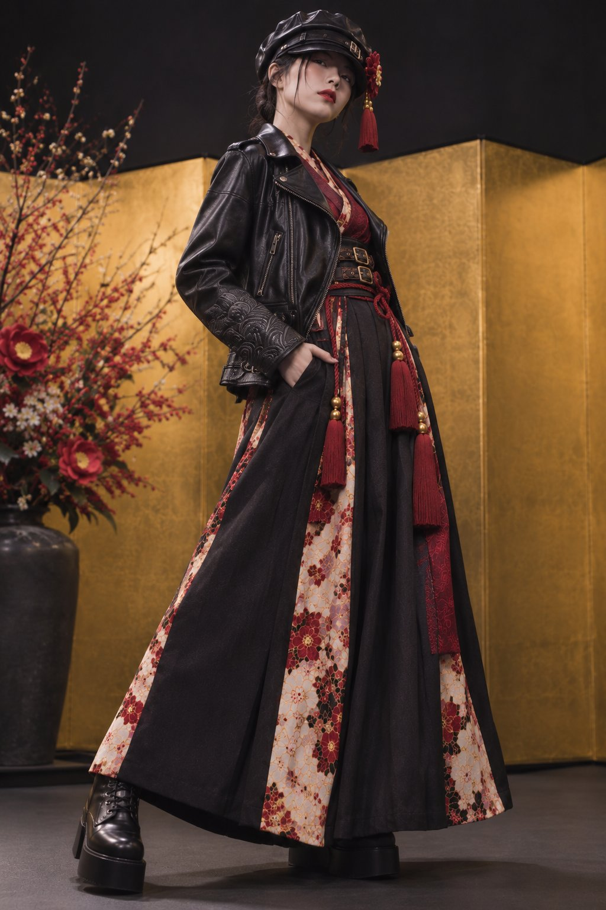
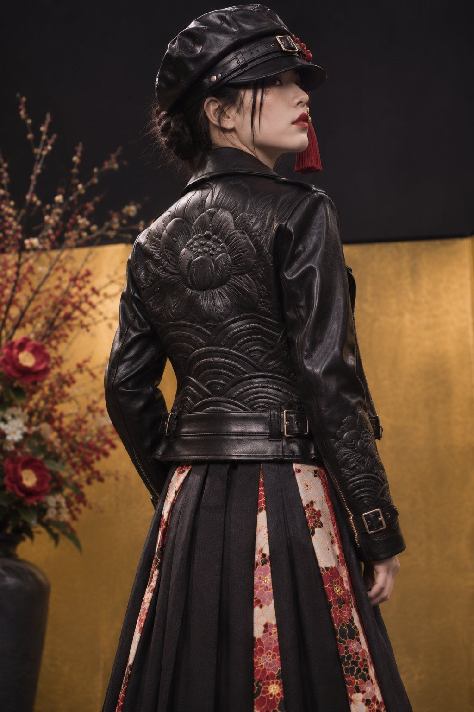
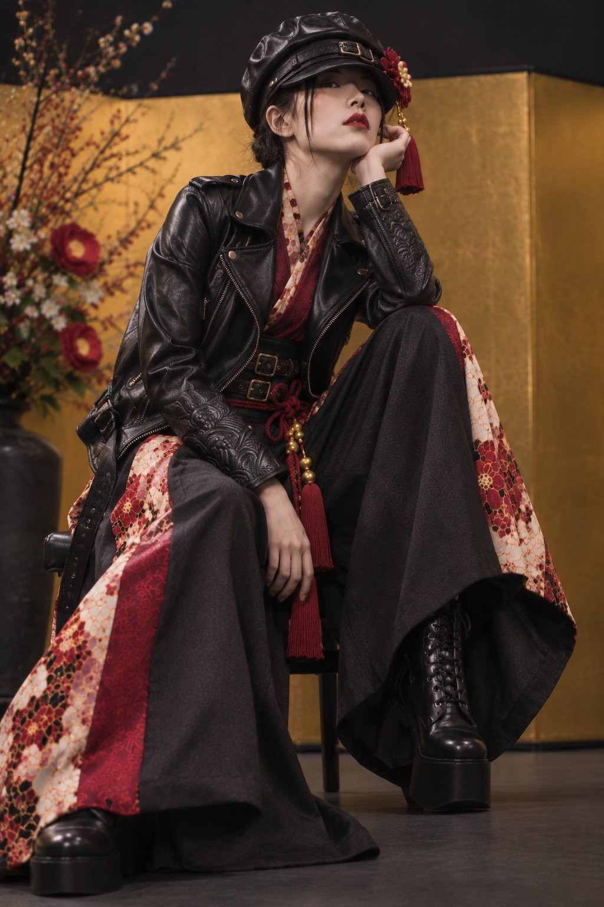
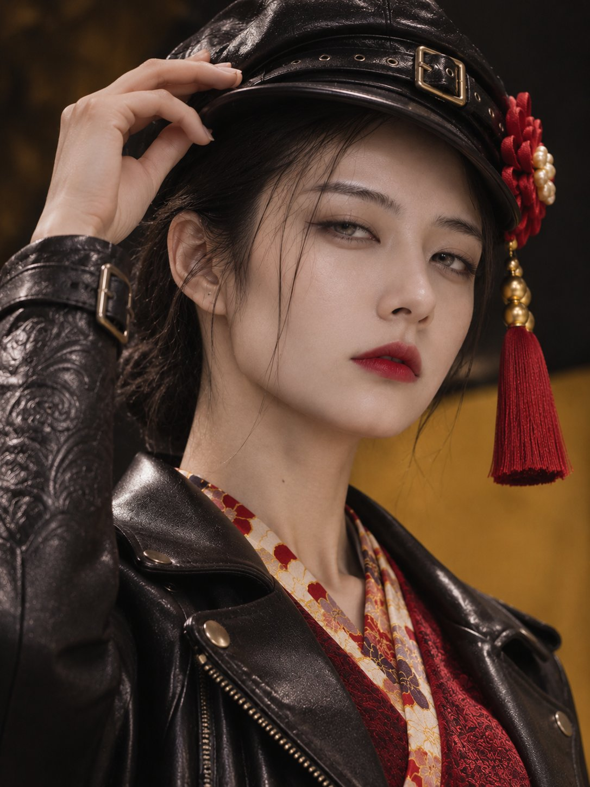

# 和柄 × 皮革：黑皮机车夹克 + 和服风叠穿上衣 + 袴风阔腿裤的和洋折衷衣装 prompt

- 原帖链接：https://x.com/FKT_AIBOX/status/2122537340350668857
- 作者：FKT-AIBOX（@FKT_AIBOX）
- 时间：2026-11-17 11:48 (UTC+8 / Asia/Taipei)
- 互动摘要：点赞 57 · 转发 2 · 回复 2 · 引用 0 · 书签 2 · 浏览 640（采集快照：2026-11-18 19:44 UTC+8）
- 模型/工具：未注明（衣装 prompt）
- 标签：真人
- 媒体路径：
  - `media/images/2122537340350668857_1.jpg`（）
  - `media/images/2122537340350668857_2.jpg`（）
  - `media/images/2122537340350668857_3.jpg`（）
  - `media/images/2122537340350668857_4.jpg`（）
- 入库日期：2026-11-18
- prompt 来源：https://x.com/FKT_AIBOX/status/2122537658270601593（作者自回复）
- 备注：prompt 在作者自回复（2122537658270601593），为纯衣装描述 prompt，可套用到任意人物/角色。示例图为写实人像风，4 张全部入库。原样摘录。

## prompt 原文

```text
ジャポニスムガーリーをテーマにした和洋折衷ファッション。ブラックレザーのマリンキャスケット、ハードなダブルライダースジャケット、着物風の一体型レイヤードトップス、袴風ワイドパンツのコーディネート。

ジャケットは上質なブラックレザー製。シルバーのファスナーとバックルを備え、背中中央には大輪の椿と青海波、両袖口には連続する青海波と小さな椿を同色ブラックの立体エンボス加工で表現。光の角度で浮かび上がる精緻な凹凸。

トップスは生成り地に紅色の小花柄を配した着物風長袖インナーと、紅緋色のジャカード生地によるベスト風身頃を一体化。重ね襟、斜めの打ち合わせ、黒の二連帯風ベルト、アンティークゴールドのバックル、えんじ色の組紐と長いタッセルを装飾。

ボトムスは濡羽色を基調とした袴風ワイドパンツ。深いタックによる豊かなボリュームと、椿柄の紅緋系ジャカード、生成りの桜柄生地を縦方向に縫い合わせた切替パネル構造。重ね布ではなく、柄生地を本体に組み込んだ一体型の縫製仕様。

帽子には黒レザーのマリンキャスケットを採用。二連ベルト、花形金具、えんじ色の組紐とタッセルをあしらう。伝統色の奥行き、和柄の繊細さ、レザーの無骨さ、ガーリーな装飾性を融合した、個性的で高級感のあるファッション。
```

---

个人学习归档，非商业。prompt 与媒体版权归原作者 @FKT_AIBOX，引用请回到原帖。
