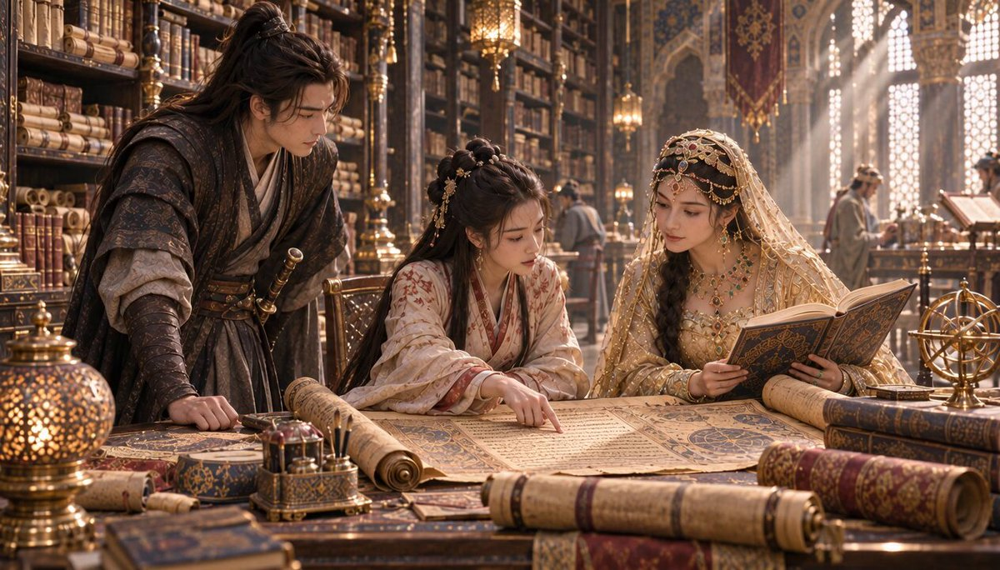

# 古代西域王宫藏书阁：男侠、女子与西域公主共研星象古卷（中文情境图 prompt）

- 原帖链接：https://x.com/Ling_1055Tw/status/2122563818924675127
- 作者：LingTian594888（@Ling_1055Tw）
- 时间：2026-11-17 13:33 (UTC+8 / Asia/Taipei)
- 互动摘要：点赞 43 · 转发 13 · 回复 12 · 引用 1 · 书签 3 · 浏览 3686（采集快照：2026-11-18 19:44 UTC+8）
- 模型/工具：未注明（帖内只写「情境圖片提示詞」；成片为视频）
- 标签：真人
- 媒体路径：
  - `media/video-stills/2122563818924675127_still.jpg`（视频封面截图，）
  - 视频本体未入库，仅保留原帖链接：https://x.com/Ling_1055Tw/status/2122563818924675127
- 入库日期：2026-11-18
- prompt 来源：https://x.com/Ling_1055Tw/status/2122563818924675127
- 备注：prompt 在正文（「情境圖片提示詞👇」之后），从「4K 、16:9」起至负面提示词止原样摘录；该 prompt 为生成情境静帧用，帖子成片为视频。视频本体未入库，仅保留原帖链接。

## prompt 原文

```text
4K 、16:9 ，真人超寫實古裝西域冒險電影劇照，古裝電影美學。ARRI ALEXA 35 Xtreme，ARRI Signature Prime 35mm 電影鏡頭，平視三人中景，自然動態抓拍，細膩 35mm 彩色膠片顆粒，暖金色陽光與柔和體積光。

場景設定：古代西域王宮內宏偉華麗的藏書閣。高聳深色木製書架從地面延伸至天花板，架上擺滿古老書籍與羊皮卷軸；牆面和拱門裝飾深藍色與金色幾何花紋，懸掛精緻金色宮燈與酒紅色刺繡幔旗。

畫面右後方，一排高大的雕花格窗透入明亮金色陽光，光束穿過空氣中細微的塵埃，照亮寧靜的藏書閣。遠處有少量西域學者低頭整理書卷，背景柔和虛化。

人物與動作：畫面左側，一位年輕俊美的東亞男俠站在書桌旁，身形修長，黑色長髮半束高馬尾。身穿深棕黑色金紋多層武俠長袍、皮革護腕與腰帶，腰間佩掛古劍。他微微俯身，一手自然扶著桌面，專注望向桌上的古卷。

畫面中央，一位年輕美麗的東亞女子坐在桌前，黑色長髮半束，以精緻金色髮飾點綴。身穿象牙白與淡粉色花卉刺繡古裝，袖口帶暗紅色滾邊。她微微前傾，伸出一隻手指向古卷上的文字，神情認真，彷彿正在向身旁的公主解說其中的秘密。

畫面右側，一位年輕美麗的中亞面容西域公主坐在桌前，深色長髮編成側辮，佩戴華麗的金色寶石頭飾與垂墜珠鏈，身穿香檳金寶石刺繡宮廷長裙，披著半透明金色薄紗。她雙手自然捧著一本深藍金紋古書，微微側身看向中央女子與桌上的古卷，神情溫柔專注。

前景細節：寬大的深色木桌上鋪展一幅古老羊皮卷，上面有細密的古文字、藍金色幾何圖案與星象圖。桌面散放捲起的羊皮卷、深藍與酒紅色精裝古書、金色雕花筆盒、毛筆與小型銅製渾天儀。左前方放著一盞透出暖光的雕花銅燈，營造豐富的前、中、後景層次。

整體氛圍：三人共同研究古卷的自然互動，神秘、安靜而充滿探索感。真實演員面容與膚質，布料刺繡和金屬飾品細節清晰，光影柔和，電影敘事感。

負面提示詞：動漫風、卡通臉、塑膠皮膚、過度磨皮、人物僵硬擺拍、手指數量錯誤、多餘手臂、手部融合、肢體比例異常、書本變形、畫面過度發光、背景人物過多、現代物品、字幕、浮水印、Logo。
```

---

个人学习归档，非商业。prompt 与媒体版权归原作者 @Ling_1055Tw，引用请回到原帖。
