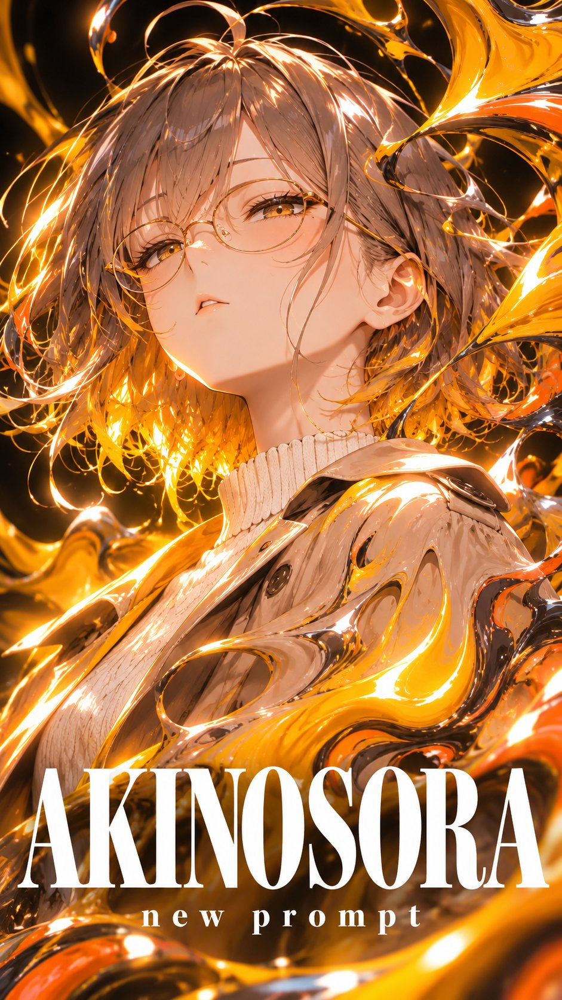
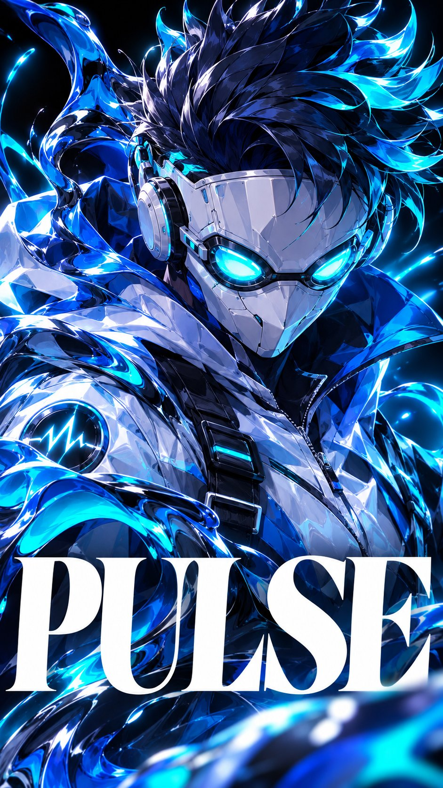
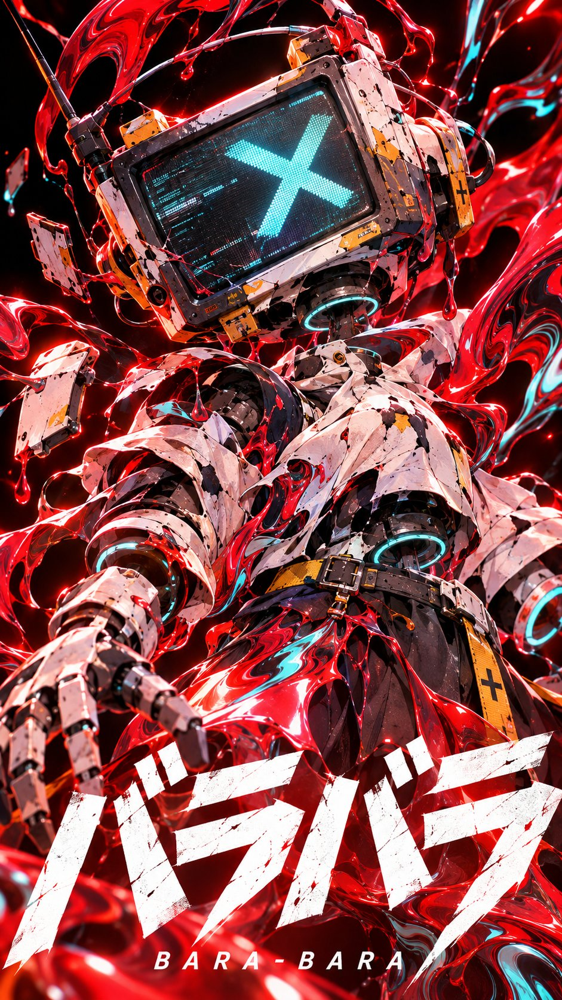
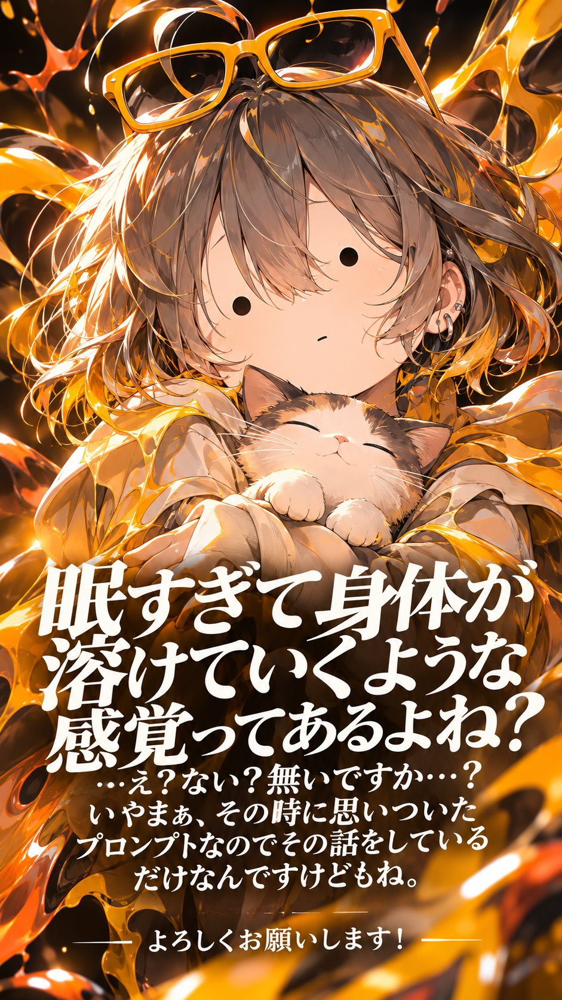

# 「CHROMATIC LIQUID POSTER GENERATOR」：上传角色图，头发与衣装溶成发光马布尔流体的黑底海报生成器

- 原帖链接：https://x.com/AkinoSora_Sky/status/2122592872876699658
- 作者：秋ノ空 / AKINOSORA（@AkinoSora_Sky）
- 时间：2026-11-17 15:29 (UTC+8 / Asia/Taipei)
- 互动摘要：点赞 71 · 转发 13 · 回复 6 · 引用 23 · 书签 37 · 浏览 6274（采集快照：2026-11-18 09:05 前后 UTC+8）
- 模型/工具：未注明（图生图，需附角色图 1 张）
- 标签：二次元
- 媒体路径：
  - `media/images/2122592872876699658_1.jpg`（）
  - `media/images/2122592872876699658_2.jpg`（）
  - `media/images/2122592872876699658_3.jpg`（）
  - `media/images/2122592872876699658_4.jpg`（）
- 入库日期：2026-11-18
- prompt 来源：https://x.com/AkinoSora_Sky/status/2122592879503618367
- 备注：主帖为【プロンプト配布】，完整 prompt 在作者第一条自回复（长帖，约 1.3 万字符），原样摘录。作者另有一条「セクシーアレンジ」回复（外链），未收录。示例图均为非性化角色海报。

## prompt 原文

```text
CHROMATIC LIQUID POSTER GENERATOR

漆黒 × 高光沢マーブル流体 × 強い流体同化 × 発光 × 被写界深度 × ホワイトタイポグラフィ

━━━━━━━━━━━━━━━━━━

【INPUT｜ここだけ入力】

━━━━━━━━━━━━━━━━━━

メインコピー ▶︎
〈必須 / ポスターの主役となる文字〉

サブコピー ▶︎
〈任意 / 未入力なら表示しない〉

メインカラー ▶︎
〈任意 / 未入力ならAUTO〉

差し色 ▶︎
〈任意 / 未入力ならAUTO〉

演技指示 ▶︎
〈任意 / 表情・目線・ポーズ・顔の向きなど。未入力ならAUTO〉

画像比率 ▶︎
〈任意 / 未入力なら9:16〉

その他指定 ▶︎
〈任意 / 未入力ならAUTO〉

添付画像

* 必須：キャラクター画像1枚
* 任意：その他参照画像

━━━━━━━━━━━━━━━━━━

【00｜CONTEXT FIREWALL】

━━━━━━━━━━━━━━━━━━

参照する情報は今回のINPUTと添付画像のみ。

過去の会話、生成履歴、既存設定は参照しない。

未入力項目は本プロンプトのルールに従い自動補完する。

画像比率未入力時は必ず縦長9:16で生成する。

4:5、1:1、3:4などへ自動変更しない。明示的な指定がある場合のみ変更する。

カメラ位置の指定がない場合は、キャラクターに近い距離から、キャラクターの肩の高さを基準に撮影する。

メインカラー未入力時は、キャラクターに映える鮮やかな色を自動選択する。

差し色未入力時は、メインカラーと調和しつつマーブル模様に変化を与える色を自動選択する。

反対色ハイライトは差し色とは独立した照明色として自動設定する。

添付画像はキャラクターデザインの基準とし、元画像の構図やポーズを再現する必要はない。

指定された演技指示とその他指定を優先する。ただし、キャラクターの再現性、流体の質感、文字の正確性は維持する。

完成画像のみを出力する。

━━━━━━━━━━━━━━━━━━

【01｜ART DIRECTION】

━━━━━━━━━━━━━━━━━━

漆黒の空間に、大胆なクローズアップで浮かび上がるキャラクター。

作品の最重要視覚要素はキャラクターの顔。

カメラはキャラクターに近い距離から、肩の高さを基準として顔を見上げるように捉える。

キャラクターの存在感を強調する、近距離のポートレート構図。

髪と衣装の広い範囲が、粘度の高い不透明な流体へ大きく変質している。

流体は身体に付着しているのではなく、髪そのもの、服そのものが溶け、引き伸ばされて液体の帯へ変化している。

キャラクター本来の色彩がわずかに流体へ溶け出し、独特なマーブル模様を生み出す。

流体は指定メインカラーを主成分とし、黒と差し色が複雑に混ざり合う。

表面には強烈な鏡面反射と細密なマーブル模様。

メインカラー部分は鮮やかに発光し、周辺の髪、肌、衣装へ強い色光を与える。

カメラのピントはキャラクターの顔に合わせる。

前景の流体はキャラクターの少し手前に配置し、適度なピンボケを発生させる。

カメラのレンズに極端に近づけず、流体の立体形状とマーブル模様を認識できる距離感にする。

背景の流体は柔らかくぼかし、画面全体に自然な奥行きを作る。

流体全体を見せようとしてカメラを引かない。

巨大な流体の一部は画面外にはみ出し、キャラクターの顔を中心に大胆なトリミングを行う。

キャラクター、流体、光、タイポグラフィを一体化したハイエンドなアートポスター。

VISUAL KEYWORDS

* Character-focused close-up
* Shoulder-height camera
* Close-range portrait
* Subtle low-angle perspective
* Face-focused photography
* Controlled depth of field
* Moderate foreground blur
* Layered cinematic depth
* Opaque viscous liquid
* High-gloss lacquer
* Extensive organic material fusion
* Hair-to-liquid transformation
* Fabric-to-liquid transformation
* Character-color diffusion
* Chromatic marbling
* Sculptural liquid ribbons
* Strong emissive glow
* Complementary-color highlights
* Cinematic edge lighting
* Deep black background
* Premium editorial typography

━━━━━━━━━━━━━━━━━━

【02｜CHARACTER】

━━━━━━━━━━━━━━━━━━

添付画像のキャラクターを正確に再構築する。

髪型、髪色、目、顔立ち、装飾品、衣装の特徴と配色を維持する。

キャラクターの顔を画面内で最も重要な視覚要素として扱う。

A｜CHARACTER FRAMING

* 顔のクローズアップ〜バストアップを基本とする。
* 顔を画面上半分に大きく配置する。
* 顔の面積と存在感を十分に確保する。
* カメラは原則として近距離に配置する。
* カメラの高さはキャラクターの肩付近を基準とする。
* 自然な見上げ角度で顔を捉える。
* 斜め向きや横顔を積極的に活用する。
* 頭部や肩の一部が画面外に見切れてもよい。
* 流体の全体像を見せる必要はない。
* キャラクターを小さくしない。

流体を画面内へ収めるのではなく、キャラクターを大きく描き、流体を大胆に見切れさせる。

B｜FACE PRIORITY

* 目、まつ毛、眉、鼻、口を精密に描く。
* 顔の輪郭を正確に維持する。
* 表情のニュアンスを明確にする。
* 顔を流体によって変形させない。
* 顔の前に大きな流体を重ねない。
* 強い発光によって顔の造形を失わない。
* 近距離撮影でも顔のパーツを不自然に歪ませない。

演技指示がない場合、静かな迫力と強い意思を感じさせる表情とする。

C｜CHARACTER PRESERVATION

流体化していない部分では、元のキャラクターデザインを正確に維持する。

髪型や衣装の特徴は、残存する部分と全体シルエットから認識できるようにする。

人体構造、装飾品、顔のパーツを不自然に変形させない。

━━━━━━━━━━━━━━━━━━

【03｜ORGANIC LIQUID FUSION】

━━━━━━━━━━━━━━━━━━

最重要：髪と衣装そのものを大胆かつ広範囲に流体化させる。

流体を身体の周囲に追加するのではなく、髪と服の素材自体が高粘度の不透明流体へ変質していくように描く。

A｜HAIR FUSION

* 複数の大きな毛束単位で流体化する。
* 毛先だけでなく、毛束の中腹から液体へ移行する。
* 一部は根元付近から流体化してよい。
* 髪の流れが太い液体リボンへ連続する。
* 複数の毛束が合流して巨大な流体の帯を形成する。
* 髪の質感から鏡面光沢へ徐々に変化する。
* 毛流れがマーブル模様の流線に変わる。
* 髪色が液体の中へ細い筋となって溶け出す。

髪全体の40〜60%程度を流体化の目標とする。

元の髪型を認識できるシルエットと特徴的な毛束を残す。

B｜COSTUME FUSION

* 肩、袖、襟、胸元、裾など複数部位を流体化する。
* 布の表面が崩れて高光沢流体へ変化する。
* 袖や裾は布の延長として液体の帯へ変わる。
* 衣装のしわがマーブル模様へ移行する。
* 衣装の輪郭が溶けて滑らかな曲線になる。
* 衣装の一部は形を保ち、一部は大きく崩れる。
* 流体化した衣装が前景と後景へ広がる。
* 元の衣装色が流体の中へわずかに混ざる。

衣装の見えている領域の35〜50%程度を流体化の目標とする。

元衣装の特徴的な形状、装飾、配色は認識可能に残す。

C｜PARTIAL LIQUID WEARING

流体は髪と衣装が変質した延長物として存在する。

* 肩から胸元へ広く流れる。
* 腕や胴体の一部を包み込む。
* 髪から生まれた流体が身体の前方を横断する。
* 衣装から生まれた流体が側面へ広がる。
* 太い液体の帯が身体を部分的に巻き込む。
* 流体が前景・中景・後景に連続する。

前景へ伸びる流体も、キャラクターから極端に離さず、周囲を漂う距離感に留める。

元の素材・変質途中の素材・完全に流体化した素材の3段階を表現する。

D｜SEAMLESS TRANSITION

* 髪の毛束がそのまま液体のうねりへ接続する。
* 布の輪郭が液体の丸いフォルムへ変形する。
* 境界では徐々に光沢が増す。
* マーブル模様が素材を侵食するように広がる。
* 元の素材感と流体感が混ざり合う。
* 流体化の境界では発光が強まる。
* 一つの物質が連続して変化するように描く。

液体を後から付け足した見え方は禁止。

━━━━━━━━━━━━━━━━━━

【04｜CHARACTER COLOR DIFFUSION】

━━━━━━━━━━━━━━━━━━

キャラクター固有の色彩が、わずかに流体へ溶け出している表現を加える。

流体化する髪や衣装の境界から、キャラクター本来の色が液体内部へ流れ込む。

* 髪色が細い流線となって流体へ混ざる。
* 衣装色が液体の表面にわずかに残る。
* キャラクターの特徴色が細かなマーブル模様として伸びる。
* 元の素材色がメインカラーへ徐々に溶け込む。
* 変化の境界に細い色筋や小さな渦を作る。
* 流れに沿って元の色が徐々に薄まり、消えていく。

キャラクター固有色は、流体化境界周辺の局所的な混色として扱う。

流体全体の配色を崩さない。

肌色を大量に流体へ混ぜない。

━━━━━━━━━━━━━━━━━━

【05｜OPAQUE LIQUID】

━━━━━━━━━━━━━━━━━━

完全不透明・高粘度・超高光沢の流体。

メインカラーを主体とする、高光沢ラッカー塗料や樹脂を思わせる質感。

A｜LIQUID SHAPE

* 厚みと重量を感じる立体的な液体。
* 太く長い帯状の流体。
* 大きくうねり、ねじれ、折り返す。
* 細い流体が主流体に絡みつく。
* 一部が雫となって浮遊する。
* 表面張力による滑らかな膨らみ。
* キャラクターから画面外へ連続する構造。

流体の動きには明確な方向性を持たせる。

ランダムな飛沫ではなく、一本の大きな流れから複数の流線が分岐する構造にする。

B｜SURFACE QUALITY

* 完全不透明。
* 極めて高い光沢。
* 強烈な鏡面反射。
* 鋭い白色ハイライト。
* 黒による深い陰影。
* 滑らかな曲面。
* 厚みのある丸い輪郭。
* 強い明暗差による立体感。

透明な水、ガラス、ゼリー状の表現は禁止。

C｜CHROMATIC MARBLING

メインカラーを主役とし、黒と差し色が複雑に混ざり合う。

* 引き伸ばされた細い色筋。
* 同心円状の巻き込み。
* 不規則に分岐する流線。
* 細かな渦巻き。
* 色が折り重なる層状模様。
* 複雑に絡み合う曲線。

異なる色の塗料が混ざりきる直前の模様を描く。

マーブル模様は流体の立体形状に沿って変形する。

単純なグラデーションや均等なストライプは禁止。

D｜ACCENT COLOR MIXING

差し色を流体全体の約20%に混ぜ込む。

* メインカラーの流線へ複雑に入り込ませる。
* 細い色筋、分岐、渦、層として配置する。
* 一部ではメインカラーと交差させる。
* 大きな単色面を作らない。
* 差し色を主役にしない。

差し色の目的は、マーブル模様の複雑さと密度を高めること。

━━━━━━━━━━━━━━━━━━

【06｜COLOR SYSTEM】

━━━━━━━━━━━━━━━━━━

背景：BLACK

流体ベース：指定メインカラー

流体陰影・マーブル補助：BLACK

流体差し色：指定アクセントカラー

発光色：メインカラー

補助照明：メインカラーの反対色

文字：PURE WHITE #FFFFFF

流体の色彩バランス

* メインカラー系：50〜60%
* ブラック系：25〜30%
* 差し色系：15〜20%

上記は流体表面の面積比率の目安とし、合計100%になるよう調整する。

キャラクター固有色の微量な混入は、流体化境界付近の既存色筋に重ねる。

白色の鏡面反射や反対色ハイライトは、この比率に含めない。

配色原則

* メインカラーが流体の主面積。
* 黒は陰影、深み、マーブルの流れを作る。
* 差し色は複雑な色筋として使う。
* キャラクターの固有色はわずかに溶け出す。
* 反対色は照明のハイライトとして使う。
* 背景は漆黒で統一する。

黒い流体に色が混ざるのではなく、メインカラー主体の流体に黒が深く混ざっている状態。

━━━━━━━━━━━━━━━━━━

【07｜STRONG EMISSIVE GLOW】

━━━━━━━━━━━━━━━━━━

最重要：メインカラー部分の発光を強くする。

流体は実際に周囲を照らす発光体として表現する。

A｜EMISSIVE SURFACE

* メインカラーの表面から強い光を放つ。
* 明るい部分は鮮烈に輝く。
* 光の周囲に柔らかなグローを発生させる。
* 色の境界から光が滲む。
* マーブル模様の流線に沿って発光する。
* 発光の強い部分と弱い部分を混在させる。
* 特に流体の曲面や交差部分で強い発光を作る。

B｜LIGHT SPILL

発光した流体は周辺にも色光を与える。

* 流体同士の接近部分に光を反射させる。
* 黒い流体の表面にメインカラーの光を映す。
* 髪や衣装の流体化境界を照らす。
* キャラクターの肌や衣装にも色光を反映する。
* 奥の流体にも柔らかな光が回り込む。

C｜GLOW CONTROL

発光は強くするが、形状を失わない。

* 完全な白飛びを避ける。
* マーブル模様を視認可能に残す。
* 液体の曲面と厚みを維持する。
* 黒い陰影は深く残す。
* 光源の周辺に柔らかな滲みを追加する。

ピンボケした流体の発光も過度に拡大させず、元の液体の形状が伝わる程度にする。

流体そのものは完全不透明。

━━━━━━━━━━━━━━━━━━

【08｜LIGHTING & REFLECTION】

━━━━━━━━━━━━━━━━━━

強烈な鏡面反射と鮮やかな発光が共存する、映画的なスタジオライティング。

A｜WHITE SPECULAR LIGHT

* 強い白色の線状ハイライト。
* 曲面に沿って歪む反射。
* 明部は鋭く輝かせる。
* 暗部は深い黒に沈める。
* 流体の厚みと曲率を反射で表現する。

B｜CHARACTER EDGE LIGHTING

メインカラーの発光をキャラクターへ強く反映する。

* 髪の外周。
* 頬の輪郭。
* 鼻筋の側面。
* 顎先。
* 首筋。
* 肩。
* 衣装の端。
* 流体との接触部分。

光はキャラクターの形状に沿って自然に回り込む。

発光源に近い部分ほど強く、離れるほど弱くする。

顔全体を発光色で塗りつぶさず、顔立ちと表情の視認性を維持する。

C｜COMPLEMENTARY HIGHLIGHTS

メインカラーの反対色によるハイライトを追加する。

反対色は色相環上の補色関係を基準に自動設定する。

* 流体表面の一部に鋭い反射光を作る。
* 液体の曲面やエッジに沿わせる。
* マーブル模様の境界に微細な反射を加える。
* キャラクターの輪郭のごく一部にも反映する。
* 主発光とは異なる方向から照射する。

反対色は照明として限定的に使い、流体の主成分にはしない。

D｜LIGHTING HIERARCHY

1. メインカラーの強い発光：色彩と光の主役。
2. キャラクターへのエッジライト：顔と流体の一体感。
3. 白色鏡面反射：高光沢と立体形状。
4. 反対色ハイライト：色彩の緊張感と奥行き。

━━━━━━━━━━━━━━━━━━

【09｜CAMERA & DEPTH OF FIELD】

━━━━━━━━━━━━━━━━━━

最重要：近距離・肩の高さ・顔への正確なピント。

カメラは原則としてキャラクターに近い位置へ配置する。

カメラの高さは、キャラクターの肩付近を基準とする。

この位置から顔を自然に見上げるように撮影する。

A｜CAMERA POSITION

デフォルトのカメラ設定

* 撮影距離：近距離。
* カメラ高さ：キャラクターの肩付近。
* カメラ角度：肩の高さから顔を捉える、自然な軽いローアングル。
* 撮影範囲：顔のクローズアップ〜バストアップ。
* ピント：キャラクターの目。
* 被写界深度：適度に浅い。
* レンズ：自然な顔の形状を維持できるポートレートレンズ相当。

肩の高さとは、キャラクターの身体を基準にした高さを指す。

地面からの固定的な高さではなく、キャラクターの姿勢に合わせて調整する。

カメラはキャラクターの近くに置くが、極端な広角パースや顔の歪みを発生させない。

演技指示でアングルや距離が指定された場合は、その内容を優先する。

B｜FOCUS TARGET

* ピントの中心はキャラクターの目。
* 目、まつ毛、眉、鼻、口を精密に描く。
* 顔のディテールを最も鮮明にする。
* 顔周辺の流体は比較的シャープに残す。
* 前景と後景の流体には自然なボケを与える。

顔が画面内で最も解像感の高い領域になるようにする。

C｜FOREGROUND DISTANCE

近景の流体をカメラへ近づけすぎない。

前景の流体はキャラクターの身体や髪から伸びたものであり、顔より少し手前の空間に存在する。

* 流体はキャラクターのすぐ前方〜少し手前に配置する。
* カメラのレンズ付近に巨大な流体を置かない。
* 顔と前景流体の奥行きの差を小さめにする。
* 前景流体を極端に拡大しない。
* 大きな液体の塊をカメラの直前に配置しない。
* 流体の連続性と付け根が認識できる距離を保つ。
* 前景の流体は画面端や肩周辺を中心に配置する。

キャラクターの近くを流れる液体として描き、カメラの目の前を遮る液体として描かない。

D｜FOREGROUND BLUR

前景の流体には弱〜中程度のピンボケを適用する。

* 流体の輪郭が少し柔らかくなる程度。
* 大きな曲線と立体形状は明確に残す。
* マーブル模様の色の流れを認識できるようにする。
* 鏡面反射の輪郭を適度に柔らかくする。
* 発光は自然に滲ませるが、大きな光の塊にしない。
* 顔の重要部分は隠さない。

前景の流体も作品の重要な造形要素として認識できる状態を維持する。

E｜BACKGROUND BLUR

キャラクターより奥の流体は中程度のピンボケを適用する。

* 奥へ行くほど輪郭を柔らかくする。
* マーブル模様のディテールを段階的に減らす。
* 発光した液体は柔らかな色光へ変化する。
* 黒い背景と自然に溶け込ませる。
* 奥の流体の大きな形状は認識できる程度に残す。

F｜DEPTH GRADATION

奥行きによってピントの強さを段階的に変える。

前景：弱〜中程度のピンボケ

キャラクターの顔：最もシャープ

顔と同じ奥行きの髪・流体：シャープ

後景：中程度のピンボケ

極端な最前景レイヤーは原則設けない。

顔の前後で穏やかにピントが変化する構成にする。

G｜CAMERA CONTROL

* 原則として近距離を維持する。
* カメラ高さは肩付近を維持する。
* 顔を自然に見上げる構図を基本とする。
* 顔が画面内で十分に大きく見えるようにする。
* 極端なローアングルやハイアングルは避ける。
* 顔のパースを過剰に強調しない。
* 流体を見せるために撮影距離を遠くしない。
* 流体がカメラへ近づきすぎないようにする。

カメラの基本位置を固定し、流体側の配置と流れによって構図を調整する。

━━━━━━━━━━━━━━━━━━

【10｜COMPOSITION】

━━━━━━━━━━━━━━━━━━

主役はキャラクターの顔。

キャラクターを近距離から大きく捉え、流体を画面外へ大胆に見切れさせる。

A｜FRAMING RULE

* 顔のクローズアップ〜バストアップを基本とする。
* カメラは肩の高さから近距離で撮影する。
* 顔を画面上半分に大きく配置する。
* 顔の存在感を最優先する。
* 髪や衣装の流体化を顔の周囲から展開する。
* 流体が画面端で見切れてもよい。
* 全身を描く必要はない。
* 流体全体を画面に収める必要はない。
* 縦長9:16の画面を基本とする。

流体を多く描くためにキャラクターを小さくしてはいけない。

B｜LAYER STRUCTURE

BACKGROUND

* 漆黒の背景。
* 余計な風景や装飾を入れない。
* 発光した流体の色光がわずかに滲む。

BACK LIQUID

* キャラクターの背後を流れる液体。
* 髪や衣装から連続して生まれる。
* メインカラー主体のマーブル模様。
* 中程度のピンボケ。
* 発光部分が柔らかな色光となる。

CHARACTER

* 顔を大きく配置する。
* カメラは近距離・肩の高さ。
* 顔のディテールは最もシャープ。
* 髪と衣装を広範囲に流体化させる。
* キャラクターの固有色をわずかに流体へ混ぜる。
* 発光を肌や衣装のエッジライトへ反映する。

FRONT LIQUID

* 身体から連続した流体が少し手前へ伸びる。
* キャラクターの近くを漂うように配置する。
* 太い帯と細い流線を組み合わせる。
* 弱〜中程度のピンボケ。
* 輪郭とマーブル模様を認識できる状態にする。
* 画面端や肩周辺を中心に配置する。
* 顔を覆わない。
* カメラの直前へ伸ばさない。

前景流体の画面占有は控えめにし、目安として画面全体の10〜20%程度に抑える。

ただし、流体化した髪や衣装そのものの面積は制限しない。

TYPOGRAPHY

* キャラクターと流体の手前に白文字を配置する。
* 文字はピンボケさせず、鮮明に表示する。

C｜VISUAL FLOW

髪、衣装、流体が一本の動線でつながる。

流体はキャラクターの周囲で大きな曲線を描く。

前景・中景・後景を重ねて奥行きを作るが、前景だけを極端に手前へ突出させない。

流体の奥行きよりも、キャラクターの顔と表情を優先する。

━━━━━━━━━━━━━━━━━━

【11｜TYPOGRAPHY】

━━━━━━━━━━━━━━━━━━

文字色は純白 #FFFFFFで統一する。

指定されたメインコピーとサブコピーのみを表示する。

メインコピー

* 画面中央〜下半分に配置する。
* 大きく大胆に表示する。
* 高級感のある極太セリフ体を基本とする。
* 日本語の場合は力強い明朝体。
* 画面幅を最大限活用する。
* 文字は水平に配置する。
* 字間と文字幅を丁寧に調整する。

文字はキャラクターや流体に大胆に重ねてよい。

ただし、顔の重要部分を隠さない。

サブコピー

* メインコピーの直下に配置する。
* 細め〜標準ウェイトのサンセリフ体。
* メインコピーより十分に小さくする。
* 字間をやや広めにする。
* メインコピーと整列させる。

共通ルール

* 指定文字列を正確に描画する。
* 各コピーは原則1回のみ。
* 誤字、脱字、重複は禁止。
* 文字を湾曲・変形・回転させない。
* 色付きの縁取りや派手なエフェクトを付けない。
* 背後の流体の明暗を調整して可読性を確保する。
* 文字には被写界深度のボケを適用しない。
* 指定外の文字、ロゴ、署名は禁止。

━━━━━━━━━━━━━━━━━━

【12｜RENDERING STYLE】

━━━━━━━━━━━━━━━━━━

キャラクターイラストと超高精細なCG的流体表現を融合する。

キャラクターは洗練された日本のイラストレーション表現。

流体は高精度な3DCGレンダリングを思わせる描写。

* 近距離・肩の高さからのポートレート。
* 精密な顔の描写。
* シャープな目元。
* 自然な軽いローアングル。
* 適度な被写界深度。
* 前景と後景の自然なボケ。
* 精密な鏡面反射。
* 滑らかな流体の曲面。
* 細密なマーブル模様。
* 鮮やかなメインカラー。
* 複雑に混ざる差し色。
* キャラクター固有色の微量な混色。
* 強い発光。
* 柔らかなグロー。
* 鋭い反対色ハイライト。
* 精密なエッジライティング。
* 有機的な素材変質表現。

顔は最も精密に描き、前景と後景の流体は形状を認識できる程度に自然にぼかす。

━━━━━━━━━━━━━━━━━━

【13｜NEGATIVE CONSTRAINTS】

━━━━━━━━━━━━━━━━━━

以下の表現は禁止する。

画像比率・カメラ

* 未指定時の9:16以外の比率。
* カメラがキャラクターから遠すぎる構図。
* 流体全体を収めるための引き構図。
* 極端な俯瞰。
* 極端なあおり。
* 地面付近からの過剰なローアングル。
* 不自然な広角パース。
* 近距離撮影による顔の変形。
* 顔よりも流体を優先したカメラ位置。

キャラクター・構図

* キャラクターが小さすぎる構図。
* 不必要な全身描写。
* 顔より流体が目立つ構図。
* 顔の重要部分を隠す流体。
* 顔や目のピンボケ。
* 人体や衣装の不自然な変形。
* キャラクターの特徴の消失。

流体化

* 液体を身体へ貼り付けただけの表現。
* キャラクターと流体が完全に分離した構図。
* 毛先だけがわずかに流体化した表現。
* 衣装が控えめに溶けるだけの表現。
* 元素材と流体の不自然な分断。
* 髪や衣装がすべて液体に置き換わる表現。
* 全身を均等に覆う液体スーツ。

質感・色彩

* 透明な液体。
* 水しぶき主体の表現。
* 水中表現。
* ガラスやクリスタル状の流体。
* 煙、炎、布への置き換え。
* 金属鎧のような硬い流体。
* 単調なグラデーション。
* 光沢のないマットな流体。
* 黒がメインカラーより大きな面積を占める流体。
* 差し色がメインカラーより目立つ配色。
* キャラクター固有色の過剰な混入。
* マーブル模様のない単色の液体。

ライティング・被写界深度

* カメラのレンズ直前に配置された流体。
* 極端に巨大化した前景流体。
* 画面全体を覆う大きなピンボケ。
* 流体の輪郭が判別できない過剰なボケ。
* 前景を占領する大きな光の滲み。
* 顔より手前の流体が目立つ構図。
* 弱すぎて認識できない発光。
* 発光による極端な白飛び。
* 均一なネオンチューブ状の発光。
* 反対色ハイライトの過剰使用。
* 顔全体への強すぎる色光。
* 全画面が均一にシャープな描写。
* 全画面が均一にぼけた描写。
* 意味のないモーションブラー。

タイポグラフィ

* 白以外の文字。
* 誤字、脱字、文字の重複。
* 指定外の文字や記号。
* UI、アプリ画面、透かし。

━━━━━━━━━━━━━━━━━━

【14｜FINAL QUALITY CHECK】

━━━━━━━━━━━━━━━━━━

生成前に以下を確認する。

1. 未指定時の画像比率が縦長9:16になっているか。
2. カメラがキャラクターの近距離に配置されているか。
3. カメラの高さがキャラクターの肩付近になっているか。
4. 肩の高さから自然に顔を捉える構図になっているか。
5. キャラクターの顔が最大の視覚的主役になっているか。
6. キャラクターが十分に大きく描かれているか。
7. 流体のために引き構図になっていないか。
8. 顔と目に正確にピントが合っているか。
9. 前景の流体がカメラへ近づきすぎていないか。
10. 前景流体がキャラクターの少し手前に配置されているか。
11. 前景流体の輪郭とマーブル模様を認識できるか。
12. 前景のボケが強すぎないか。
13. 奥の流体が自然にピンボケしているか。
14. 顔と同じ奥行きの流体は精密に描写されているか。
15. 添付キャラクターの特徴を維持しているか。
16. 髪の大きな毛束が大胆に流体化しているか。
17. 衣装の複数部位が広範囲に流体化しているか。
18. キャラクター固有の色がわずかに流体へ溶け出しているか。
19. 流体が完全不透明で高粘度に見えるか。
20. 流体に強烈な鏡面反射があるか。
21. メインカラーが流体の主面積を占めているか。
22. 差し色が約20%の比率で自然に混ざっているか。
23. 複雑なマーブル模様が成立しているか。
24. メインカラー部分が強く発光しているか。
25. 発光がキャラクターのエッジライトに反映されているか。
26. 反対色ハイライトが効果的に入っているか。
27. 漆黒の背景と流体のコントラストが成立しているか。
28. メインコピーとサブコピーが白く正確に表示されているか。
29. 余計な文字や装飾が混入していないか。

最終優先順位

第1優先：キャラクターの顔

顔が最大の視覚的主役。正確にピントを合わせ、最も精密に描写する。

第2優先：カメラと構図

デフォルト画像比率は必ず9:16。

カメラは原則として近距離・キャラクターの肩の高さ。

自然な軽いローアングルから顔を大きく捉える。

第3優先：キャラクターの再現性

添付画像の顔立ち、髪型、衣装、装飾品を維持する。

第4優先：髪と衣装の大胆な流体化

髪の40〜60%、衣装の35〜50%程度を目標に変質させる。

第5優先：流体の質感と配色

完全不透明・高粘度・超高光沢・複雑なマーブル模様。

メインカラー50〜60%、黒25〜30%、差し色15〜20%。

第6優先：強い発光とライティング

メインカラーの強い発光、周囲への色光、キャラクターへのエッジライト、反対色ハイライト。

第7優先：自然な被写界深度

前景をカメラへ近づけすぎず、顔を中心に穏やかなボケを作る。

第8優先：タイポグラフィ

白い文字を大胆に配置し、正確な文字列と可読性を維持する。

━━━━━━━━━━━━━━━━━━

【FINAL OUTPUT】

画像比率は未指定時、必ず縦長9:16。

カメラは原則、キャラクターの近距離・肩の高さに配置する。

自然な軽いローアングルから顔を大きく捉え、最も鮮明に描く。

髪と衣装は大胆に流体化し、高光沢の巨大なマーブル流体となって画面外へ広がる。

キャラクターの固有色がわずかに流体へ溶け出し、複雑な色彩を生み出す。

流体のメインカラーは強く発光し、その光がキャラクターの肌や髪、衣装を照らす。

カメラのピントは顔に固定する。

前景の流体はキャラクターの少し手前に配置し、極端な近接や強すぎるピンボケを避ける。

流体の形状やマーブル模様を残した自然な被写界深度で奥行きを表現する。

流体全体を見せようとせず、キャラクターの顔を最大の主役として構成する。

すべての条件を満たした、一枚の完成されたアートポスターを生成する。

完成画像1枚のみを出力する。

説明文・注釈・生成報告は不要。
```

---

个人学习归档，非商业。prompt 与媒体版权归原作者 @AkinoSora_Sky，引用请回到原帖。
