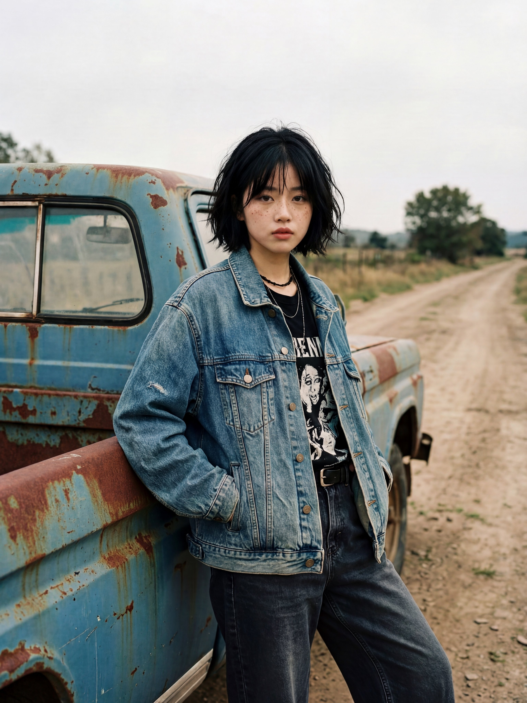
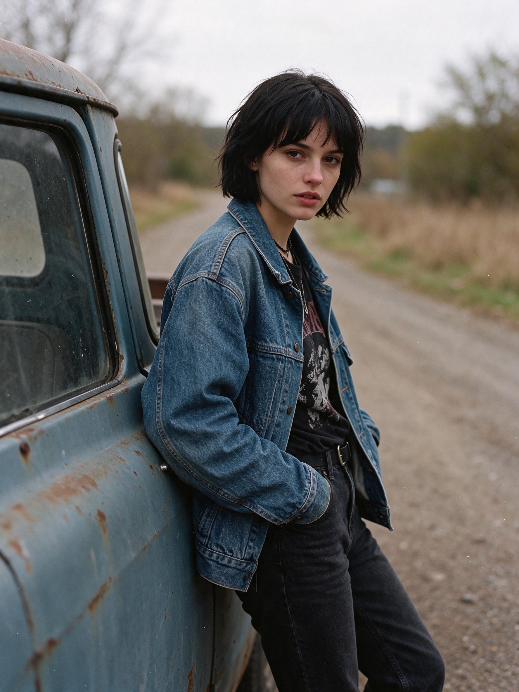
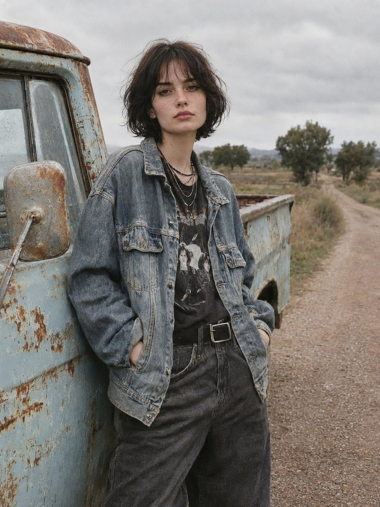

# 乡间土路旧皮卡旁的牛仔夹克女生：35mm 胶片独立电影感时装照（三模型同 prompt 对比）

- 原帖链接：https://x.com/saniaspeaks_/status/2122667263375425682
- 作者：𝗦𝗮𝗻𝗶𝗮（@saniaspeaks_）
- 时间：2026-11-17 20:24 (UTC+8 / Asia/Taipei)
- 互动摘要：点赞 52 · 转发 2 · 回复 21 · 引用 0 · 书签 10 · 浏览 1530（采集快照：2026-11-18 09:05 前后 UTC+8）
- 模型/工具：MiniMax H3 image vs Seedream 5.5 vs GPT image 2.6（三图对比，作者未逐图标注对应模型，推测按标题顺序）
- 标签：真人
- 媒体路径：
  - `media/images/2122667263375425682_1.jpg`（）
  - `media/images/2122667263375425682_2.jpg`（）
  - `media/images/2122667263375425682_3.jpg`（）
- 入库日期：2026-11-18
- prompt 来源：https://x.com/saniaspeaks_/status/2122667263375425682
- 备注：prompt 在主帖正文（长帖）。人物为「young European woman」，服装为夹克 + T 恤 + 牛仔裤，非性化街头时装。三张图依次为三个模型的同 prompt 结果，图与模型对应为按标题顺序推测。

## prompt 原文

```text
Create an ultra-realistic 8K editorial fashion photograph of a young European woman standing casually beside an old, weathered vintage pickup truck on a deserted countryside dirt road.

Character appearance: A young European woman with pale natural skin, delicate facial features, subtle freckles, deep brown eyes, and a short messy black bob haircut with soft, uneven bangs. Her expression is calm, slightly serious, effortless and natural.

Outfit: An oversized faded blue denim jacket with worn fabric and realistic stitching, a black vintage graphic band T-shirt underneath, layered black necklaces, a black belt, and loose dark charcoal jeans. Both hands casually tucked into the jacket pockets.

Pose and composition: She is leaning her back and hip against the side of an old rusty light-blue pickup truck, standing with one leg slightly bent. Her body is angled naturally while her face looks directly toward the camera. Capture her from approximately mid-thigh upward, with the truck occupying the left side of the frame.

Environment: A quiet rural countryside setting with an old dirt road extending into the distance, dry grass, scattered trees, and an overcast pale grey sky. The pickup truck has faded blue paint, visible rust patches, dusty windows, and authentic vintage wear.

Photography style: Authentic 35mm analog film photography, early 2000s European indie-film aesthetic, muted earthy colors, soft natural overcast daylight, subtle film grain, realistic skin texture, natural imperfections, soft shadows, documentary-style composition, slightly imperfect candid framing.

Image quality: Extremely photorealistic, 8K ultra-high resolution, finely detailed facial features, individual hair strands, realistic denim texture, authentic rust and weathering, professional photography, sharp subject focus, natural depth of field.

Important: Preserve realistic human anatomy and natural proportions. No beauty filters, no artificial skin smoothing, no exaggerated makeup, no illustration, no CGI, no text overlays, no watermark. Vertical 3:4 portrait composition.
```

---

个人学习归档，非商业。prompt 与媒体版权归原作者 @saniaspeaks_，引用请回到原帖。
