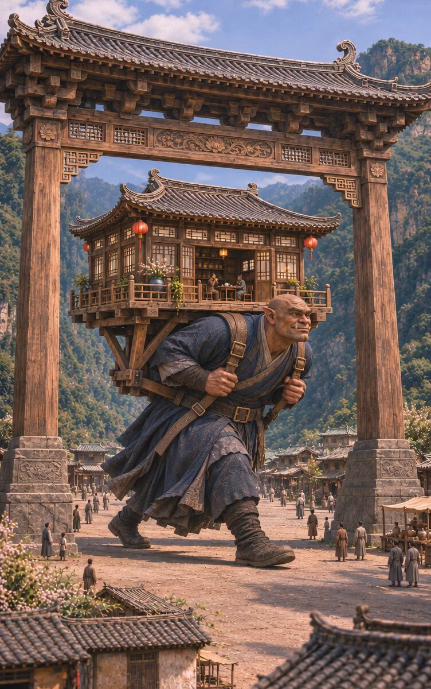

# 温柔的光头兽人巨人背着整座古代茶馆走过山谷村口牌楼（中文情境图 prompt）

- 原帖链接：https://x.com/Ling_1055Tw/status/2122697245879611828
- 作者：LingTian594888（@Ling_1055Tw）
- 时间：2026-11-17 22:23 (UTC+8 / Asia/Taipei)
- 互动摘要：点赞 45 · 转发 12 · 回复 9 · 引用 0 · 书签 0 · 浏览 1475（采集快照：2026-11-18 19:44 UTC+8）
- 模型/工具：未注明（帖内只写「情境圖片提示詞」；成片为视频）
- 标签：真人
- 媒体路径：
  - `media/video-stills/2122697245879611828_still.jpg`（视频封面截图，）
  - 视频本体未入库，仅保留原帖链接：https://x.com/Ling_1055Tw/status/2122697245879611828
- 入库日期：2026-11-18
- prompt 来源：https://x.com/Ling_1055Tw/status/2122697245879611828
- 备注：prompt 在正文（「情境圖片提示詞👇」之后），从「4K ，9:16」起至负面提示词止原样摘录；该 prompt 为生成情境静帧用，帖子成片为视频，视频 prompt 未给出。视频本体未入库，仅保留原帖链接。

## prompt 原文

```text
4K ，9:16 ，真人超寫實古裝奇幻電影劇照，奇幻電影美學。ARRI ALEXA 35 Xtreme，ARRI Signature Prime 35mm 電影鏡頭，平視廣角全身遠景，自然動態抓拍，細膩的 35mm 彩色膠片顆粒，溫暖明亮的自然陽光。

場景設定：陽光明媚的古代山谷村莊，四周高聳的青綠山峰與險峻岩壁環繞，藍天飄著柔白雲朵。村莊內排列著灰瓦木屋、茶攤與小商鋪，乾燥的石土道路延伸至遠方，少量古裝村民在街道兩側駐足觀看。

畫面前景是一座宏偉的古代木造牌樓，粗壯木柱立於道路兩側，柱腳為雕花石基；上方有精緻木雕橫梁、層疊灰瓦與翹起的屋簷。

巨人造型與動作：一位身形高大壯碩的成年獸人巨人位於畫面中央，從頭到腳完整入鏡。他完全光頭，擁有寬厚臉龐、明顯眉骨、尖耳和微微露出的小獠牙。外貌威猛，神情卻十分溫柔：眉頭放鬆，眼神和善，嘴角帶著淡淡微笑。

他穿著深藍色古代交領布袍，布料帶有細膩暗紋與自然皺褶，腰間繫著寬皮帶，腳穿深色布靴。巨人雙手握住肩上的背帶，身體微微前傾，小心跨步穿過村口牌樓。

背上的茶館：巨人背著一間完整的古代木造茶館。茶館建於水平木製平台上，底部有結實的三角木架支撐；寬厚肩帶與腰帶清楚連接支架，穩穩固定在巨人背上。

茶館有灰色翹簷屋頂、木格窗、雕花欄杆與小陽台，屋簷下掛著紅色小燈籠，陽台擺放盆栽與垂落的綠葉。

茶館內有兩名正常人大小的成年茶客，坐在小木桌旁悠閒喝茶。茶客、桌椅、門窗與欄杆的尺度一致；茶客的實際身高與地面村民相同，並依照鏡頭距離呈現自然透視。

比例與構圖重點：巨人全身、背上的茶館與牌樓開口清楚可見。
牌樓足夠高且寬，兩根柱子位於巨人行進路線兩側。
茶館屋頂低於牌樓橫梁，兩者之間留有清楚空隙，沒有碰撞或穿透。
茶館地板保持水平，木架與背帶的連接自然、穩固。
前景村屋、中景巨人與牌樓、遠景山谷形成清楚層次。

負面提示詞：卡通、動漫、塑膠皮膚、人物比例錯誤、茶客過大、巨人身體被裁切、茶館傾斜、支架懸空、建築穿模、屋頂撞上橫梁、多餘手指、模糊臉部、過度磨皮、地面潮濕反光、字幕、文字、浮水印、Logo。
```

---

个人学习归档，非商业。prompt 与媒体版权归原作者 @Ling_1055Tw，引用请回到原帖。
