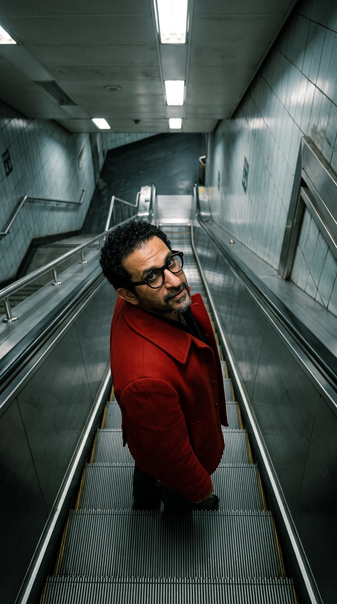
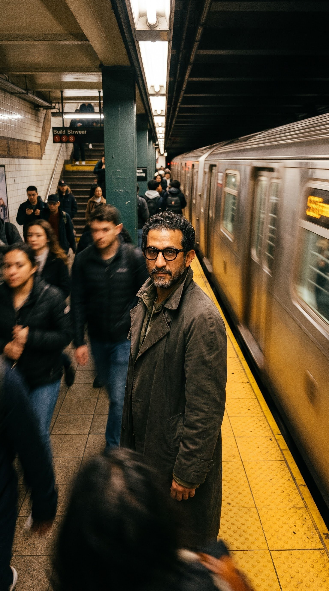
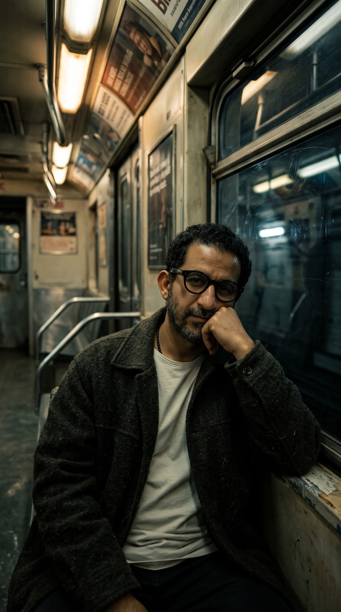

# 地铁三部曲：90 年代车厢、早高峰站台长曝光、俯拍扶梯红大衣（参考图锁脸 · Nano Banana 2.1）

- 原帖链接：https://x.com/Faeiz4Ai/status/2122778420593500452
- 作者：FAEIZ（@Faeiz4Ai）
- 时间：2026-11-18 03:46 (UTC+8 / Asia/Taipei)
- 互动摘要：点赞 52 · 转发 7 · 回复 3 · 引用 1 · 书签 28 · 浏览 2221（采集快照：2026-11-18 09:05 前后 UTC+8）
- 模型/工具：Nano Banana 2.1（作者原文写「Nano model Banana 2.1」）
- 标签：真人
- 媒体路径：
  - `media/images/2122778420593500452_1.jpg`（）
  - `media/images/2122778420593500452_2.jpg`（）
  - `media/images/2122778420593500452_3.jpg`（）
- 入库日期：2026-11-18
- prompt 来源：https://x.com/Faeiz4Ai/status/2122778730271568160、https://x.com/Faeiz4Ai/status/2122778968524738888、https://x.com/Faeiz4Ai/status/2122779179792191836
- 备注：主帖只写「prompt:👇」，三段 prompt 在作者自回复串里，前缀「1-」「2-」「3-」为作者原有编号。均为图生图（需上传本人参考图锁定脸/发型/配饰）。按画面判断：图 1 = 俯拍扶梯红大衣（对应 3-），图 2 = 站台长曝光风衣（对应 2-），图 3 = 夜间地铁车厢（对应 1-）；对应关系为本仓库判断。示例人物为成年男性，非性化。

## prompt 原文

```text
1-
REFERENCE IMAGE — ABSOLUTE SOURCE OF TRUTH | STRICT ALR LOCK

Use the uploaded reference image as the exclusive source of truth for the subject's identity. Preserve the exact facial features, face shape, skin tone, natural skin characteristics, hairstyle, hair color, hair length, texture, hairline, and all visible accessories. Apply strict identity, face, hair, and accessories preservation regardless of gender. No identity drift, beautification, or redesign. Do not independently describe or invent these features.

SCENE & COMPOSITION

Create an ultra-photorealistic cinematic 1990s film still inside an empty vintage subway train car at late night. The subject sits alone beside the window, resting their chin naturally on one hand, gazing thoughtfully toward the camera with a subtle, melancholic expression.

The subject wears an oversized retro jacket made from richly textured wool or heavyweight vintage fabric, with visible fibers, natural folds, realistic stitching, and authentic fabric weight.

CAMERA & OPTICS

Shot on a professional full-frame camera with a 50mm prime lens at f/1.8, natural perspective, shallow depth of field, precise focus on the subject's eyes and face, and softly blurred background. Authentic 35mm analog film composition.

SKIN REALISM

Natural, realistic skin texture with visible fine pores, subtle skin variations, delicate facial details, and realistic light interaction. Preserve natural skin characteristics without excessive imperfections, artificial smoothing, plastic-like skin, or beauty filters.

LIGHTING & ATMOSPHERE

Warm, softly flickering tungsten ceiling lights create a nostalgic cinematic glow across the subject and train interior. Subtle cool reflections from the dark underground tunnel pass across the window, creating a natural contrast between warm interior lighting and cool exterior darkness. Add faint atmospheric haze and delicate reflections on the glass.

FILM & COLOR SCIENCE

Kodak Vision3 500T / Cinestill 800T inspired 35mm analog film aesthetic, organic fine film grain, subtle halation around practical lights, soft highlight roll-off, restrained contrast, natural color reproduction, and authentic cinematic color grading.

FINAL QUALITY CONTROL

Maintain realistic human anatomy, natural hand proportions, physically accurate lighting, authentic environmental reflections, and consistent perspective. Preserve the original composition and melancholic 1990s atmosphere. Avoid CGI, excessive sharpening, artificial bokeh, overprocessed skin, text, and watermarks.

REFERENCE AUTHORITY: The uploaded image controls identity, face, hair, hairstyle, hair color, and accessories exclusively. The written prompt controls clothing, pose, environment, camera, lighting, and cinematic style.
```

```text
2-
Use the uploaded reference image as the ABSOLUTE SOURCE OF TRUTH for identity and appearance. Apply STRICT ALR FACE, HAIR & ACCESSORIES LOCK. Preserve the exact facial features, face shape, skin tone, hairstyle, hair color, hair texture, hairline, and all visible accessories. These details must come exclusively from the reference image, regardless of gender. No identity drift, beautification, or redesign.

Create an ultra-photorealistic cinematic street-style photograph on a crowded underground subway platform during rush hour. The subject stands completely still on the yellow safety line, looking directly at the camera with a calm, confident expression, wearing an elegant, sharply tailored vintage trench coat.

A speeding metro train and rushing commuters create dramatic long-exposure motion blur, while the subject remains perfectly stationary and exceptionally sharp.

Photography: 35mm analog film aesthetic, Kodak Portra 800, cool fluorescent lighting mixed with warm amber reflections, subtle organic film grain, natural skin texture, realistic colors, and cinematic contrast.

Preserve the original scene composition and realistic anatomy. The reference image controls identity, face, hair, hairstyle, hair color, and accessories exclusively; all other visual elements follow this prompt. No CGI, text, or watermarks.
```

```text
3-
Use the uploaded reference image as the ABSOLUTE SOURCE OF TRUTH for the subject's identity and appearance. Apply STRICT ALR FACE, HAIR & ACCESSORIES LOCK.

Preserve the exact original identity, facial features, face shape, skin tone, hairstyle, hair color, hair length, texture, density, hairline, and all visible accessories exactly as shown in the reference image. All these characteristics must be derived exclusively from the reference image, regardless of the subject's gender. No identity drift, beautification, facial alterations, redesign, additions, or modifications.

Create an ultra-photorealistic editorial fashion photograph captured from a dramatic high-angle overhead bird's-eye perspective, looking straight down a steep, dimly lit underground metro escalator.

The subject is riding down the escalator alone, wearing a bold red vintage-style coat, tilting their head back and looking directly up into the camera lens with a confident, composed expression.

Geometric metallic escalator steps and cool-toned tiled walls create strong symmetrical leading lines, emphasizing depth and perspective. Use dramatic directional lighting, cinematic shadows, and subtle atmospheric contrast to enhance the visual impact.

PHOTOGRAPHIC AESTHETIC: Kodak Portra 400 film emulation, authentic 35mm analog photography, natural skin texture, accurate color reproduction, subtle film grain, crisp details, and sophisticated editorial fashion photography.

Maintain realistic human anatomy, natural body proportions, and authentic photographic depth.

ABSOLUTE SCENE & COMPOSITION LOCK: Preserve the specified camera angle, underground metro escalator setting, red coat, subject's pose, lighting, and overall visual composition without alteration.

The reference image exclusively controls the subject's identity, facial features, hair, and accessories, while the scene description and clothing specified in this prompt remain the authoritative source for the image's composition and styling.
```

---

个人学习归档，非商业。prompt 与媒体版权归原作者 @Faeiz4Ai，引用请回到原帖。
