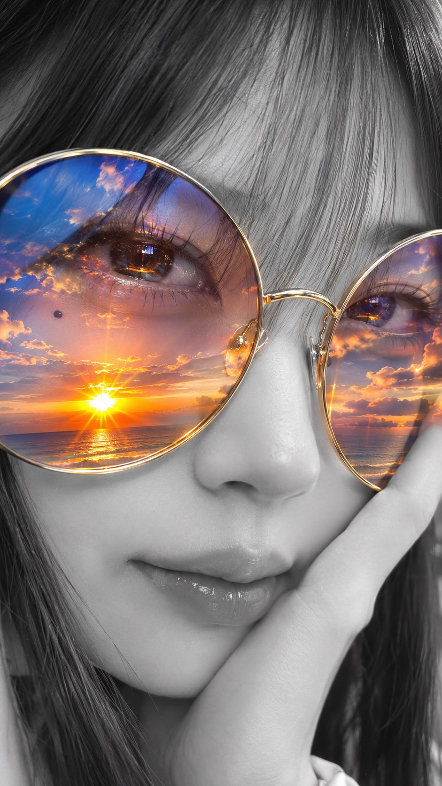
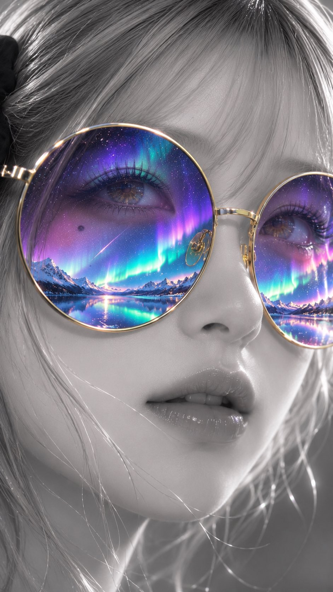
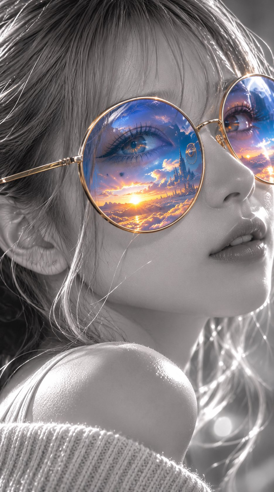

# 黑白人像 × 超大金框圆墨镜：镜片里映出彩色夕阳海景的二重曝光（日文结构化 prompt）

- 原帖链接：https://x.com/rin_ai_daily/status/2122889771546759633
- 作者：幡ヶ谷 凛｜はたりん（@rin_ai_daily）
- 时间：2026-11-18 11:08 (UTC+8 / Asia/Taipei)
- 互动摘要：点赞 38 · 转发 7 · 回复 15 · 引用 7 · 书签 7 · 浏览 1290（采集快照：2026-11-18 19:44 UTC+8）
- 模型/工具：未注明（参考图驱动的通用 prompt）
- 标签：真人
- 媒体路径：
  - `media/images/2122889771546759633_1.jpg`（）
  - `media/images/2122889771546759633_2.jpg`（）
  - `media/images/2122889771546759633_3.jpg`（）
- 入库日期：2026-11-18
- prompt 来源：https://x.com/rin_ai_daily/status/2122890107820900394（作者自回复）
- 备注：prompt 在作者自回复（2122890107820900394，长帖），需上传一张人物照片；分 01–08 节 + 负面 prompt。3 张示例图全部入库。原样摘录。

## prompt 原文

```text
添付画像の人物の顔立ち・目元・髪型・髪色・ほくろなどの個性を忠実に維持し、芸術性と圧倒的な視覚的インパクトを兼ね備えた、超写実的なポートレート作品を生成してください。

【01｜構図】

縦長9:16、独立した画像1枚。

顔の極端な超クローズアップ。
額、髪、頬の一部が画面から見切れるほど大胆に顔を拡大する。

斜めから撮影した立体感のあるアングル。
片手を自然に頬に添え、落ち着いた神秘的な表情。

人物の顔全体を収める必要はない。
サングラスの存在感を最優先に構図を設計する。

【02｜サングラス：最重要】

極めて大きなラウンド型サングラス。
繊細で高級感のあるゴールドメタルフレーム。

サングラスの横幅は画面全体の約100％を占め、左右のフレームが画面から見切れるほど大胆に配置する。

手前側のレンズだけで画面横幅の約60％を占める。

両目を必ずレンズの内側に収め、透明なレンズ越しに瞳、まつ毛、目元の特徴が鮮明に見えるようにする。

フレームの金属光沢、ガラスの透明感、光の透過・屈折・微細な反射を精密に描写する。

【03｜レンズの中の世界】

鮮烈な青空と黄金色に輝く夕焼け、壮大な雲、燃えるような太陽、夕陽の光を反射する海。

レンズ全体に奥行きのある壮大な風景を映し出す。

深いコバルトブルー、燃えるようなオレンジ、鮮烈な黄金色の強烈なコントラスト。

極めて高い彩度とコントラスト。
雲の輪郭、太陽の光芒、水面の細かな波、黄金色の反射まで緻密に描写する。

光の粒子や微細なプリズム反射を繊細に加え、レンズの中に引き込まれるような幻想的な空間を演出する。

風景は単なる半透明の重ね合わせではなく、レンズの向こうに別世界が実在しているかのように表現する。

左右のレンズは同じ世界を異なる視点から映し出し、光源・色彩・風景に一貫性を持たせる。

【04｜瞳と風景の融合：最重要】

透明なレンズの奥に人物の瞳が鮮明に見える。

瞳の虹彩にも風景の色彩と光を反映させ、虹彩の繊細な放射状の模様が宝石のように美しく輝く。

瞳孔、白目、まつ毛、まぶた、目の形状など、人物本来の特徴は自然に維持する。

瞳と風景のどちらかが消えてしまわないよう、双方の視認性を高い水準で両立する。

風景の反射と人物の瞳が光学的に融合した、芸術的な二重露光表現。

瞳そのものが人工的に発光するのではなく、風景から受けた光によって自然に輝いて見える。

【05｜色彩設計】

サングラスのレンズ内だけを鮮烈なフルカラーで表現する。

人物の肌、髪、唇、手、衣装、背景は完全なモノクロ。

フレームのみ上品なゴールドの金属色を残す。

レンズ内の高彩度な世界と、レンズ外の無彩色の世界に圧倒的なコントラストを生み出す。

レンズ外への不要な色漏れを禁止する。

人物のモノクロ表現は単調なグレーではなく、白から深い黒まで豊かな階調を持たせ、立体的で美しい陰影を作る。

【06｜人物の個性・実写表現】

添付画像の人物のアイデンティティを最優先で維持する。

顔の輪郭、目の形、瞳、鼻筋、唇、髪型、髪色、ほくろなど、固有の特徴を勝手に変更しない。

自然な肌の質感、繊細な髪の毛、リアルなまつ毛、自然な唇、細部まで整った手指。

過度な美肌加工、プラスチックのような肌、人工的な光沢、過剰な毛穴の強調を避ける。

CGやイラストではなく、高級ファッション誌に掲載される芸術的な実写写真として仕上げる。

【07｜光・奥行き・画質】

超高精細、フォトリアリスティック、マクロポートレート、シネマティックライティング、HDR、繊細な光学反射、豊かな階調、立体的な陰影。

プロフェッショナルな一眼レフカメラで撮影したような繊細で自然な描写。

レンズ、瞳、まつ毛、金属フレームを中心にシャープなピントを合わせる。

光と影によって顔の立体感を演出し、レンズ内の世界には圧倒的な奥行きとスケール感を持たせる。

最高品質のアートフォトグラフィー。
高級感、幻想美、神秘性、独創性、圧倒的な視覚的インパクト。

【08｜作品のコンセプト】

作品の主役は人物ではなく、サングラスの中に広がる世界。

モノクロの現実に浮かぶ、二つの鮮烈な異世界。

人物の瞳とレンズの中の世界が一体化し、見る人の視線を強く引き込む芸術作品に仕上げる。

文字、ロゴ、署名、透かし、コラージュなし。

【ネガティブプロンプト】

低画質、ぼやけ、CG感、3Dレンダリング感、プラスチック肌、過剰な肌の光沢、過度な美肌加工、不自然な顔、顔の別人化、顔の変形、ほくろの消失、不要なほくろ、小さなサングラス、小さなレンズ、眼鏡の変形、レンズの外に出た瞳、不透明なレンズ、瞳の消失、人工的な瞳の発光、風景の単純な貼り付け、薄すぎる風景、低彩度、弱いコントラスト、不自然な反射、レンズ外への色漏れ、過剰なエフェクト、不自然な手指、文字、ロゴ、透かし。
```

---

个人学习归档，非商业。prompt 与媒体版权归原作者 @rin_ai_daily，引用请回到原帖。
