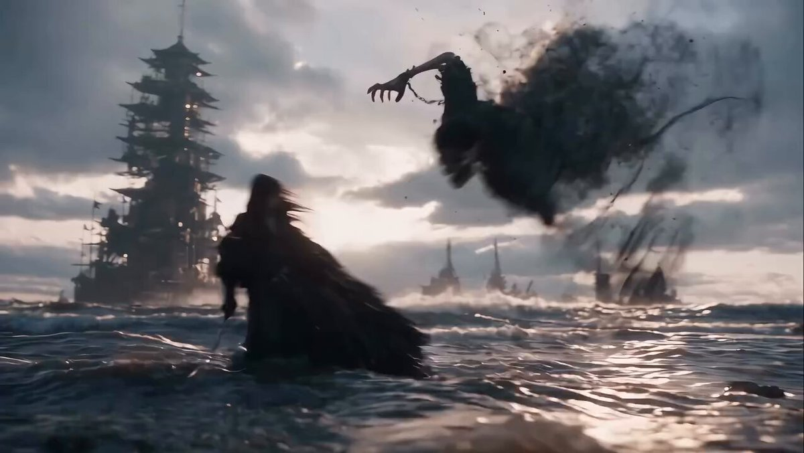

# 残破海岸的黑暗奇幻对决：黑斗篷女剑士 vs 肋骨燃烧的骷髅怨灵（4 镜头约 50 秒视频分镜）

- 原帖链接：https://x.com/Viniai_/status/2122916879824306422
- 作者：Vini（@Viniai_）
- 时间：2026-11-18 12:56 (UTC+8 / Asia/Taipei)
- 互动摘要：点赞 338 · 转发 47 · 回复 63 · 引用 5 · 书签 178 · 浏览 15189（采集快照：2026-11-18 19:44 UTC+8）
- 模型/工具：Fable 5.2 + Seedance 2.5（作者标注）
- 标签：真人
- 媒体路径：
  - `media/video-stills/2122916879824306422_still.jpg`（视频封面截图，）
  - 视频本体未入库，仅保留原帖链接：https://x.com/Viniai_/status/2122916879824306422
- 入库日期：2026-11-18
- prompt 来源：https://x.com/Viniai_/status/2122916892432335074（作者自回复）
- 备注：prompt 在作者自回复（2122916892432335074），从「Cinematic dark-fantasy battle」起原样摘录（略去开头的「Prompt:」标签）。主角写明为 young woman，非性化动作场面。视频本体未入库，仅保留原帖链接。

## prompt 原文

```text
Cinematic dark-fantasy battle, 16:9, ~50s, built in 4 shots (12–13s each). Same characters, location and grade in every shot.

CHARACTERS (lock with reference images):
• HEROINE: young woman, pale skin, long straight black hair, calm cold expression. Layered tattered black hooded cloak, wet and heavy, frayed edges. Wields a very long thin katana (nodachi). Moves low and fast, often crouched or kneeling in water.
• WRAITH: floating skeletal spirit, bone-white skull, black smoke and torn rags for a body (no legs). Ribcage glows molten orange like embers inside. Rusted chains hang from bony wrists. Long clawed fingers. Leaves a trail of black ash particles. Eyes glow red when enraged.

LOCATION: destroyed shoreline after a war. Ankle-deep grey seawater, wet rocks, broken wooden palisade walls, piles of splintered timber, a wrecked wooden sailing ship on the shore, a tall dark pagoda tower in the distance. Overcast sky with breaking clouds and soft sun rays behind.

LOOK: photoreal, AAA game-cinematic. Desaturated teal-grey grade, crushed blacks, warm orange only from the ribcage glow. Anamorphic lens, shallow depth of field, heavy motion blur, handheld chase camera that whips, dives and orbits with the action. Water spray, ash and splinters in every shot.

SHOT 1 (0–13s): Wide low angle. Heroine kneels in water, sword drawn. The wraith dives at her out of black smoke. She rolls; it smashes through a palisade, wood explodes. It swings its chains, she dodges, they clash. Fast push-in to an extreme close-up of the glowing ribcage as her blade stabs into it, embers burst out.

SHOT 2 (13–26s): The wraith screams, arms spread, and blasts her back. She skids across the water and stops crouched, one hand on the surface. Black ink swirls in a circle around her hand. Front close-up of her face, emotionless. She charges; the camera races low over the water behind her. Mid-air clash, the wraith bursts into black ash and re-forms behind her.

SHOT 3 (26–39s): The wraith hurls a giant ball of spiky black smoke. It hits the water next to her and blasts a huge white water explosion. She stays kneeling, unmoved. Slow-motion close-up of her gripping the sword over her shoulder. She leaps out of the spray and slashes; the wraith spins into a vortex of black smoke. Its skull lunges at the camera, red eyes ignite, red mist behind.

SHOT 4 (39–50s): She leaps high, sword raised, and slams down into a huge splash. Chaotic close fight, black smoke whips past the lens. The wraith rises from wreckage and grows into a giant hulking skeletal demon draped in rags and chains, burning debris behind it. Its eyes flare red. It charges straight at the camera through the water, arms spread wide, chains swinging. Hard cut to black.

SOUND (premium, loud, crisp, full-range, never muffled): deep epic orchestral score with taiko drums and low brass, rising to a huge hit at every clash. Sharp metallic sword swings and ringing steel. Bone and chain clatter. Heavy water splashes and impacts with deep sub-bass booms. Wood cracking and exploding. A distorted demonic wraith scream with a reverb tail. Wind and ash hiss. Wide stereo field, punchy transients, cinema-trailer mix. No dialogue.
```

---

个人学习归档，非商业。prompt 与媒体版权归原作者 @Viniai_，引用请回到原帖。
