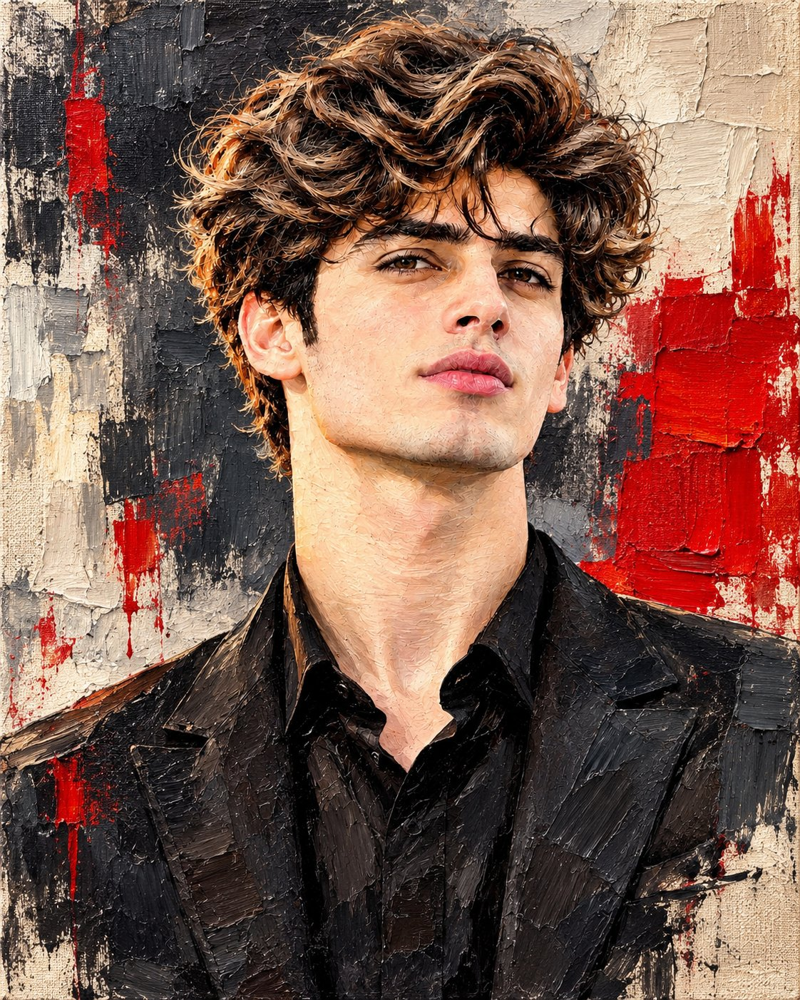
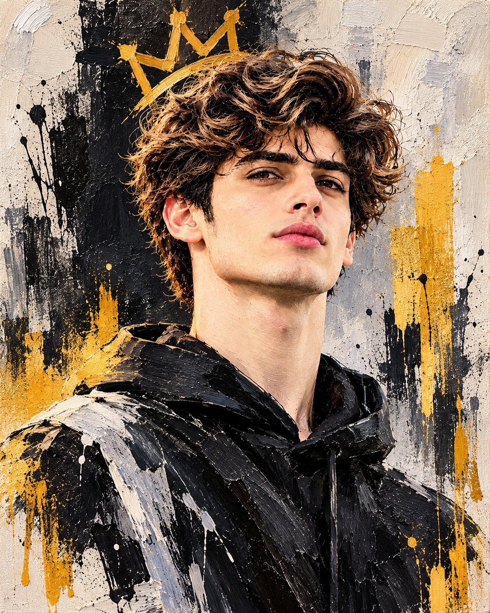
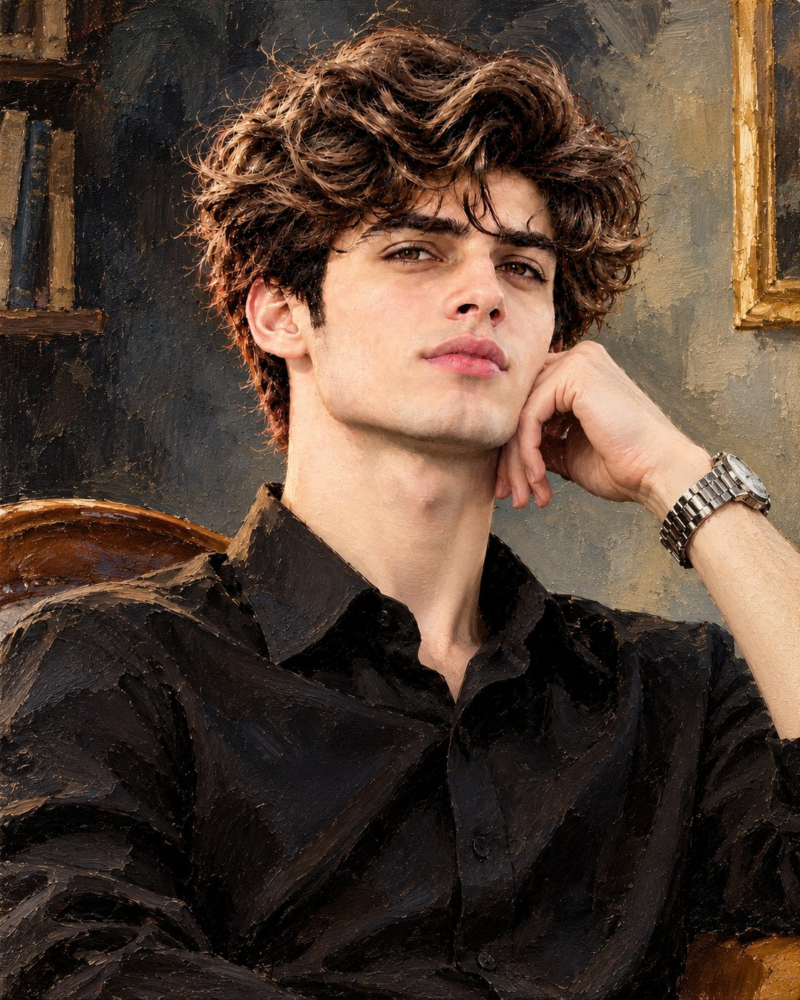

# 同一张脸的三种手绘：厚涂油画 / 刮刀丙烯抽象 / 古典写实油画肖像

- 原帖链接：https://x.com/aiwithleo1/status/2122957339712245849
- 作者：Leo Ai（@aiwithleo1）
- 时间：2026-11-18 15:37 (UTC+8 / Asia/Taipei)
- 互动摘要：点赞 49 · 转发 15 · 回复 10 · 引用 1 · 书签 24 · 浏览 411（采集快照：2026-11-18 19:44 UTC+8）
- 模型/工具：ChatGPT（作者在回复中注明）
- 标签：真人
- 媒体路径：
  - `media/images/2122957339712245849_1.jpg`（）
  - `media/images/2122957339712245849_2.jpg`（）
  - `media/images/2122957339712245849_3.jpg`（）
- 入库日期：2026-11-18
- prompt 来源：https://x.com/aiwithleo1/status/2122957521166172632（作者自回复）
- 备注：prompt 在作者自回复（2122957521166172632），需上传一张人物参考图，一次生成 3 张独立画作。模型依据作者对网友提问的回复「Chatgpt」（https://x.com/aiwithleo1/status/2122959630926282852）。3 张示例图全部入库。原样摘录。

## prompt 原文

```text
Use the uploaded reference image as the ONLY identity reference. Create three completely different, premium-quality hand-painted portrait artworks of the exact same person.

CRITICAL IDENTITY PRESERVATION:
Preserve the original person's exact facial identity, face shape, eyes, eyebrows, nose, lips, jawline, skin tone, hairstyle, hair texture and natural facial proportions. Do not change the person's identity or make the face look like another person. The portrait must clearly resemble the reference image.

STYLE 1 — TEXTURED OIL PAINTING

Create a sophisticated traditional oil-on-canvas portrait. Use thick visible brushstrokes, rich layers of oil paint, realistic skin shading, detailed hair strokes and authentic canvas texture. Add an artistic abstract background with deep red, charcoal black, cream and grey tones. The painting should look like an original masterpiece created by a professional portrait painter.

STYLE 2 — ABSTRACT ACRYLIC & PALETTE KNIFE ART

Create a bold contemporary acrylic painting with expressive palette-knife techniques. Use layered paint, rough textures, dynamic brush movements, artistic splashes and controlled paint drips. Choose a premium black, white, grey and golden-yellow colour palette. Keep the face recognizable while allowing the surrounding composition and clothing to have expressive artistic textures. Make it look like an expensive modern gallery artwork.

STYLE 3 — CLASSICAL REALISTIC OIL PORTRAIT

Create a highly realistic classical oil painting inspired by traditional European portrait art. Use delicate natural brushwork, subtle paint layering, realistic skin tones, detailed eyes, naturally painted curly hair and beautiful light-and-shadow transitions. Give the subject an elegant black outfit and a sophisticated dark studio background with warm golden lighting. The result should look like a genuine hand-painted museum-quality portrait, not a photograph with an oil-paint filter.

IMPORTANT ART DIRECTION

- All three artworks must depict exactly the same person.
- Each artwork must have a distinctly different painting technique.
- Authentic hand-painted appearance with visible brushwork and canvas texture.
- Professional composition, sophisticated colour grading and artistic depth.
- Maintain natural facial proportions and recognizable identity.
- No cartoon, anime, 3D rendering or plastic-looking skin.
- No artificial face replacement or exaggerated beauty filters.
- No text, watermark, signature or logos.
- Vertical 4:5 portrait composition.
- Generate THREE SEPARATE FULL-SIZE IMAGES, never combine them into a collage, triptych or multi-panel layout.

FINAL GOAL: Each image should look like an original physical painting created by a highly skilled professional artist, worthy of being displayed in a premium art gallery.
```

---

个人学习归档，非商业。prompt 与媒体版权归原作者 @aiwithleo1，引用请回到原帖。
