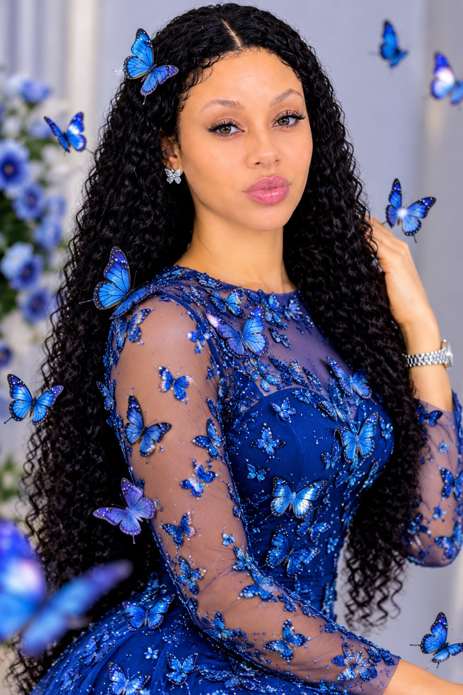

# 皇家蓝蝴蝶刺绣高定礼服：参考图人物的奢华时尚大片肖像

- 原帖链接：https://x.com/claire44/status/2122970980393889977
- 作者：Claire（@claire44）
- 时间：2026-11-18 16:31 (UTC+8 / Asia/Taipei)
- 互动摘要：点赞 26 · 转发 13 · 回复 13 · 引用 0 · 书签 8 · 浏览 428（采集快照：2026-11-18 19:44 UTC+8）
- 模型/工具：GPT Image 2.6（作者标注）
- 标签：真人
- 媒体路径：
  - `media/images/2122970980393889977_1.jpg`（）
- 入库日期：2026-11-18
- prompt 来源：https://x.com/claire44/status/2122971552425590895（作者自回复）
- 备注：prompt 在作者自回复（2122971552425590895），需上传一张人物参考图；prompt 明确要求高领、保守、无暴露。原样摘录。

## prompt 原文

```text
Create an ultra-realistic, luxurious butterfly-themed fashion editorial portrait of the woman in the uploaded reference image. Preserve her exact facial identity, natural facial structure, eye shape, nose, lips, skin tone and body proportions. Do not change her identity or excessively beautify her face.

POSE AND EXPRESSION:
She poses elegantly like a high-fashion editorial model, with her body slightly turned at a three-quarter angle and her face looking directly into the camera. One hand rests gently beside her hair. Her expression is dreamy, graceful, feminine and quietly confident.

HAIR AND MAKEUP:
Long, voluminous, middle-parted black curly hair cascading naturally over both shoulders and down her back. Beautifully styled natural edges. Soft glamorous makeup, defined eyes, delicate winged eyeliner, natural-looking long lashes, subtle blush and glossy pink lips. Preserve realistic skin texture. No plastic skin or excessive retouching.

OUTFIT:
A breathtaking royal-blue haute couture gown with a fully covered neckline, fitted elegant bodice and long sheer sleeves. The gown is richly decorated with intricate blue, violet and iridescent butterfly embroidery, delicate crystals and shimmering beadwork. The dress must be sophisticated, modest and luxurious, with absolutely no cleavage exposure.

BUTTERFLY DETAILS:
Surround her with beautiful, realistic butterflies in electric blue, lavender, violet and subtle touches of orange. Some butterflies gently rest on her hair, shoulders and sleeves, while others flutter gracefully around her. Include intricate butterfly details throughout the gown. The butterflies should look delicate, colourful and naturally integrated into the scene.

BACKGROUND AND LIGHTING:
Dreamy luxury editorial studio with a soft lavender-grey background, delicate purple and white flowers, subtle floral bokeh and floating butterflies. Beautiful diffused lighting illuminates her face, creating a soft radiant glow. Elegant cinematic depth of field.

PHOTOGRAPHY STYLE:
High-end luxury fashion magazine photography, photorealistic, sophisticated composition, exquisite details, realistic fabric textures, natural anatomy, premium editorial retouching, 85mm portrait lens, beautiful soft lighting, sharp focus on the eyes.

COMPOSITION: Vertical 4:6 portrait, three-quarter body framing, elegant model proportions, visually balanced butterfly placement.

No text, no logos, no watermark, no extra fingers, no distorted butterflies, no artificial facial features, no exaggerated curves, no cleavage, no revealing clothing. Keep the result natural, breathtaking and photorealistic.
```

---

个人学习归档，非商业。prompt 与媒体版权归原作者 @claire44，引用请回到原帖。
