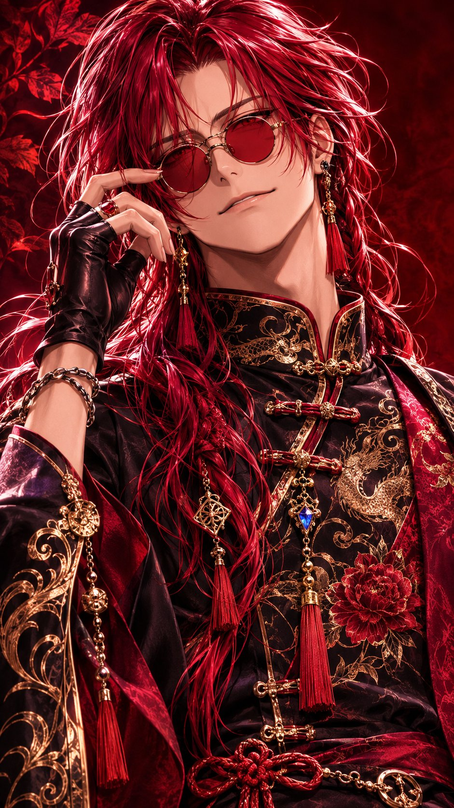
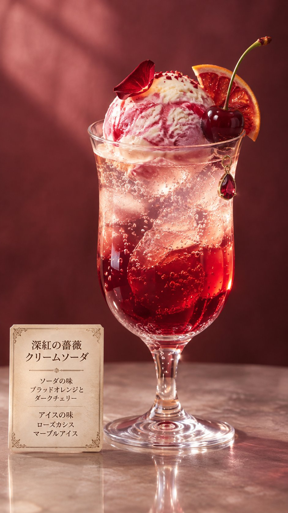
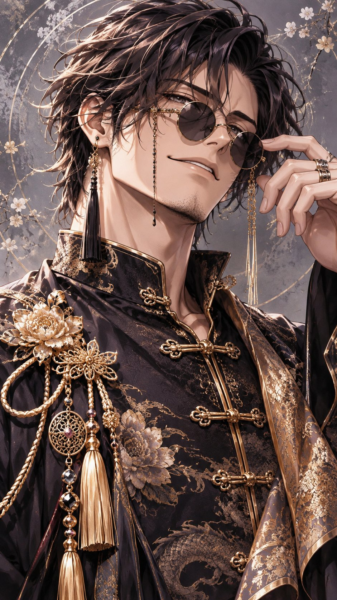
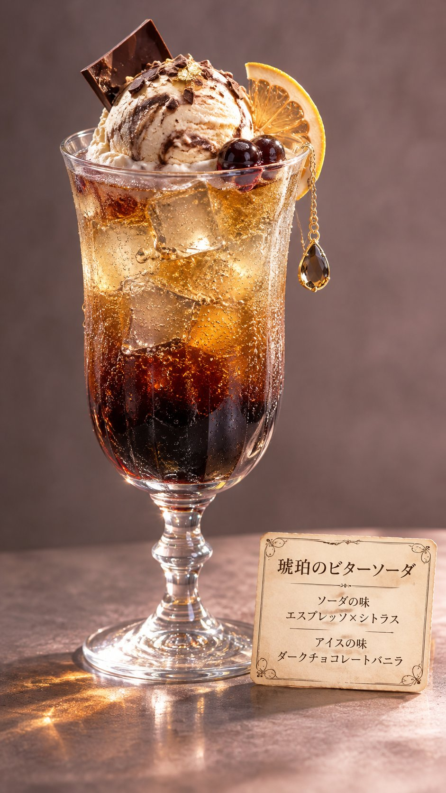

# うちの子×幻想クリームソーダ：按角色配色/性格设计专属奶油苏打的商品照（#のらるプロンプト）

- 原帖链接：https://x.com/irohachang77/status/2122621745723228192
- 作者：のらる（@irohachang77）
- 时间：2026-11-17 17:23 (UTC+8 / Asia/Taipei)
- 互动摘要：点赞 38 · 转发 8 · 回复 1 · 引用 3 · 书签 15 · 浏览 1209（采集快照：2026-11-19 09:05 UTC+8）
- 模型/工具：未注明（角色参考图驱动的通用 prompt）
- 标签：其它
- 媒体路径：
  - `media/images/2122621745723228192_1.jpg`（）
  - `media/images/2122621745723228192_2.jpg`（）
  - `media/images/2122621745723228192_3.jpg`（）
  - `media/images/2122621745723228192_4.jpg`（）
- 入库日期：2026-11-19
- prompt 来源：https://x.com/irohachang77/status/2122621781370650783（作者自回复）
- 备注：prompt 在作者自回复（https://x.com/irohachang77/status/2122621781370650783），需上传一张角色图，输出为不含人物的饮品商品照。4 张示例图（2 张角色参考 + 2 张对应奶油苏打成品）全部入库。原样摘录。

## prompt 原文

```text
🍹 うちの子、幻想クリームソーダ

添付キャラの髪色・瞳色・衣装・性格・象徴モチーフから、世界にひとつのクリームソーダを制作してください。

【9:16／ストーリーサイズ】

🍹 ソーダ

- キャラを象徴する2〜3色の透明グラデーション
- 色彩に合わせたフルーツ＆シロップ
- 繊細な炭酸、透明な氷、宝石のような輝き

🍨 アイス

- 個性から考案したオリジナルフレーバー
- 丸く盛り付け、自然な溶け具合
- 象徴モチーフの小さな食べられるトッピングを1点

💎 グラス

- 装飾の少ない美しい脚付き透明グラス
- キャラカラーの小さな宝石チャームを1個だけ添える
- 金細工・房飾りなどの過剰な装飾は禁止

🌸 背景＆演出

- キャラカラーに合わせた無地のダスティ背景
- 背景小物・花・家具・キャンドルは描かない
- シンプルなテーブルにグラスを1杯だけ配置
- 柔らかな自然光と上品な余白
- 高級喫茶店の商品写真のようなフォトリアル表現

📜 メニューカード

- 小さくシンプルなアンティーク調
- 商品名・ソーダの味・アイスの味を日本語で簡潔に記載
- 装飾枠は控えめに

【注意】
人物・ミニキャラ・キャラ名・ロゴなし。
グラス全体を描写し、余白を十分に確保。

✨ 主役はソーダの美しいグラデーション！
装飾より透明感と美味しさを優先し、洗練された幻想的な一杯に仕上げてください。
```

---

个人学习归档，非商业。prompt 与媒体版权归原作者 @irohachang77，引用请回到原帖。
