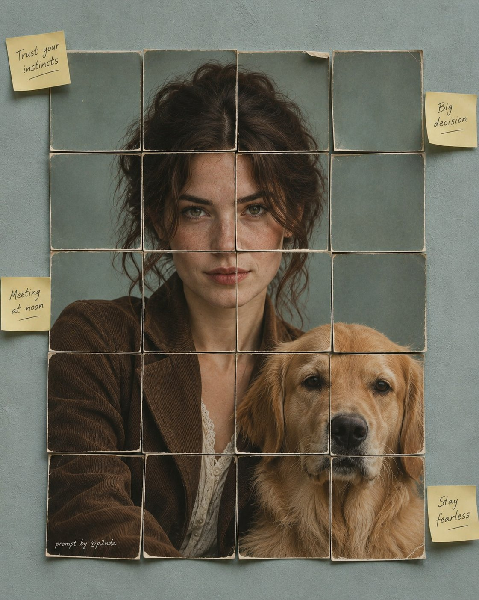
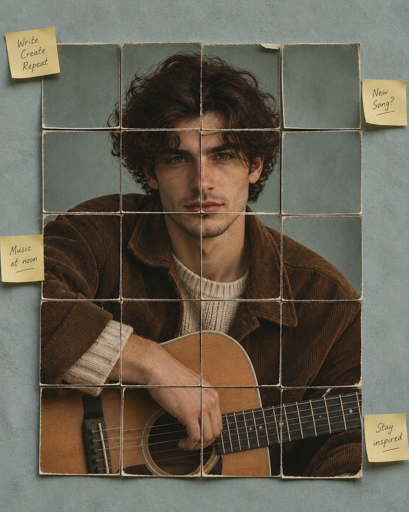

# 上传照片 → 4×5 瓷砖拼贴复古人像海报（便利贴手写语录 + 灰绿灰泥墙，JSON prompt）

- 原帖链接：https://x.com/Maercihh/status/2122671563837436361
- 作者：Maercih（@Maercihh）
- 时间：2026-11-17 20:41 (UTC+8 / Asia/Taipei)
- 互动摘要：点赞 75 · 转发 8 · 回复 24 · 引用 0 · 书签 27 · 浏览 1810（采集快照：2026-11-19 09:05 UTC+8）
- 模型/工具：GPT Image 2.6（ChatGPT，作者标注）
- 标签：真人
- 媒体路径：
  - `media/images/2122671563837436361_1.jpg`（）
  - `media/images/2122671563837436361_2.jpg`（）
- 入库日期：2026-11-19
- prompt 来源：https://x.com/Maercihh/status/2122671563837436361（正文）
- 备注：prompt 在正文「Prompt.」之后，为 JSON 结构，从「{」起至末尾「}」原样摘录。需上传一张人物照片作身份参考；2 张示例图（女子 + 金毛犬、男子 + 吉他）全部入库。

## prompt 原文

```text
{
  "task": "Transform the uploaded photograph into a cinematic, photorealistic vintage tiled portrait poster.",

  "reference_image": {
    "source": "Use the user's uploaded photograph as the primary identity reference.",
    "identity_preservation": "Preserve the person's exact facial identity, facial structure, skin tone, hairstyle, eye shape, and recognizable features.",
    "gender": "Automatically follow the uploaded subject.",
    "expression": "Maintain the original expression or create a subtle, confident, natural expression."
  },

  "composition": {
    "layout": "Vertical editorial poster.",
    "structure": "A large rectangular portrait assembled from approximately 4 columns and 5 rows of individual square, slightly irregular ceramic or paper tiles.",
    "portrait": "The subject occupies the central majority of the composition, visible from the head to the upper torso.",
    "tile_effect": "Every tile is physically separated by thin, dark, realistic grout lines. Slight variations in alignment, chipped edges, worn corners, and subtle shadows create an authentic handmade tiled-wall appearance.",
    "continuity": "The portrait must align seamlessly across all tiles, with facial features and body details continuing naturally across tile boundaries."
  },

  "environment": {
    "background": "Muted dusty sage-gray textured plaster wall.",
    "surface": "Aged, slightly weathered surface with subtle imperfections.",
    "lighting": "Soft natural diffused daylight with gentle shadows."
  },

  "styling": {
    "clothing": "Automatically create tasteful, sophisticated clothing that complements the subject's appearance. Prefer vintage-inspired casual or smart-casual styling.",
    "aesthetic": "Understated vintage editorial photography.",
    "color_palette": "Muted earthy browns, charcoal, dusty sage, warm beige and subtle faded tones."
  },

  "personalized_details": {
    "sticky_notes": {
      "placement": "Four small yellow handwritten sticky notes positioned around the outer edges of the tiled portrait.",
      "messages": [
        "Trust your instincts",
        "Big decisions",
        "Make it happen",
        "Stay fearless"
      ],
      "style": "Authentic handwritten black ink, slightly imperfect lettering, naturally curled paper corners and realistic shadows."
    },
    "signature": "A tiny handwritten 'prompt by @yourusername' near the bottom-left tile. Omit if no username is supplied."
  },

  "photography": {
    "style": "Ultra-realistic photographic portrait.",
    "lens": "50mm editorial portrait photography.",
    "details": "Natural skin texture, realistic hair strands, detailed fabric textures, subtle film grain and authentic photographic imperfections.",
    "color_grading": "Warm vintage film aesthetic with restrained contrast."
  },

  "quality_control": {
    "priority": [
      "Preserve the uploaded person's identity.",
      "Keep the face realistic and anatomically accurate.",
      "Ensure the tile grid is clearly visible.",
      "Maintain seamless portrait continuity across tiles.",
      "Keep sticky notes outside the main facial area.",
      "Avoid excessive AI beautification."
    ],
    "avoid": [
      "Changing facial identity",
      "Plastic-looking skin",
      "Artificial facial features",
      "Broken tile alignment",
      "Floating tiles",
      "Excessive decorative elements",
      "Cartoon or illustrated appearance",
      "Distorted text",
      "Watermarks"
    ]
  },

  "output": {
    "aspect_ratio": "3:4",
    "resolution": "High resolution",
    "rendering": "Photorealistic vintage editorial poster"
  }
}
```

---

个人学习归档，非商业。prompt 与媒体版权归原作者 @Maercihh，引用请回到原帖。
