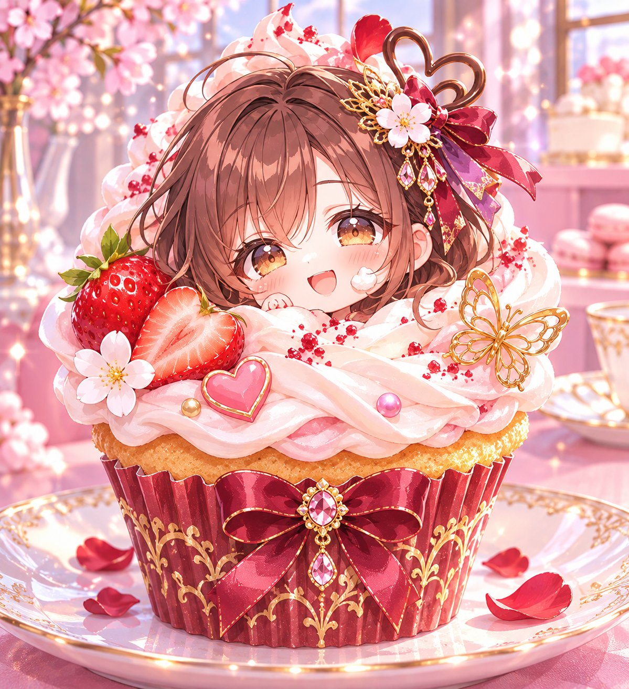
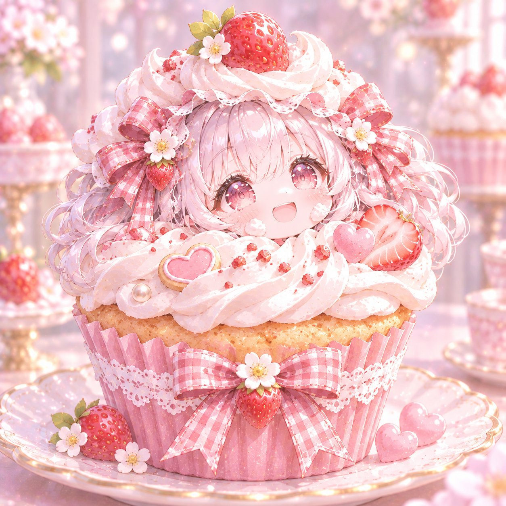

# 「カップケーキからひょこっ」：二头身 Q 版角色从奶油杯子蛋糕里探出脸（#ゆきプロンプト）

- 原帖链接：https://x.com/AIXyu1v/status/2122676150925447463
- 作者：ゆき　AIイラストXで収益化（@AIXyu1v）
- 时间：2026-11-17 21:00 (UTC+8 / Asia/Taipei)
- 互动摘要：点赞 114 · 转发 14 · 回复 4 · 引用 17 · 书签 33 · 浏览 5184（采集快照：2026-11-19 09:05 UTC+8）
- 模型/工具：未注明（角色参考图驱动的通用 prompt）
- 标签：二次元
- 媒体路径：
  - `media/images/2122676150925447463_1.jpg`（）
  - `media/images/2122676150925447463_2.jpg`（）
- 入库日期：2026-11-19
- prompt 来源：https://x.com/AIXyu1v/status/2122676152921915614（作者自回复）
- 备注：prompt 在作者自回复（https://x.com/AIXyu1v/status/2122676152921915614），需上传一张角色图；原样摘录（含 ** 粗体标记）。2 张示例图全部入库。

## prompt 原文

```text
カップケーキからひょこっ 🧁💕

添付画像のキャラクターを、**二頭身の可愛いミニキャラ**にしてください。

髪型・髪色・瞳・衣装・アクセサリーなど、元キャラの特徴を忠実に再現してください。

【シーン】
ふわふわのホイップクリームがたっぷり乗った、大きなカップケーキ。

**クリームの中から、ミニキャラが顔だけひょこっと出しています。**

小さな顔がクリームにふんわり包まれ、楽しそうにこちらを見つめています。

【可愛さのポイント】
・大きな頭と小さな身体の二頭身
・クリームから顔だけのぞく姿
・ほっぺにちょこんと付いたクリーム
・キラキラの瞳と無邪気な笑顔
・カップケーキとの可愛いサイズ差

【構図・背景】
**キャラクター1人とカップケーキ全体が見える構図。**

キャラの身体はクリームの中に隠し、顔だけをはっきり見せてください。

カップケーキには、いちごや小さなハートの飾りを添えてください。

背景はパステルカラーの可愛いスイーツカフェ。柔らかな光とキラキラしたボケ感で、甘く夢のような雰囲気にしてください。

【仕上がり】
高品質な可愛いアニメイラスト。ふわふわのクリーム、しっとりしたスポンジ、繊細なスイーツの装飾、優しいパステルカラー、癒やされる世界観。

【禁止事項】
元キャラの特徴変更、人物の追加、カップケーキの増殖、顔がクリームで隠れる、身体が外に出る、顔とクリームの不自然な融合、余分な手足、顔の崩れ、文字、ロゴ、透かし。
```

---

个人学习归档，非商业。prompt 与媒体版权归原作者 @AIXyu1v，引用请回到原帖。
