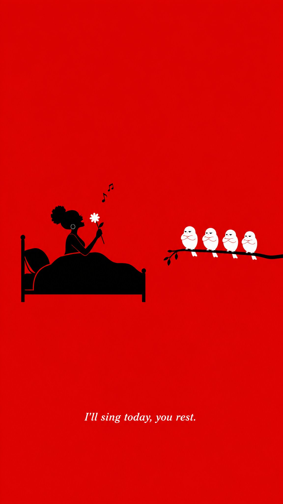

# 极简红底漫画海报：床上举花唱歌的小人与一排不买账的小白鸟（含精确文字）

- 原帖链接：https://x.com/abulu8/status/2122994169195159599
- 作者：Syed Abuthahir ∞（@abulu8）
- 时间：2026-11-18 18:03 (UTC+8 / Asia/Taipei)
- 互动摘要：点赞 62 · 转发 7 · 回复 42 · 引用 0 · 书签 2 · 浏览 12381（采集快照：2026-11-19 19:45 UTC+8）
- 模型/工具：未注明
- 标签：其它
- 媒体路径：
  - `media/images/2122994169195159599_1.jpg`（）
- 入库日期：2026-11-19
- 备注：prompt 在图片 ALT 文本，原样摘录。

## prompt 原文

```text
Ultra-minimal comic poster, flat scarlet background, a tiny black adult woman silhouette sitting up in bed holding a single white flower like a microphone, singing to a row of tiny white birds sitting on a branch with crossed wings as if unimpressed, vast negative space, small white italic text 'I'll sing today, you rest.' near the bottom, white, black and red, playful and funny, flat vector, exact text.
```

---

个人学习归档，非商业。prompt 与媒体版权归原作者 @abulu8，引用请回到原帖。
