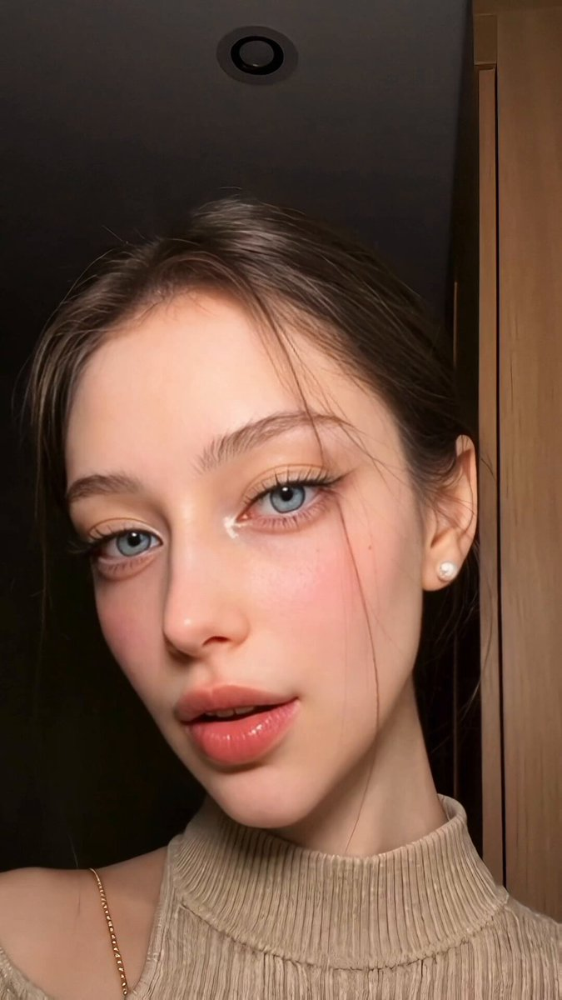

# 手机前置一镜到底自拍特写：冰蓝瞳孔欧洲女子的松弛呼吸感 vlog（15 秒导演式中文 prompt）

- 原帖链接：https://x.com/johnAGI168/status/2123016617835532705
- 作者：John（@johnAGI168）
- 时间：2026-11-18 19:33 (UTC+8 / Asia/Taipei)
- 互动摘要：点赞 44 · 转发 3 · 回复 2 · 引用 0 · 书签 25 · 浏览 5290（采集快照：2026-11-19 19:45 UTC+8）
- 模型/工具：Seedance 2.5（作者标注）
- 标签：真人
- 媒体路径：
  - `media/video-stills/2123016617835532705_still.jpg`（视频封面截图，）
  - 视频本体未入库，仅保留原帖链接：https://x.com/johnAGI168/status/2123016617835532705
- 入库日期：2026-11-19
- prompt 来源：https://x.com/johnAGI168/status/2123016776535380196（作者自回复）
- 备注：prompt 在作者自回复（2123016776535380196），原样摘录。需上传一张人物参考图（@图片1）；服装为半高领针织上衣，非性化。视频本体未入库，仅保留原帖链接。

## prompt 原文

```text
SEEDANCE 2.5 DIRECTOR PROMPT
Duration: 15秒
Aspect ratio: 9:16
Reference: @图片1＝艾琳，锁定面部五官、冰蓝瞳孔、右侧鼻梁小痣、冷暗灰棕后梳低发髻、双耳白色珍珠耳钉与燕麦卡其色细罗纹半高领针织上衣（含右肩镂空与细金链肩带），全片造型一致，不额外描述或更换穿着
           以下正文一律使用中文名字指代，不再出现 @图片/@视频编号。
Audio: 安静的室内手机麦克风收音底噪，极轻缓真实的呼吸气声；无对白、无旁白、无音乐、无字幕
Overall style: 手机前置摄像头单手实拍近距自拍视频，原生 26mm 手机广角近距透视，室内弱光手机传感器细微动态噪点，自然手持呼吸晃动与真实背景视差，原生皮肤肌理与微弱手机自动测光呼吸，拒绝三脚架固定感、稳定器机械平滑、影棚广告光、过度磨皮塑料肌与假AI渲染感

GLOBAL CONTINUITY
Setting:
私密安静的普通室内房间，景深柔和虚化。画面右侧背景隐约可见浅棕色实木门框与木质立柜的竖直边缘，左侧是昏暗柔和的室内墙面。随着手持手机的晃动，后景木门框与前景人物之间产生真实清晰的近快远慢三维视差移动。
Main subject:
艾琳为唯一主角，身份、冰蓝瞳孔、右侧鼻梁中段小黑痣、双耳白色珍珠耳钉与燕麦卡其色半高领针织上衣全程一致。一缕极细软的游离深色长发丝从额顶垂下，斜掠过眉心、鼻侧与唇角轻轻贴拂面颊，随转头与呼吸自然微晃并投下极浅细影。
Lighting:
室内自然偏暗，正前上方一盏日常小型环形补光灯柔和照亮全脸，在双眼冰蓝虹膜下半部映出月牙形白色高光反光；背景只有微弱暖色室内低照度环境光。人物转头迎光时，画面伴随真实的手机自动测光极轻微明暗呼吸变化。
Color:
60:30:10——冷白自然原生肤调 / 燕麦卡其色细罗纹领口与暗暖棕虚化木门框背景 / 冰蓝色虹膜与浅豆沙粉双唇点缀。

CAMERA CONTINUITY
全片为一镜到底的手机前置单手手持自拍大特写 (Handheld smartphone selfie POV, Extreme close-up / Close-up)，等效 26mm 手机前置广角贴脸实拍，绝非三脚架或稳定器机位 (No tripod, no gimbal, no stabilization)。手机由艾琳在画外单手举在脸前约一臂半以内，略高于视线微俯拍摄；顶部卡在发际线上方颅顶边缘，底部卡在半高领领口与左下角右肩镂空细金链处，双手全程不入画。画面全程保持活生生的单手握持动态：随呼吸自然上下轻浮、手腕悬空受力带出细微高频轻颤、随转头产生手眼联动的轻微画面歪斜 (Organic handheld roll & sway) 与几厘米的远近呼吸浮动，背景右侧木门框随之持续轻微错位晃动 (Real optical parallax)。全程不切镜、不瞬移、不电子变焦 (No zoom)。

PERFORMANCE ENGINE
艾琳｜目的：独自举着手机随手录一段安静自拍，顺着呼吸看镜头又任眼神随意游离 障碍：懒散放松，不刻意摆硬照，也不做夸张表情 保护策略：用微张松弛的双唇与随性的偏头转移视线维持自然松弛感
情绪曲线：随手静视 → 放松微仰 → 偏头掠视 → 居中浅笑 → 侧颜仰头抽离

0.0–3.2秒｜微侧直视·持机呼吸轻沉
艾琳单手举着手机开拍，头一开始微偏向画面左侧、下巴轻收，冰蓝双眼直看镜头，双唇松弛微张露出一丁点下齿缘，那缕细发丝贴着鼻侧与唇角轻轻晃动。随着她轻轻呼气，举手机的手腕自然一松，镜头跟着呼吸往下轻微沉了一小段、画面带出一点点轻微左倾歪斜 (Handheld breathing drop & slight roll)，右侧虚化的木门框跟着明显错位移动；第 2.0–3.2 秒她把头慢慢转回正中，手腕也顺势微晃着把画面带正。

3.2–6.0秒｜正面微仰·悬空手腕微颤
艾琳的脸转回正面，下巴顺势轻轻往上扬起一点，眼神清澈平视镜头；第 4.2–5.0 秒微张的双唇轻轻往里合碰一下再自然松开微张，全程不说话不对口型。这段时间举手机的胳膊悬在半空维持居中，镜头带着单手持机特有的轻微上下漂浮与细碎手部轻颤 (Subtle organic handheld tremor)，手机离脸极轻微地一进一出，右侧木门框边缘随手腕支点轻轻弧形滑移；第 5.2 秒起她的头开始轻缓往画面右侧偏去。

6.0–9.0秒｜右偏掠视·持机连带歪斜贴近
艾琳的头顺势向画面右侧侧偏，第 6.2 秒眼球突然轻快地往画面右上方大幅斜挑望去，视线离开镜头停住约一秒。因为歪头时肩膀自然牵动了举手机的胳膊，手里的手机跟着往右下轻微带歪了一点角度、机位顺势轻轻下沉并往前贴近了一两厘米 (Linked handheld tilt & slight drift closer)，画面重心微微下坠，右侧木门框被头部多挡住一小截，同时手机自动测光随浅色脸颊转向灯光产生极自然的细微明暗适应。第 7.4 秒她轻垂眼皮柔软眨眼、嘴角极轻地抿了一下再放松，第 8.0–9.0 秒头平稳回正，视线落回镜头。

9.0–12.0秒｜居中凝视·呼吸回抬浅笑
随着她转回正中轻轻吸气，举手机的手被胸腔起伏带着轻轻往上回抬了一点，镜头像浮在水面上一样带着松弛的上下呼吸起伏轻轻晃动 (Gentle handheld breathing sway)。艾琳平视镜头，第 10.0 秒下巴极轻地点了一下又自然抬平，第 10.5–11.8 秒嘴角极轻微地向两侧舒展，浮起一丝若有似无的松弛浅笑——不露齿、不咧嘴，只在唇角停留一拍便随呼气松回自然微张。

12.0–15.0秒｜仰头侧颜·持机滞后微退补角
第 12.1 秒艾琳流畅地把头向画面左上方侧转并仰起，眼球顺势向上望向画面左上方高处，双唇随转头轻轻微抿后保持松弛微张，清晰露出右侧下颌线、舒展的颈部线条与双耳白色珍珠耳钉。为了不让侧仰的下巴跑出画框，举手机的手略带半拍真人反应滞后感地往后稍微退开一点并微微仰起补角 (Reactive handheld pull-back & slight tilt up)，画面带着真实自然的手持轻晃，右后方虚化的木门框随镜头转动产生明显的空间透视偏移，保持这个仰头侧颜与柔和呼吸晃动直至第 15.0 秒自然结束。

Performance:
① 0.0–6.0秒：松弛随手自拍——眉心额头完全放松，冰蓝眼眸自然直视镜头，双唇只随呼吸微张轻合，不是死板盯镜头的假人，也不是刻意放电摆拍。
② 6.0–9.0秒：眼球先往右上方偏转，头部与举机手自然联动轻歪贴近，停顿一拍后经由一次柔和轻眨眼顺畅回正，不翻僵硬白眼。
③ 9.0–15.0秒：正面给出一瞬极淡的闭口浅笑，不露齿甜笑、不夸张挑眉，随后流畅向画面左上方仰头侧颜，让视线抽离镜头留在松弛的日常余韵里。

Environment:
室内安静私密，后景虚化的浅棕色木门框随单手持机晃动持续产生真实的左右与透视视差位移，绝非静止贴图背景。
Camera:
0.0–3.2秒 26mm 手机前置微俯贴脸大特写 (Handheld selfie Extreme close-up)，随呼气自然轻微下沉与微幅歪斜 → 3.2–6.0秒 悬空单手持机自然漂浮微颤 (Organic handheld micro-tremor)，背景木门框弧形轻移 → 6.0–9.0秒 随人物右偏头连带轻微歪斜、下沉并贴近一两厘米 (Linked handheld tilt & drift) → 9.0–12.0秒 随呼吸轻轻上抬回稳，保留低频柔和呼吸晃动 → 12.0–15.0秒 持机手滞后半拍微微后退并轻仰补角 (Reactive handheld pull-back)，带出清晰背景透视视差直至收尾。
Constraints:
全片必须保持真实单手举手机自拍的持续轻微晃动、呼吸起伏与背景视差，绝不能变成三脚架固定画面或稳定器平滑画面；全程一镜到底，绝不切镜、跳剪或黑场；艾琳全程静默，绝不开口说话或对口型；双手全程不入画；右侧鼻梁小黑痣、双眼虹膜下半部月牙白光、双耳白色珍珠耳钉、右肩镂空细金链及穿过面颊的细发丝必须全程连贯稳定不闪烁。

---
Negative:
三脚架固定机位，云台稳定器平滑画面，画面纹丝不动，死板静止背景，2D平面平移假晃动
改变艾琳人物造型，重新设计服装，服装漂移，面部漂移，人物替换
中途切镜，硬切，跳剪，机位瞬移，电子推拉变焦，视角切换，黑场淡出
张嘴说话，对口型，露齿大笑，僵硬定格发呆，夸张挑眉，翻白眼
双手入画，手指遮脸，手机入画，大幅度出画，肩颈解剖变形
鼻梁小痣消失或移位，瞳孔变色，珍珠耳钉消失，右肩镂空金链错位，发丝融化断层
过度磨皮，塑料皮肤，油光假面，影棚商业精修感，动漫渲染，游戏CG
长焦平视假人感，自动对焦抽搐，极端鱼眼变形
字幕，屏幕文字，水印，品牌标志，旁白，背景音乐，多余音效
```

---

个人学习归档，非商业。prompt 与媒体版权归原作者 @johnAGI168，引用请回到原帖。
