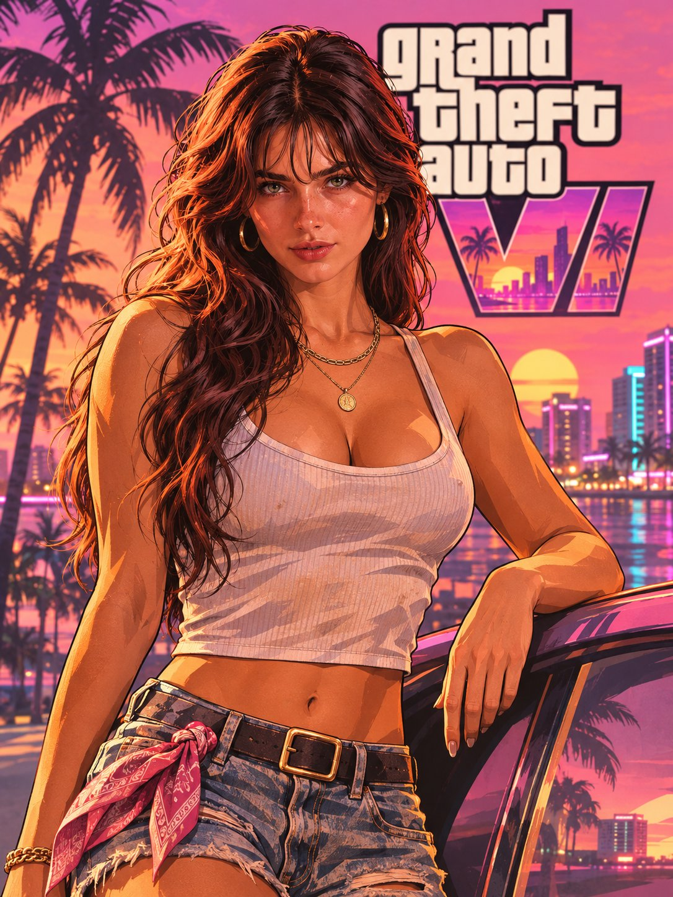

# 一键变 GTA VI 宣传画角色：男变 Jason Duval、女变 Lucia Caminos（参考图驱动）

- 原帖链接：https://x.com/antrospike/status/2123023416475472235
- 作者：Antrospike（@antrospike）
- 时间：2026-11-18 20:00 (UTC+8 / Asia/Taipei)
- 互动摘要：点赞 85 · 转发 13 · 回复 42 · 引用 5 · 书签 17 · 浏览 6914（采集快照：2026-11-19 19:45 UTC+8）
- 模型/工具：未注明（作者在回复中建议用 ChatGPT 等模型）
- 标签：真人
- 媒体路径：
  - `media/images/2123023416475472235_1.jpg`（）
  - `media/images/2123023416475472235_2.jpg`（）
- 入库日期：2026-11-19
- prompt 来源：https://x.com/antrospike/status/2123023417230361076（作者自回复）
- 备注：prompt 在作者自回复（2123023417230361076），原样摘录。需上传本人照片作脸部参考；作者示例男性用 Jake Gyllenhaal 照片。

## prompt 原文

```text
Style: GTA VI official promo art, semi-realistic digital illustration, bold clean outlines, painterly shading, vibrant saturated colors.

Subject: Use the uploaded reference image as the face reference. Keep the exact face, skin tone, hairstyle and expression from the reference, no identity changes. If the person in the reference is male, style him as Jason Duval from GTA VI: rugged confident look, casual street outfit. If the person in the reference is female, style her as Lucia Caminos from GTA VI: confident look, stylish casual outfit. Waist-up, looking at the viewer.

Setting: Vice City neon skyline, palm trees, pink and orange sunset sky, a large GTA VI logo behind the character, slightly blurred for depth.

Lighting: Soft golden-hour light, warm tropical color grading, sun-kissed glow on the face.

Main Prompt: Transform the person from the uploaded reference image into a GTA VI loading-screen style character. Detect the gender from the reference: male becomes Jason Duval style, female becomes Lucia Caminos style. Face similarity is the top priority, only the reference face is used. Confident pose, stylish casual outfit, waist-up, 3:4 vertical, Vice City neon skyline with palm trees and a pink-orange sunset behind, large GTA VI logo in the background, golden-hour lighting, bold outlines, painterly shading, sharp focus on the face.

Negative Prompt: no face change, no copied face of Jason Duval or Lucia Caminos, no wrong gender style, no extra text, no watermark, no distorted hands, no extra fingers, no blurry face, no low quality, no cropped head.

Aspect Ratio: 3:4
```

---

个人学习归档，非商业。prompt 与媒体版权归原作者 @antrospike，引用请回到原帖。
