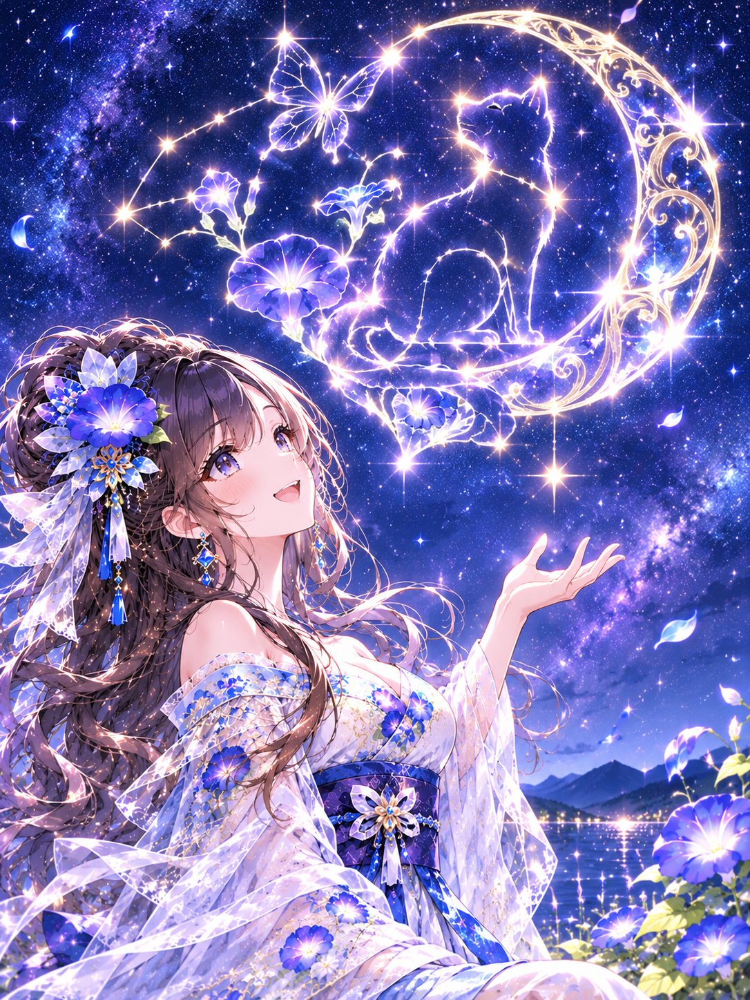
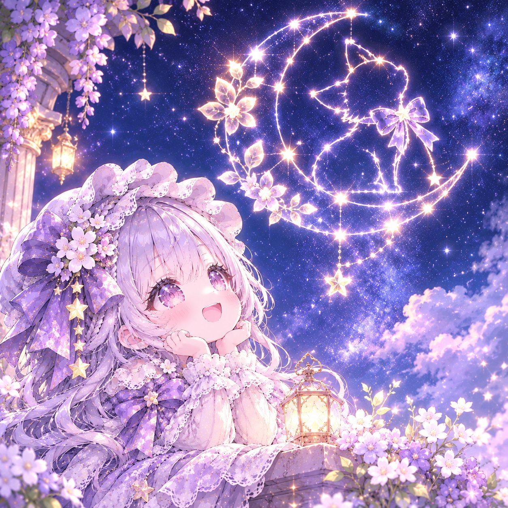
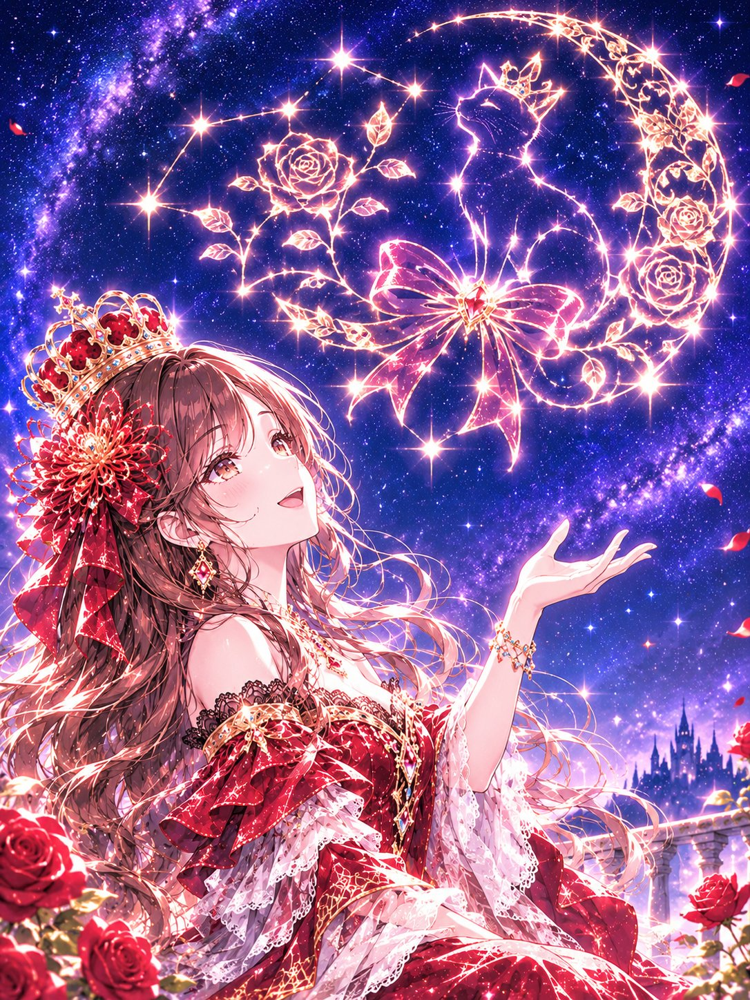

# 「うちの子・オリジナル星座」：按角色性格生成专属星座的星空插画（#ゆきプロンプト）

- 原帖链接：https://x.com/AIXyu1v/status/2123023441175699603
- 作者：ゆき　AIイラストXで収益化（@AIXyu1v）
- 时间：2026-11-18 20:00 (UTC+8 / Asia/Taipei)
- 互动摘要：点赞 127 · 转发 26 · 回复 2 · 引用 15 · 书签 53 · 浏览 4594（采集快照：2026-11-19 19:45 UTC+8）
- 模型/工具：未注明（角色参考图驱动的通用 prompt）
- 标签：二次元
- 媒体路径：
  - `media/images/2123023441175699603_1.jpg`（）
  - `media/images/2123023441175699603_2.jpg`（）
  - `media/images/2123023441175699603_3.jpg`（）
- 入库日期：2026-11-19
- prompt 来源：https://x.com/AIXyu1v/status/2123023443465757014（作者自回复）
- 备注：prompt 在作者自回复（2123023443465757014），原样摘录。需上传角色参考图。

## prompt 原文

```text
うちの子・オリジナル星座 🌌⭐

添付画像のキャラクターを参考に、**その子だけのオリジナル星座が夜空に輝く**幻想的なイラストを描いてください。

髪型・髪色・瞳・衣装・アクセサリーなど、元キャラの特徴を忠実に再現してください。

【オリジナル星座】
キャラクターの性格やモチーフから、世界にひとつだけの星座を作ってください。

・可愛い系：リボンやハート 🎀
・優しい系：花や蝶 🌸
・クール系：剣や氷の結晶 ❄️
・元気系：太陽や翼 ☀️
・幻想系：月や魔法の鍵 🌙

上記以外のモチーフでも構いません。

【シーン】
キャラクターが星空の下に立ち、自分だけの星座を見上げています。

**頭上の夜空には、選んだモチーフの形をした大きな星座がひとつ輝いています。**

星々は細い光の線で結ばれ、星座の形がひと目で分かるようにしてください。

【可愛さのポイント】
・自分の星座を見つめる嬉しそうな表情
・キャラの個性が伝わる星座の形
・キラキラ輝く星と繊細な星座線
・キャラのイメージカラーに合わせた星の光
・星座から降り注ぐ幻想的な輝き

【構図・背景】
**キャラクター1人と、オリジナル星座1つがはっきり見える構図。**

画面の下側にキャラクター、上側に大きな星座を配置してください。

背景は深い青紫の夜空。天の川や小さな星々を控えめに散りばめ、主役の星座を際立たせてください。

【仕上がり】
高品質なアニメイラスト。透明感のある星空、繊細な光、幻想的な色彩、夢のように美しい世界観。

【禁止事項】
元キャラの特徴変更、人物の追加、星座の増殖、星座線の複雑な交差、モチーフが判別できない星座、星がキャラの顔を隠す、余分な手足、顔や手の崩れ、文字、ロゴ、透かし。
```

---

个人学习归档，非商业。prompt 与媒体版权归原作者 @AIXyu1v，引用请回到原帖。
