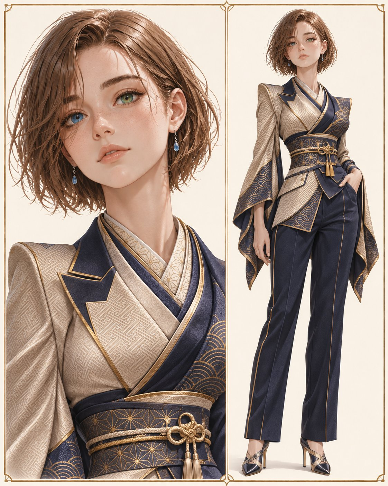
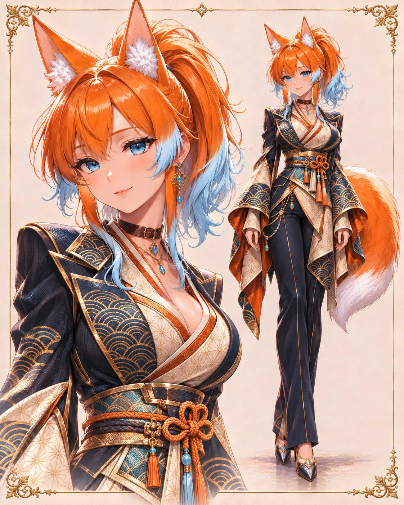
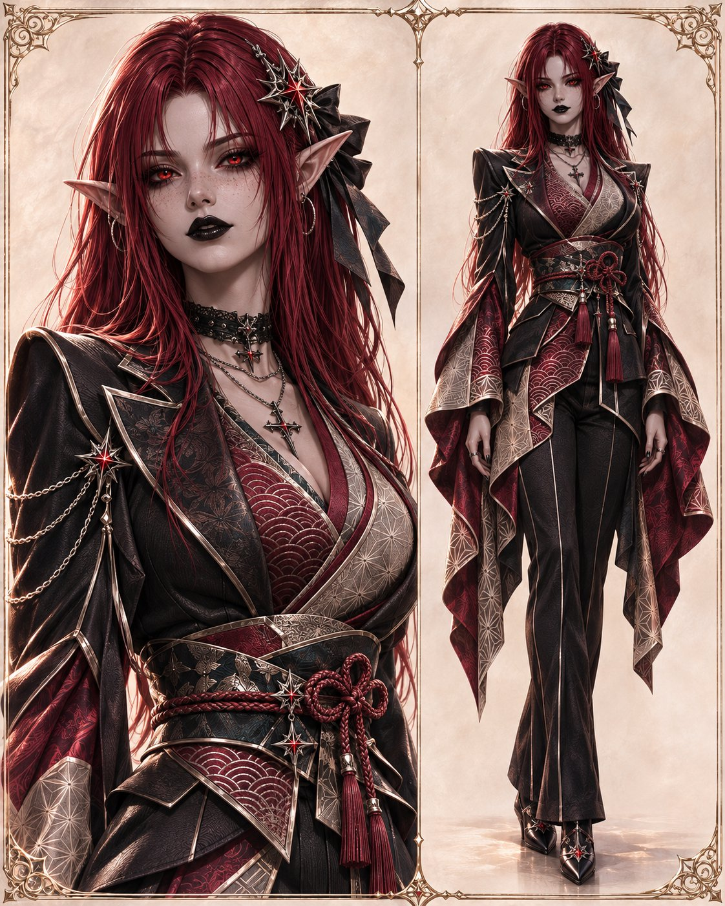
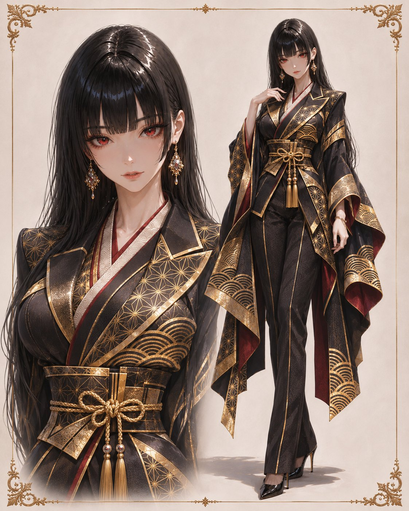

# 现代花魁浴衣 × 欧式高定西装裤套装：角色参考图 → 双栏时装设定图（衣装 prompt）

- 原帖链接：https://x.com/Le_Tavernicole/status/2123039923020185939
- 作者：Le Tavernicole（@Le_Tavernicole）
- 时间：2026-11-18 21:05 (UTC+8 / Asia/Taipei)
- 互动摘要：点赞 75 · 转发 11 · 回复 15 · 引用 6 · 书签 19 · 浏览 1311（采集快照：2026-11-19 09:05 UTC+8）
- 模型/工具：未注明（角色参考图 + 作者衣装设定图驱动的通用 prompt）
- 标签：二次元
- 媒体路径：
  - `media/images/2123039923020185939_1.jpg`（）
  - `media/images/2123039923020185939_2.jpg`（）
  - `media/images/2123039923020185939_3.jpg`（）
  - `media/images/2123039923020185939_4.jpg`（）
- 入库日期：2026-11-19
- prompt 来源：https://x.com/Le_Tavernicole/status/2123039954825515363（作者自回复）
- 备注：prompt 在作者自回复（https://x.com/Le_Tavernicole/status/2123039954825515363），为一整条长文帖，开头「UNIVERSAL MODERN OIRAN × ELEGANT PANTSUIT」至结尾「ORIGINAL IDENTITY AND PROPORTIONS FULLY INTACT.」完整原样摘录。使用时需上传角色图，prompt 还要求同时附上作者的衣装设定图作服装参考。4 张示例图（作者 OC Zoé 与 @CorVulpis、@Vaelari_AI、@Madinichii 的角色）全部入库，均为成年外观的全身着装设定图。

## prompt 原文

```text
UNIVERSAL MODERN OIRAN × ELEGANT PANTSUIT — HAUTE COUTURE OUTFIT TRANSFER

Japanese Oiran-Inspired Yukata × European Luxury Tailoring × Contemporary Power Dressing × Refined Character Fashion Sheet

MASTERPIECE, best quality, ultra-detailed, premium fashion illustration, refined semi-realistic rendering, luxurious textile realism, sophisticated haute couture design, elegant character presentation.

[FORMAT: Vertical 4:5 — TWO-PANEL CHARACTER REFERENCE SHEET]

[OUTFIT: Modern Oiran Yukata × Elegant Tailored Pantsuit]

[EMOTION/TONE: Elegant / Sophisticated / Confident / Graceful]

[CHARACTER IDENTITY: STRICTLY PRESERVED FROM UPLOADED REFERENCE]

[COLOR PALETTE: AUTOMATICALLY ADAPTED TO THE ORIGINAL CHARACTER]

01 — MASTER CONCEPT

Use the uploaded character image as the SOLE AND ABSOLUTE AUTHORITY FOR CHARACTER IDENTITY.

Use the provided Modern Oiran × Pantsuit fashion sheet as the ABSOLUTE REFERENCE FOR OUTFIT DESIGN, GARMENT CONSTRUCTION, MAKEUP PHILOSOPHY, PRESENTATION STYLE, AND SHEET COMPOSITION.

Recreate the uploaded character wearing the same elegant, sophisticated fusion outfit.

The ensemble combines:

Luxurious Japanese Oiran-inspired yukata design.

European haute couture pantsuit construction.
Structured contemporary tailoring.
Traditional Japanese overlapping garment layers.
Elegant, flowing kimono sleeves.
Ornamental obi-inspired corset tailoring.
Refined geometric brocade textiles.
Delicate metallic embroidery and piping.
High-waisted formal trousers.
Sophisticated fashion accessories.
Understated, refined editorial makeup.
The result must look like a genuine custom-tailored luxury fashion creation designed specifically for the uploaded character, never like an outfit crudely pasted onto another body.

CRITICAL DESIGN PRINCIPLE:

The uploaded character does not adapt to the outfit.

THE OUTFIT MUST ADAPT TO THE CHARACTER.

All garment dimensions, cuts, seams, volumes, and proportions must be intelligently reconstructed around the character's original anatomy.

The original character must remain immediately recognizable.

02 — ABSOLUTE CHARACTER IDENTITY LOCK

MANDATORY — PRESERVE THE ORIGINAL CHARACTER DESIGN.

Maintain the uploaded character's exact recognizable identity throughout the transformation.

Preserve:

Facial structure and facial proportions.

Original facial features and expression language.

Eye shape, iris colors, and heterochromia if present.
Eyebrow shape and placement.
Nose, mouth, lips, and jawline.
Original hairstyle, hairline, length, texture, and volume.
Original hair color and characteristic strands.
Skin tone, fur color, surface material, and markings.
Freckles, scars, tattoos, birthmarks, and identifying details.
Original species and non-human characteristics.
Original body type and anatomical proportions.
Natural shoulder width and torso length.
Original chest shape and proportions.
Waist, abdomen, hips, and pelvis proportions.
Original arm and leg lengths.
Head-to-body ratio.
Apparent stature and height.
Natural muscle and fat distribution.
Distinctive character silhouette.
Original personality and visual presence.
For non-human characters, preserve all defining anatomical features:
Ears, horns, tails, wings, claws, paws, hooves, muzzles, feathers, fur, scales, mechanical limbs, cybernetic elements, prosthetics, unusual skin materials, and other canonical anatomical traits.

These features must remain anatomically correct, structurally connected, and visually intact.

Never replace an original species trait with a human equivalent.

Never add human ears to a character whose design establishes only animal ears.

Never remove horns, tails, wings, prosthetics, or other identifying characteristics for garment convenience.

Never alter the character's physical proportions to match the model shown in the outfit reference.

THE REFERENCE OUTFIT'S ORIGINAL MODEL IS NOT A BODY TEMPLATE.

Its face, hairstyle, eye colors, figure, and physical measurements must NOT be transferred to the uploaded character.

Only the outfit, fashion presentation, and makeup treatment are transferable.

03 — ORIGINAL BODY TYPE & PROPORTIONS: ABSOLUTE PRIORITY

The final character must retain the same natural physique as the original reference.

Do not automatically impose:

An hourglass silhouette.

A smaller waist.

Wider hips.

Longer legs.
Narrower shoulders.
A larger or smaller chest.
A thinner or more muscular body.
A taller or shorter stature.
An artificially elongated neck.
A smaller or larger head.
Feminized or masculinized proportions that contradict the character.
Every garment must be custom-tailored to the original body.
The jacket's shoulders must follow the character's real shoulder width.
The waist belt must wrap around the original waist without artificially compressing it.

The trousers must follow the character's actual pelvis, thighs, knees, and legs.

The jacket's length and sleeve dimensions must be adapted to the original torso and arms.

The resulting silhouette must remain anatomically believable and recognizable.

Preserve a natural, proportional neck.

Preserve the original head size relative to the body.

For extremely stylized, anthropomorphic, robotic, or fantasy characters, reinterpret the garment's construction according to their actual anatomy without changing their established proportions.

GARMENT FIT IS VARIABLE. CHARACTER ANATOMY IS NOT.

04 — THE FUSION OUTFIT: MODERN OIRAN × PANTSUIT

Reconstruct the complete ensemble from the fashion reference, maintaining its recognizable design language.

The outfit must remain a sophisticated fusion rather than becoming an ordinary business suit or a traditional, unmodified kimono.

A — STRUCTURED KIMONO-BLAZER JACKET

Create a tailored formal jacket combining:

European luxury blazer construction:

Elegant structured shoulders.

Precise tailoring and anatomical seams.

Sophisticated peak-lapel geometry.

Refined fitted or naturally shaped torso.

Luxurious reinforced fabric.
Architectural garment silhouette.
Delicate metallic edge piping.
Japanese Oiran-inspired yukata construction:
Traditional overlapping front panels.
Layered diagonal collar arrangement.
Distinctive crossed garment neckline.

Kimono-inspired fabric wrapping.

Graceful elongated sleeve construction.
Wide draped sleeve openings.
Ornamental interior sleeve lining.
Asymmetrical overlapping jacket panels.
The upper garment must visually merge both traditions into one coherent couture garment.
The blazer lapels transition naturally into layered kimono collars.
The structured shoulders transition into refined flowing sleeves.
The fitted tailoring gradually opens into decorative asymmetrical lower panels.

The garment must feel physically manufacturable, with plausible seams, fabric thickness, weight, and fastening systems.

B — OIRAN-INSPIRED LAYERED COLLAR

Create an elegant series of layered fabric collars.

Include:

A narrow, geometrically patterned inner collar.

A contrasting secondary textile layer.

A wider overlapping kimono collar.

A structured outer blazer lapel.

Fine metallic piping between important edges.
The layers must follow the anatomy of the neck, shoulders, and upper chest.
The neck must remain its original natural length and proportion.
The collar must not conceal or distort essential character features.
For characters with horns, unusual neck anatomy, fur, or mechanical components, adapt the collar structure naturally.

C — FLOWING COUTURE SLEEVES

The sleeves combine tailored blazer construction with elegant yukata drapery.

Preserve:

Structured upper-arm tailoring.

Graceful widening toward the forearm.

Distinctive flowing kimono sleeve openings.

Richly patterned inner fabric.

Contrasting outer and inner surfaces.
Metallic trim along the edges.
Realistic folds and fabric gravity.
The sleeves must look luxurious and expressive while remaining harmonious with the tailored jacket.
They must not become excessively oversized or obscure the character's silhouette.
For characters with wings, extra arms, mechanical limbs, or unusual anatomy, construct appropriate sleeve openings or tailored accommodations.
D — ORNAMENTAL OBI-CORSET WAIST

Create the distinctive centerpiece of the design:

A wide, tailored obi-inspired corset belt integrated into the pantsuit jacket.

It includes:

Structured overlapping waist panels.

Luxurious woven geometric textile.

Layered horizontal decorative bands.

Refined metallic geometric embroidery.

Elegant braided ceremonial cords.
A decorative knot inspired by traditional Japanese cordwork.
Small hanging ornamental tassels.
Discreet metallic fastening hardware.
The belt must merge naturally with the jacket's layered front.
It should reinforce the outfit's elegant architecture without forcing the character into an artificial body shape.
Adapt the belt's width and curvature to the original waist and torso.
For characters without a human waist, reinterpret the obi as an equivalent anatomically compatible tailored structure.

The obi is decorative tailoring, not a body-altering device.

E — ASYMMETRICAL JACKET PANELS

The jacket extends below the waist through elegant overlapping panels.

Include:

Refined asymmetric hems.

Contrasting textile inserts.

Fine metallic edge piping.

Traditional Japanese geometric brocade.

Precise angular tailoring.
Graceful continuity from the obi.
These panels must connect logically to the jacket construction.
They should enhance the outfit without hiding the trousers completely.
F — ELEGANT HIGH-WAISTED TROUSERS
Replace conventional kimono lower garments with luxurious contemporary pantsuit trousers.

Preserve the original reference design:

High-waisted tailored construction where anatomically appropriate.

Clean formal trouser silhouette.

Elegant pressed creases.

Subtle geometric jacquard or brocade texture.

Refined metallic piping along selected seams.
Natural fabric draping and folds.
Sophisticated ankle and hem finishing.
The trousers should balance the elaborate upper garment with a more restrained, modern silhouette.
IMPORTANT:
The trousers must be tailored to the character's actual leg anatomy.
Do not force a slim figure, elongated legs, narrow hips, or conventional human leg proportions.

For digitigrade legs, unusual feet, robotic limbs, or other non-human forms, adapt the trouser construction while preserving the original design language.

The garment must maintain the character's original body type.

G — MATCHING FORMAL FOOTWEAR

Complete the ensemble with elegant footwear inspired by the fashion reference.

Use:

Refined pointed footwear when anatomically compatible.

Delicate geometric decorative details.

Subtle metallic accents.

Coordinated fabric or leather surfaces.

Tasteful crossover straps or ornamental trim.
Heel height and shoe construction must suit the character's original anatomy, stance, and personality.
For pawed, hoofed, digitigrade, prosthetic, or robotic feet, reinterpret the footwear accordingly.
Preserve original footwear or equipment when it is essential to the character's identity, adapting its styling to the outfit instead of replacing its recognizable design.
05 — FABRIC & ORNAMENTATION

The ensemble must appear made from authentic luxury materials.

Use a sophisticated combination of:

Fine silk brocade.

Japanese jacquard.

Soft structured satin.

Luxury suiting fabric.

Subtle metallic woven thread.

Refined matte and satin textile contrasts.
Delicate embroidered geometry.
Detailed woven surface patterns.
Ornaments should draw inspiration from traditional Japanese geometry:
Asanoha-inspired star geometry, Seigaiha-inspired waves, interlocking geometric borders, and refined architectural linework.
Decorative patterns must follow the actual curvature and folds of the fabric.
Embroidery should deform naturally with garment tension.
Metallic thread should respond subtly to light.

Avoid excessive ornamental density.

The ensemble must remain sophisticated, wearable, and visually coherent.

NO FLORAL MOTIFS UNLESS SPECIFICALLY REQUIRED BY THE ORIGINAL CHARACTER'S CANONICAL DESIGN.

No random flowers, petals, floral prints, or flower accessories.

06 — AUTOMATIC COLOR PALETTE ADAPTATION

CRITICAL — THE UPLOADED CHARACTER'S COLOR PALETTE IS AUTHORITATIVE.

The outfit reference establishes the construction, material hierarchy, and decorative language, not mandatory colors.

Do not automatically impose the original navy, ivory, and gold combination.

Instead, analyze the uploaded character's existing color identity.

Identify:

Primary canonical color.

Secondary canonical color.

Existing accent colors.

Metallic or ornamental colors.

Hair, skin, fur, or material colors.

Signature color combinations.

Rebuild the ensemble with a palette that feels naturally designed for that character.
Color distribution
PRIMARY FABRIC: A dominant color drawn from or harmonized with the character's canonical palette.
SECONDARY FABRIC: A complementary or contrasting color that supports the character's existing design.
INNER COLLAR: A lighter, darker, or carefully contrasted version of the palette.
OBI-CORSET: A coordinated decorative combination of the primary and secondary colors.

METALLIC ORNAMENTATION: Gold, silver, copper, bronze, or another appropriate accent determined by the character's existing design.

TROUSERS: A visually balanced formal color coordinated with the jacket.

FOOTWEAR: Harmonized with the trousers and decorative accessories.

Preserve canonical color relationships.

Do not recolor the character's body, hair, eyes, markings, or non-human features to coordinate with the garment.

The outfit must complement the character, never overwrite the character's visual identity.

COLOR ADAPTATION APPLIES TO CLOTHING, NOT TO CHARACTER ANATOMY.

07 — MAKEUP TRANSFER: REFINED EDITORIAL ELEGANCE

Reinterpret the original fashion sheet's delicate, understated makeup treatment for the uploaded character.

The goal is natural luxury beauty, not facial transformation.

The makeup must enhance the character's existing features without changing their identity.

Skin

Natural luminous skin finish.

Subtle soft highlights.

Delicate peach, rose, or palette-compatible blush.

Fine realistic skin texture.

Original freckles and facial markings remain visible.

Gentle tonal transitions.

No excessive airbrushing.

Eyes
Soft eye definition.
Delicate upper lash emphasis.
Refined, restrained eyeliner when appropriate.
Subtle eyeshadow coordinated with the outfit.
Natural eyebrow definition.
Original eye shape and iris colors preserved exactly.

Existing heterochromia fully maintained.

Lips
Soft natural lip coloration.
Subtle satin or delicate glossy finish.
Refined natural contours.
Color adapted to the character's original palette.
Original lip shape preserved.
Overall effect

Sophisticated editorial beauty with a natural, luminous appearance.

Never alter facial anatomy to imitate the original outfit model.
No exaggerated contouring, forced facial feminization, oversized eyelashes, artificial doll-like features, or dramatic cosmetic changes.
For characters whose design does not support conventional human makeup, reinterpret the effect through subtle surface refinement, lighting, pigmentation, or material treatment appropriate to their original appearance.
For characters with no visible mouth, do not invent one.
For robotic or featureless faces, preserve the original face construction.

MAKEUP MUST SERVE THE ORIGINAL FACE — NEVER REPLACE IT.

08 — ACCESSORIES & PERSONAL DETAILS

Preserve all essential original accessories and identity markers.

Existing glasses, piercings, jewelry, hair ornaments, mechanical details, and signature objects should remain recognizable whenever compatible with the new outfit.

Optional decorative accents may include:

Refined gemstone earrings.

Minimalist metallic fittings.

Coordinated ornamental cords.

Subtle traditional Japanese-inspired knotwork.

Elegant fastening hardware.

Do not add accessories that contradict the character's identity.

The original reference model's blue gemstone earrings are not mandatory character traits and must not be copied automatically.

Adapt accessory colors and materials to the uploaded character.

Do not introduce flowers.
09 — MANDATORY TWO-PANEL CHARACTER SHEET
ABSOLUTE REQUIREMENT: THE FINAL IMAGE MUST PRESERVE THE ORIGINAL FASHION SHEET'S FORMAT, ART STYLE, FRAMING, AND COMPOSITION.
Create ONE unified vertical 4:5 character reference sheet divided into TWO SIDE-BY-SIDE PANELS.
The two panels must depict THE SAME UPLOADED CHARACTER, wearing exactly the same adapted outfit.

LEFT PANEL — LARGE CHARACTER PORTRAIT

A prominent, highly detailed portrait occupying the entire left half of the sheet.

Framing:

Large face prominently visible.

Head, shoulders, upper torso, and detailed clothing.

Cropping through the lower torso or obi region.

Elegant close-up fashion editorial composition.

Slight natural head angle.

Calm, expressive facial presence.

Clear visibility of the character's original facial features.

The portrait must clearly display:

Original face and hairstyle.

Original eye colors.
Original facial markings.
Adapted natural makeup.
Layered kimono-blazer collar.
Luxury textile textures.
Shoulder tailoring.
Decorative embroidery.

Upper outfit details.

Part of the obi-inspired waist construction.
FACIAL ACCURACY HAS MAXIMUM PRIORITY IN THIS PANEL.
Do not replace the original character's face with the outfit reference model's face.
RIGHT PANEL — COMPLETE FULL-BODY VIEW
A single complete standing figure occupying the entire right half.
Framing:
Head completely visible.
Entire body visible from head to footwear.
Both feet fully inside the frame.
No cropped limbs or accessories.

Natural anatomical stance.

Elegant fashion presentation.

Front or subtle three-quarter-front orientation.

Clear visibility of the full garment silhouette.

The character may stand with one hand naturally resting near or inside a trouser pocket when anatomically appropriate, echoing the original fashion reference.

The other arm may rest naturally beside the body, allowing the flowing sleeve construction to remain visible.
Avoid exaggerated runway posing.
The pose must respect the character's original anatomy and physical balance.
The full-body panel must clearly show:
Complete jacket structure.
Overlapping yukata-blazer panels.
Both sleeves.
Obi-corset construction.

Decorative cords and tassels.

Tailored trousers.

Full leg proportions.

Footwear.

Entire character silhouette.

NO BODY PART MAY BE CROPPED.
PANEL CONSISTENCY
Both panels must show the exact same:
Character identity.
Face.
Hair.
Eye colors.
Skin, fur, or surface markings.
Character-specific anatomy.

Outfit design.

Color palette.

Textile patterns.

Collar construction.
Accessories.
Makeup treatment.
The portrait is a close-up of the same character shown in the full-body panel.
Do not create two different interpretations.
10 — SHEET GRAPHIC DESIGN & ART DIRECTION
Replicate the original reference sheet's elegant fashion presentation.
Canvas: Vertical 4:5.
Layout: Two adjacent vertical panels, left portrait and right full-body view.
Background: Clean, warm ivory or soft cream studio backdrop.
Frame: Thin decorative antique-metallic-gold ornamental border.
Divider: Fine vertical gold divider separating the two views.

Corners: Subtle geometric Art Nouveau-inspired corner details.

Panel proportions: Approximately 58% width for the portrait and 42% for the full-body figure, matching the source composition.

Lighting: Soft, balanced, luminous fashion-studio illumination.

Rendering: Refined semi-realistic digital fashion illustration with delicate painterly transitions, high-quality material definition, and precise garment details.

Maintain:

Clean visual readability.

Elegant negative space.

Harmonious character placement.

Detailed but restrained ornamentation.

Natural facial rendering.

Sophisticated textile highlights.

Clear separation between panels.

The sheet should feel like a premium character design illustration from a luxury fashion concept collection.

NO TEXT, NO LOGOS, NO WATERMARKS, NO LABELS, NO EXTRA PANELS.

Do not change the panel arrangement.

Do not transform the sheet into a magazine cover, collage, turnaround sheet, or cinematic scene.
11 — CONSISTENT VISUAL STYLE
Render both panels in the same refined visual language as the outfit reference.
Combine:
Elegant semi-realistic character rendering.
High-end anime-inspired facial refinement where appropriate to the original character.
Soft painterly skin and material transitions.

Realistic couture tailoring.

Detailed woven textile surfaces.

Delicate metallic highlights.

Refined hair rendering.

Harmonious studio lighting.

Crisp ornamental details.

Natural anatomical structure.

Preserve the uploaded character's recognizable facial stylization and design vocabulary.

Do not redesign the face merely to match the outfit model's stylization.
The result should feel cohesive, as though both panels were created by the same artist for the same character.
Maintain the original character's established proportions even when their source uses unusual or exaggerated stylization.
12 — STRICT NEGATIVE CONSTRAINTS
DO NOT:
Replace the uploaded character with the outfit reference model.
Copy the outfit model's face, hairstyle, body type, or proportions.
Change the original character's species.
Humanize non-human anatomy.
Remove or relocate important anatomical features.

Add or remove ears, horns, tails, or wings.

Alter eye colors or heterochromia.

Change canonical facial markings.

Alter original chest, waist, or hip proportions.

Enlarge or shrink the head.

Lengthen the neck.

Lengthen or shorten the legs.

Impose a universal slim or hourglass body.
Apply a fixed navy-and-gold palette to every character.
Create an ordinary business suit.
Create an unchanged traditional kimono.
Remove the obi-inspired corset element.
Replace the trousers with a skirt.
Remove the layered collar construction.
Simplify the flowing kimono sleeves into ordinary sleeves.
Add excessive ornaments unrelated to the design.
Introduce floral patterns unless canonical.
Add unrelated accessories.
Change the two-panel composition.
Crop the full-body character.
Produce inconsistent clothing between panels.
Create additional characters.
Add extra limbs, fingers, or anatomical distortions.
Produce distorted textile geometry.
Use exaggerated makeup that changes facial identity.
Add text, signatures, watermarks, or logos.
13 — FINAL GENERATION PRIORITY
When design requirements conflict, apply the following hierarchy:
PRIORITY 1 — ORIGINAL CHARACTER IDENTITY
Exact recognizable face, hair, eyes, species, markings, personality, and canonical features.
PRIORITY 2 — ORIGINAL CHARACTER ANATOMY
Unchanged body type, height impression, head-to-body ratio, torso, chest, waist, hips, limbs, and natural proportions.
PRIORITY 3 — OUTFIT DESIGN FIDELITY
Reproduce the recognizable Modern Oiran × Elegant Pantsuit silhouette, including jacket, layered collars, flowing sleeves, obi, geometric brocade, trousers, and accessories.
PRIORITY 4 — COLOR PALETTE ADAPTATION
Integrate the character's existing colors into the complete outfit while preserving the original decorative hierarchy.
PRIORITY 5 — MAKEUP & PRESENTATION
Apply delicate character-compatible editorial makeup and preserve the luxurious two-panel fashion-sheet composition.

PRIORITY 6 — MATERIALS & FINISHING

Premium fabrics, realistic tailoring, coherent ornaments, elegant highlights, detailed textures, and sophisticated visual polish.

FINAL ABSOLUTE DIRECTIVE

Create a luxurious Modern Oiran Yukata × Elegant European Pantsuit character fashion sheet based on the uploaded character.

The character must remain themselves in every anatomical, facial, and identifying detail.

The ensemble must be reconstructed as if an expert haute couture designer had tailored this exact outfit specifically for that character, using their original silhouette, color palette, and physical characteristics.

Preserve the fashion reference's distinctive design: structured kimono-blazer jacket, layered Japanese collar, flowing patterned sleeves, ornate obi-corset belt, asymmetrical panels, elegant formal trousers, and coordinated footwear.

Adapt the subtle editorial makeup to enhance the original character's natural appearance without changing their face.

Maintain the original two-panel composition:

LEFT: LARGE DETAILED CHARACTER PORTRAIT.

RIGHT: COMPLETE FULL-BODY FASHION VIEW.

Warm ivory background, delicate antique-gold ornamental frame, vertical divider, consistent character design, and premium refined illustration quality.

ONE CHARACTER. TWO VIEWS. ONE COHERENT OUTFIT. ORIGINAL IDENTITY AND PROPORTIONS FULLY INTACT.
```

---

个人学习归档，非商业。prompt 与媒体版权归原作者 @Le_Tavernicole，引用请回到原帖。
