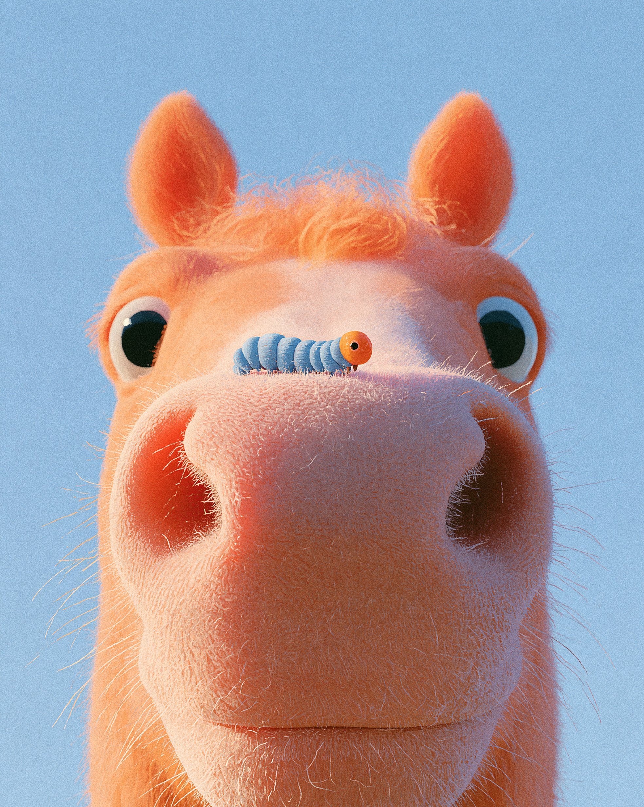

# 马鼻子上的小毛毛虫：超近景童话水彩感插画（Midjourney 多 sref 混合）

- 原帖链接：https://x.com/heathergreen/status/2123068726350148040
- 作者：Heather Green（@heathergreen）
- 时间：2026-11-18 23:00 (UTC+8 / Asia/Taipei)
- 互动摘要：点赞 6 · 转发 0 · 回复 0 · 引用 0 · 书签 1 · 浏览 91（采集快照：2026-11-19 19:45 UTC+8）
- 模型/工具：Midjourney（作者标注，帖内参数含 --raw --hd）
- 标签：其它
- 媒体路径：
  - `media/images/2123068726350148040_1.jpg`（）
- 入库日期：2026-11-19
- 备注：prompt 在原帖正文，从「Extreme close-up」起原样摘录（略去「PROMPT:」标签）。

## prompt 原文

```text
Extreme close-up illustration of a tiny caterpillar resting on a horse’s nose, the velvety muzzle filling nearly the entire frame with delicate whiskers and soft skin texture in crisp focus. The rest of the horse’s face melts into a softly blurred background, with gentle natural light, a calm whimsical mood, subtle colors, and fine painterly detail. --ar 4:5 --raw --sref 3465975336 1632499533 2208675465 --stylize 300 --hd
```

---

个人学习归档，非商业。prompt 与媒体版权归原作者 @heathergreen，引用请回到原帖。
