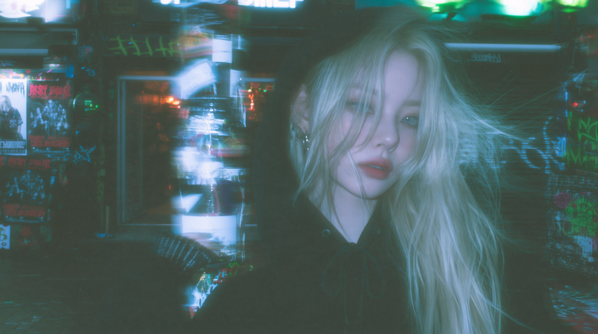
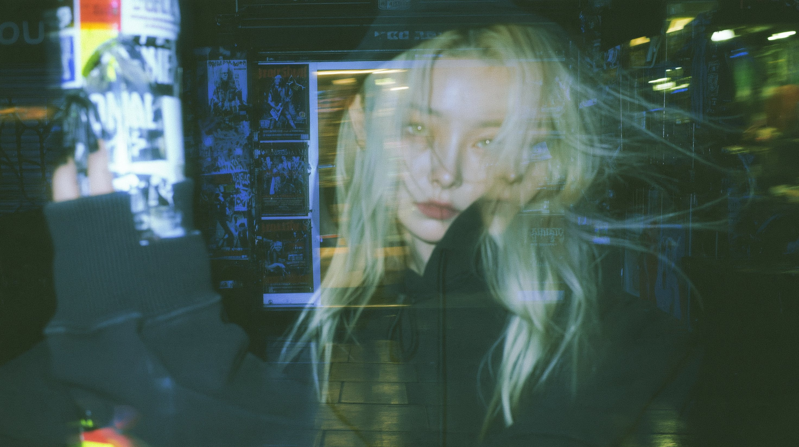
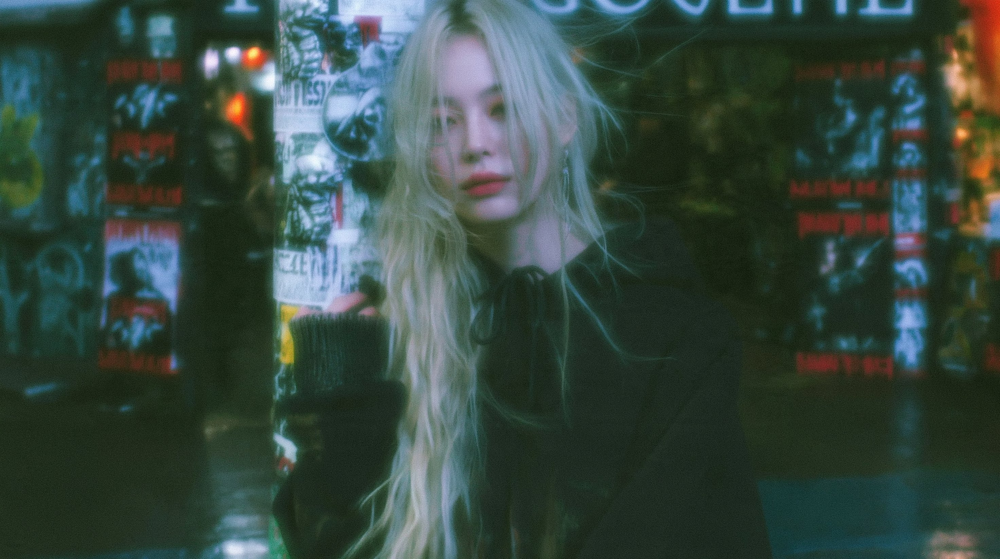
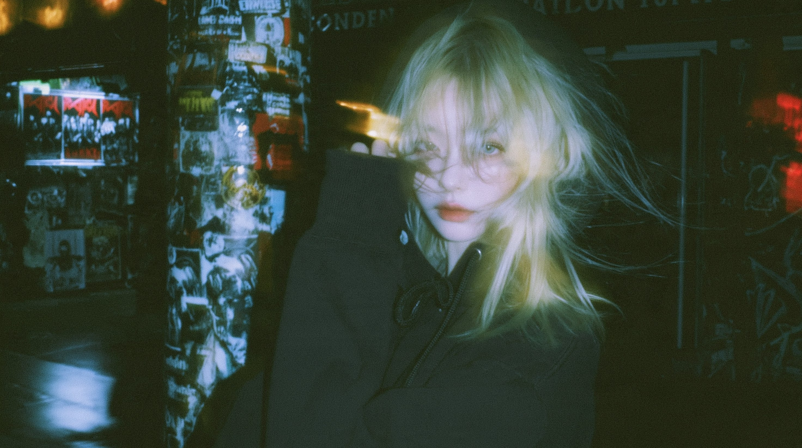

# 伦敦 Camden 朋克街角的街拍人像：Midjourney V8.2 + sref + profile 写法

- 原帖链接：https://x.com/VIBEQUIRKLABS/status/2123081613324243075
- 作者：Nailai7981（@VIBEQUIRKLABS）
- 时间：2026-11-18 23:51 (UTC+8 / Asia/Taipei)
- 互动摘要：点赞 20 · 转发 0 · 回复 0 · 引用 1 · 书签 3 · 浏览 1524（采集快照：2026-11-19 19:45 UTC+8）
- 模型/工具：Midjourney V8.2（作者标注）
- 标签：真人
- 媒体路径：
  - `media/images/2123081613324243075_1.jpg`（）
  - `media/images/2123081613324243075_2.jpg`（）
  - `media/images/2123081613324243075_3.jpg`（）
  - `media/images/2123081613324243075_4.jpg`（）
- 入库日期：2026-11-19
- 备注：prompt 在原帖正文，从「Unscripted」起原样摘录（略去开头的「Midjourney V8.2 :」）。人物写明 20 岁，黑色卫衣街拍。同作者 11-18 已收录一条港风街拍（2122967510211498416），本条为不同帖。

## prompt 原文

```text
Unscripted cinematic street photo, Camden punk street corner, London. Sticker covered pole, punk storefronts, band posters, graffiti walls, market clutter. Subject: 20 year old Korean woman, idol face, refined features, clear eyes, polished K pop beauty. Long soft light blonde waves, golden beige tone, realistic dyed texture, natural eyebrows. Lightly windswept, loose strands. Black pullover hoodie, drawstring hood, ribbed cuffs, relaxed fit. Layered foreground, middle ground, background; composition fragments storefront entrance, wall texture, or wet pavement. Ricoh GR, 85mm compressed, phone like slight overexposure, clipped highlights, auto exposure. Japanese photobook street realism, Yoshihiko Ueda influence, clear morning daylight. Deep velvety shadows, cool desaturated greens and charcoals, low key tonal calm. Incidental pedestrians as traces only. No postcard panorama, no generic rock alley, no Times Square signage. --chaos 20 --ar 16:9 --raw --stylize 600 --hd --sref 927633762 --profile 58o43cs
```

---

个人学习归档，非商业。prompt 与媒体版权归原作者 @VIBEQUIRKLABS，引用请回到原帖。
