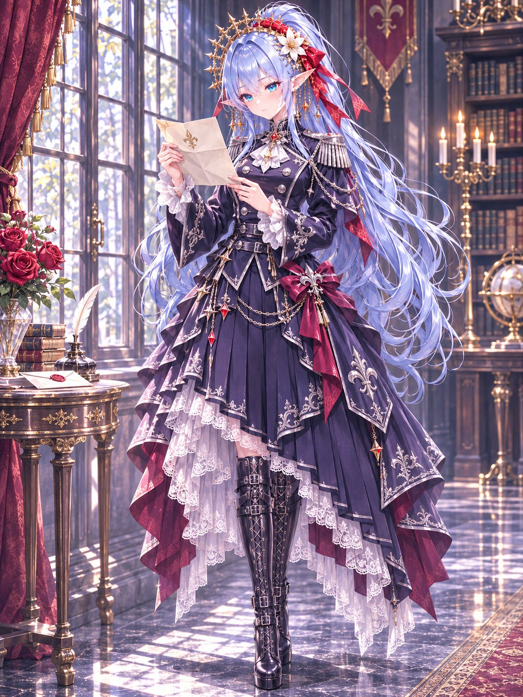

# 紺銀の軍装ゴシック：濃紺×黑×銀 军装哥特衣装、洋馆窗边读信（#FRSプロンプト）

- 原帖链接：https://x.com/1aGe3u9BBQ46771/status/2123227327589212413
- 作者：ナビ（@1aGe3u9BBQ46771）
- 时间：2026-11-19 09:30 (UTC+8 / Asia/Taipei)
- 互动摘要：点赞 12 · 转发 4 · 回复 3 · 引用 1 · 书签 0 · 浏览 361（采集快照：2026-11-19 19:45 UTC+8）
- 模型/工具：未注明（角色参考图驱动的通用 prompt）
- 标签：二次元
- 媒体路径：
  - `media/images/2123227327589212413_1.jpg`（）
- 入库日期：2026-11-19
- prompt 来源：https://x.com/1aGe3u9BBQ46771/status/2123227332500676865（作者自回复）
- 备注：prompt 在作者自回复（2123227332500676865），原样摘录。prompt 明确禁止过度暴露。

## prompt 原文

```text
紺銀の軍装ゴシック — MILITARY GOTHIC COUTURE

Identity Lock / Costume REPLACE / Military 60% × Gothic 40%

【参照・人物】
添付キャラクター画像を唯一の人物参照とし、主人公1人を描く。顔・髪型・髪色・髪長・毛量・瞳色・耳・体格・本人固有の髪飾りを忠実に保持。元衣装と履物のみ完全変更。複数視点の参照シートも同一人物として扱う。帽子・軍帽・フードは禁止。

【衣装コンセプト】
軍服60％×ゴシック40％。濃紺・黒・銀を基調に、規律ある軍装の端正さとゴシックの優雅な華やかさを融合。背景を隠しても衣装の特徴が伝わる、仕立ての美しい高級軍装ゴシック。

【衣装デザイン】
立ち襟の濃紺ダブルボタンジャケットに銀ボタン、控えめな肩章、白いインナー、袖口の繊細なレース。ウエストはコルセット風の切り替えと細いベルトで自然に引き締める。
下半身は整ったプリーツスカートに、長短差のある黒紺のオーバースカートを重ねる。裾には銀糸刺繍と薄いレース。百合紋章、小さなブローチ、細い装飾チェーンを適量配置。
足元は黒の編み上げロングブーツ。重装鎧や巨大マントにはせず、上品で実際に着用可能な衣服として構築する。

【場面・アクション】
静かな洋館の窓辺で、一通の書簡を読んでいる日常の瞬間。
片手で便箋の上端を持ち、反対の手で下端を自然に支える。視線は手紙へ向け、穏やかで少し思索的な表情。
身体は軽く斜めを向き、両足で自然に立つ。軍服の凛々しさと静かな日常の対比を表現する。

【人体・接触制御】
頭・首・肩・胸郭・骨盤・両腕・両脚を自然につなぐ。各手は親指を含む5本指。指先と便箋の接触、肘・手首の角度を正確にする。衣装で腕や脚を消失させない。重心、両足の接地、接触影を一致させる。手を極端に大きく描かず、無理な遠近短縮を避ける。

【衣装・背景の質感】
ジャケットは張りのある高密度織物、スカートは重みのある布、レースは薄い編み目、銀刺繍は布に縫い込まれた金属糸、ブーツは自然な艶と履きジワを持つ革として描く。
背景には縦長の窓、落ち着いた木製家具、石または木の床を配置。紙の薄さ、木目、金属の反射を素材ごとに描き分ける。背景は衣装より目立たせない。

【構図・品質】
縦3:4、高品質2Dアニメイラスト1枚。人物1人、頭頂からブーツまで全身を収める。顔・髪飾り・耳・両手・書簡・衣装のシルエットを明確に見せる。
カメラロール0°、床水平、自然な遠近法。柔らかな窓光と落ち着いた室内光。参照の瞳色・髪色を厳守し、繊細な描き込みと素材別の反射を両立する。

【禁止事項】
別人化、元衣装の混入、帽子、軍帽、フード、追加人物、過度な露出、重装鎧、武器、巨大な装飾、多指・融合指、余分な手足、関節破綻、浮いた足、衣装と人体の融合、紙の接触破綻、過剰な光沢、ダッチアングル、文字、ロゴ、透かし、コラージュ、3D化。

【最終指示】
添付キャラクターの本人性を保持し、濃紺×黒×銀の軍服ゴシック衣装へ完全変更。洋館で書簡を読む自然な日常動作を、正確な人体・衣装構造・素材感とともに描く。
添付画像を参照して生成開始
```

---

个人学习归档，非商业。prompt 与媒体版权归原作者 @1aGe3u9BBQ46771，引用请回到原帖。
