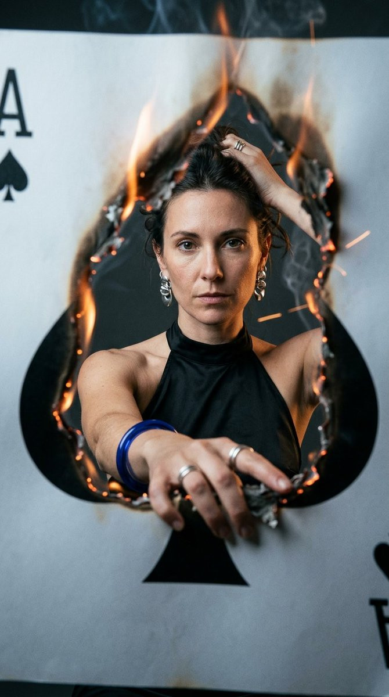

# 燃烧的黑桃 A：透过纸牌烧穿的黑桃孔洞看见的时尚大片肖像

- 原帖链接：https://x.com/dreamydigiarts/status/2123272555121537414
- 作者：dreamy digital arts（@dreamydigiarts）
- 时间：2026-11-19 12:30 (UTC+8 / Asia/Taipei)
- 互动摘要：点赞 18 · 转发 0 · 回复 6 · 引用 0 · 书签 1 · 浏览 418（采集快照：2026-11-19 19:45 UTC+8）
- 模型/工具：Nano Banana 2（作者标注，经 WeryAI）
- 标签：真人
- 媒体路径：
  - `media/images/2123272555121537414_1.jpg`（）
- 入库日期：2026-11-19
- 备注：prompt 在原帖正文，从「Create a vertical」起原样摘录（略去开头的工具推广与「Prompt 👇」标签）。prompt 写明 adult woman、高领。

## prompt 原文

```text
Create a vertical 9:16 beauty-fashion editorial built around an oversized physical Ace of Spades playing card suspended close to the camera. Its central black spade has burned open into a real aperture, with curled paper fibers, glowing edges, drifting ash, and small active flames tracing only parts of the cutout.

An adult woman stands directly behind the opening so her face, throat, and upper torso appear through the spade-shaped void. Dress her in a fitted black satin halter top with a clean high neckline and open shoulders, paired with sculptural silver earrings, stacked slim rings, and one translucent cobalt glass bangle.

Frame very tightly through the burned aperture. One hand reaches forward through the opening toward the lens, fingertips lightly gripping the charred card edge, while her other hand lifts into her hair behind the paper plane. Her gaze is direct and unflinching, lips relaxed, expression controlled rather than theatrical.

Keep the giant card slightly out of focus at the extreme foreground while her eyes remain razor sharp. Let the irregular burning edge partially interrupt her hair and shoulders so the card and portrait cannot be separated compositionally.

Use a dark graphite studio with one cool soft key on her face and a warm fire rim catching cheekbone, fingers, jewelry, and individual hair strands. Smoke should drift upward across only parts of the frame, with a few sparks crossing the lens.

Preserve natural skin texture, satin sheen, scorched paper, ember glow, ash residue, heat distortion, metallic jewelry, and fine film grain. The image should read instantly as “woman through a burning Ace of Spades” at thumbnail size, then reward closer inspection with tactile fire, paper, and beauty detail.
```

---

个人学习归档，非商业。prompt 与媒体版权归原作者 @dreamydigiarts，引用请回到原帖。
