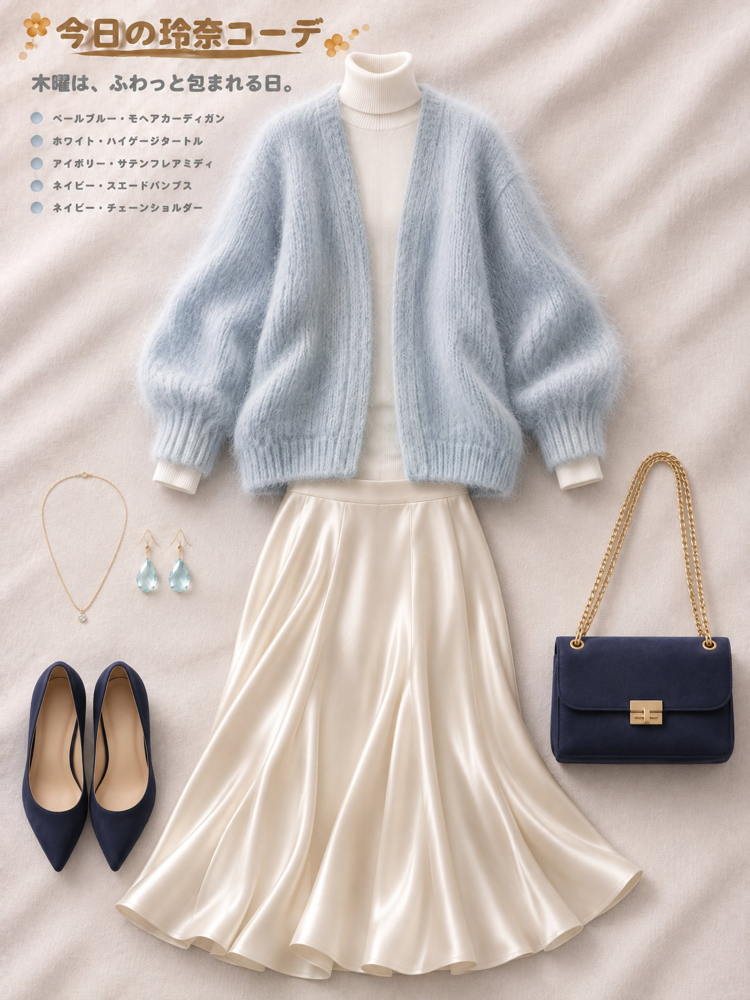
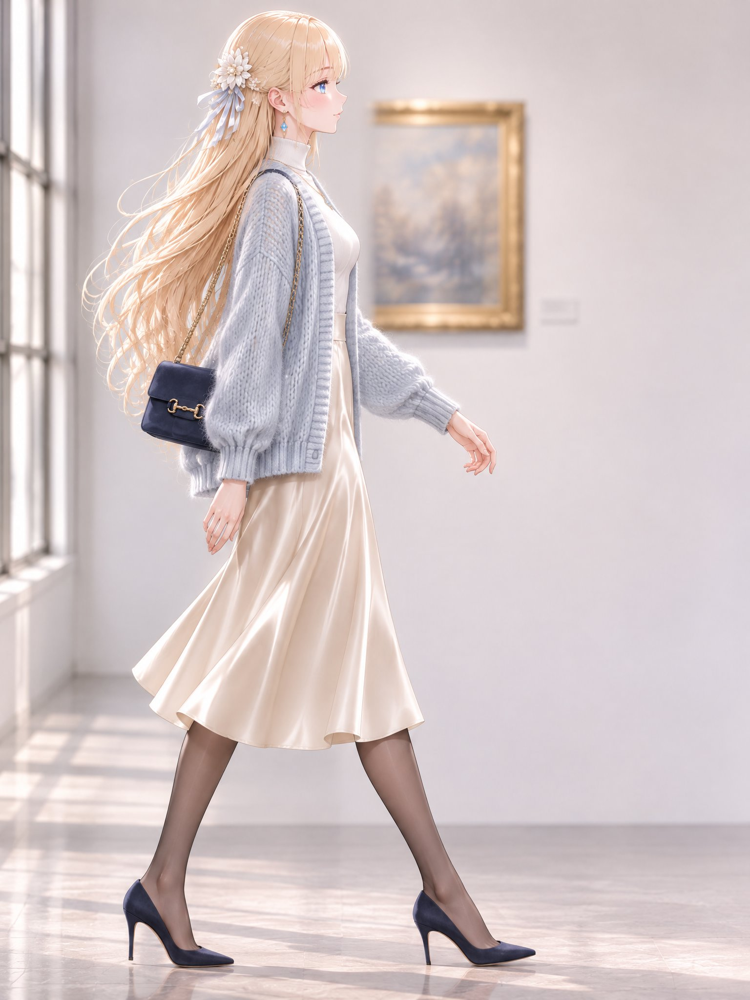

# 玲奈今日穿搭 11/19：淡蓝马海毛开衫 × 白高领 × 象牙缎面伞裙的「毛与缎」质感对比（汎用衣装 prompt + 写法技巧）

- 原帖链接：https://x.com/luche_whitewing/status/2123189515456016415
- 作者：翼 AIcreator（@luche_whitewing）
- 时间：2026-11-19 07:00 (UTC+8 / Asia/Taipei)
- 互动摘要：点赞 44 · 转发 7 · 回复 3 · 引用 1 · 书签 4 · 浏览 1772（采集快照：2026-11-20 09:10 UTC+8）
- 模型/工具：未注明（通用衣装 prompt，可加自家角色设定）
- 标签：二次元
- 媒体路径：
  - `media/images/2123189515456016415_1.jpg`（）
  - `media/images/2123189515456016415_2.jpg`（）
  - `media/images/2123189515456016415_3.jpg`（）
- 入库日期：2026-11-20
- prompt 来源：https://x.com/luche_whitewing/status/2123189516928274577（作者自回复）
- 备注：prompt 在作者自回复（2123189516928274577），整条原样摘录，含作者附带的「リプ2（コツ）」写法技巧说明（rim light 让马海毛毛感更清晰）。第 3 张图（背面）来自该自回复。插画为赛璐璐上色风格，日常通勤穿搭，非性化。

## prompt 原文

```text
（汎用衣装プロンプト）

outer: pale blue mohair-style loose-gauge cardigan, open front, no buttons, waist-covering length, ribbed cuffs, long fuzzy halo tops: white high-gauge turtleneck knit, slim fit bottoms: ivory satin flare midi skirt, high waist, bias cut, knee-below length, fluid drape tights: black 20D sheer tights shoes: navy suede pointed pumps bag: navy suede chain shoulder bag, gold chain accessories: thin gold necklace, small blue drop earrings color palette: pale blue / ivory / navy, 3 colors max fabric rendering: the contrast is the point — mohair's long fuzzy pile catching rim light vs satin's single vertical highlight running down the bias drape lighting: soft side daylight; backlit rim on the mohair in the rear-view shot finish: clean black linework, flat cel-shading with soft gradients, glossy skin, delicate fingers, no noise, no grain  ◻ 人物を入れる場合：先頭に自分のキャラ指定を1行 ◻ 平置きだけ：末尾に flat lay, top-down view, ivory-grey linen background
リプ2（コツ）：モヘアは long fuzzy pile だけで描くと曖昧になります。catching rim light（輪郭光を受ける）を必ずセットで書くと、毛足が一気に読めます。3枚目の背面カットがまさにこれで、このコーデで一番売れる絵になるはずです。
```

---

个人学习归档，非商业。prompt 与媒体版权归原作者 @luche_whitewing，引用请回到原帖。
