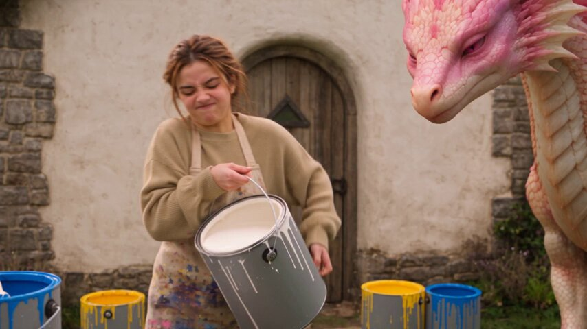

# 龙帮忙刷白墙却刷出彩虹屋：Daisy 与笨拙巨龙的 30 秒奇幻喜剧（逐 3 秒分镜 + 对白）

- 原帖链接：https://x.com/Alina_with_Ai/status/2123234896516981152
- 作者：Alina Ai（@Alina_with_Ai）
- 时间：2026-11-19 10:00 (UTC+8 / Asia/Taipei)
- 互动摘要：点赞 134 · 转发 10 · 回复 43 · 引用 0 · 书签 20 · 浏览 5152（采集快照：2026-11-20 09:10 UTC+8）
- 模型/工具：Seedance 2.5（作者标注）
- 标签：真人
- 媒体路径：
  - `media/video-stills/2123234896516981152_still.jpg`（视频封面截图，）
  - 视频本体未入库，仅保留原帖链接：https://x.com/Alina_with_Ai/status/2123234896516981152
- 入库日期：2026-11-20
- prompt 来源：https://x.com/Alina_with_Ai/status/2123234900736425987（作者自回复）
- 备注：prompt 在作者自回复（2123234900736425987），从「Photorealistic Hollywood」起原样摘录（略去开头的「Video prompt ⤵️」与几行省略点）。prompt 中写明需配合 Daisy 与巨龙的参考图（Match Daisy and giant dragon references）。家庭向喜剧，非性化、无暴力。视频本体未入库，仅保留原帖链接。

## prompt 原文

```text
Photorealistic Hollywood fantasy comedy, 16:9, 4K, shot on 35mm anamorphic lens, soft golden-hour sunlight, shallow depth of field, ultra-sharp detail, smooth cinematic camera, warm colorful look, fast comedic hard cuts. Setting stays the same in every shot: a sunny village garden with a small stone cottage with a plain white wall, a wooden fence, flower beds, a wooden ladder, and several big buckets of paint (white, blue, yellow and pink). Match Daisy and giant dragon references. The dragon is the same size in every shot, about as tall as the cottage; show its full body, wings, legs and tail in wide shots. The dragon is eager, clumsy and sweet. Natural English dialogue for Daisy only, accurate lip-sync. The dragon NEVER speaks; it only makes giggles, huffs, gulps, whimpers and sneezes. Only Daisy and the dragon appear: no animals, no insects, no extra characters, and nothing stuck on the dragon's face.

0-3s: Hook: Daisy, wearing an old paint-splattered apron, tips a bucket of white paint and proudly hands the dragon a big paintbrush. "Rule number one: only white. Slowly, from top to bottom."

3-6s: The dragon takes the brush in its claw, dips it, and paints one tiny, perfect stroke on the wall, then looks at Daisy with huge proud eyes. She gives a thumbs-up. "Perfect! Keep going."

6-9s: The dragon, too excited, dips its whole foot into the pink bucket and stamps a giant pink footprint on the wall. Daisy stops, eyes wide. "That's not white, that's pink!" The dragon smiles proudly and stamps another one.

9-12s: The dragon turns to look at its footprints, and its tail swings behind it and knocks over the big blue bucket. A wave of blue paint sweeps across the grass and covers Daisy from head to toe. She stands frozen like a blue statue, only her white eyes blinking. "Please tell me... that's not blue."

12-15s: The dragon, panicking, spreads its wing wide and uses it as a giant paint roller, smoothing the wall in huge, wobbly yellow stripes in one sweep, then freezes, eyes wide, and looks at the stripes. Daisy, wiping her eyes with a blue hand: "Okay... that's actually pretty."

15-18s: The dragon, delighted, dips the tip of its tail in yellow paint and paints a giant sun on the wall, sticking its tongue out in concentration. Daisy climbs the ladder and paints a tiny white cloud next to it. "Okay, a sun and a cloud. Now we're talking."

18-21s: The dragon's nose twitches... it sneezes! A fine spray of rainbow paint covers the whole wall in colorful dots, and Daisy, standing on the ladder, is dotted with pink, yellow and blue from head to toe. She stays frozen, then bursts into laughter. "You're hopeless!"

21-24s: The dragon lowers its head, whimpering softly, and Daisy sighs, smiles and strokes its nose, leaving a blue handprint on its snout. "It's okay. We'll make it a rainbow house." The dragon purrs happily.

24-27s: Wide shot: Daisy and the dragon finish together, her tiny brush and its big brush, painting a huge rainbow arc over the door. The cottage now looks like a colorful cake. They step back side by side to admire it.

27-30s: Golden sunset: Daisy, covered in colorful dots, hands on hips, looks at the rainbow cottage, then turns to the camera, deadpan. "I asked for white." The dragon gives a huge proud grin and a thumbs-up with its claw. Freeze on both of them. Hold this shot until the end.

Realistic paint, splash and fabric physics, expressive acting, cinematic scale. No slow motion, modern objects, subtitles or watermark.
```

---

个人学习归档，非商业。prompt 与媒体版权归原作者 @Alina_with_Ai，引用请回到原帖。
