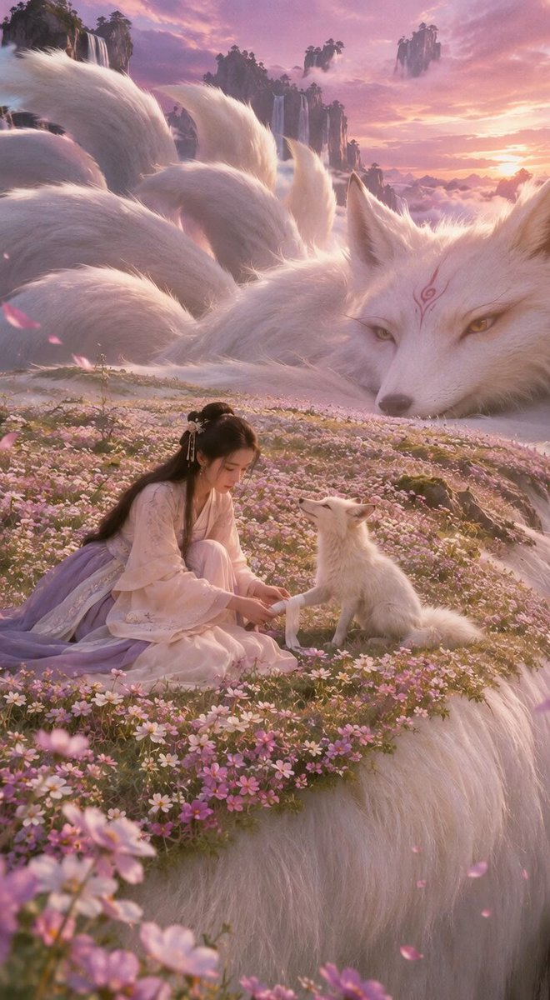

# 花海之上的九尾狐守护：仙界云海里巨狐背上长出花园、古装女子替小白狐包扎（繁中写实仙侠 prompt）

- 原帖链接：https://x.com/Ling_1055Tw/status/2123329771895701651
- 作者：LingTian594888（@Ling_1055Tw）
- 时间：2026-11-19 16:17 (UTC+8 / Asia/Taipei)
- 互动摘要：点赞 47 · 转发 13 · 回复 8 · 引用 0 · 书签 1 · 浏览 1990（采集快照：2026-11-20 19:45 UTC+8）
- 模型/工具：未注明
- 标签：真人
- 媒体路径：
  - `media/video-stills/2123329771895701651_still.jpg`（视频封面截图，）
  - 视频本体未入库，仅保留原帖链接：https://x.com/Ling_1055Tw/status/2123329771895701651
- 入库日期：2026-11-20
- 备注：prompt 在原帖正文，从「4K ，9:16」起原样摘录（略去标题与话题标签）。作者称这是「情境圖片提示詞」（先出图，再做成视频）。prompt 写明女子约 22 岁，仙裙装束，非性化。视频本体未入库，仅保留原帖链接。

## prompt 原文

```text
4K ，9:16 ，真人寫實古裝仙俠奇幻電影劇照，古裝奇幻電影美學。ARRI ALEXA 35 Xtreme，ARRI Signature Prime 35mm 電影鏡頭，平視廣角中遠景，細膩的 35mm 彩色膠片顆粒，柔和夢幻的夕陽光影。

黃昏時分的仙界，粉紫色晚霞與金色夕陽灑落雲海。遠方懸浮著高聳的仙山，山頂生長著蒼松，數道白色瀑布從山崖流入雲霧。空中飄著幾片粉色花瓣，整體氛圍溫柔、寧靜而神秘。

一隻巨大無比的白色九尾狐靈獸安靜地趴臥在雲海之中，身軀如同一座小山，覆蓋著柔軟蓬鬆、細節清晰的白色長毛。九條巨大的尾巴在畫面左側與後方層層舒展，輪廓自然分明。牠的巨大狐首位於畫面右上方，雙耳豎立，額心有精緻的紅色靈紋，金琥珀色的眼睛溫柔注視著前方。

九尾狐寬闊的背上覆蓋著一片繁盛的花海，粉紅、淡紫與白色小花隨著草地自然生長。花海邊緣可以清楚看見下方的白色狐毛，讓人發現整片花海竟然長在巨狐背上。

畫面下方，一位年約 22 歲的東亞古裝女子坐在花海中，身形纖細修長，膚色白皙自然，五官秀麗。她一頭烏黑長髮半束，髮間點綴精緻銀色髮飾與垂墜流蘇；身穿輕柔飄逸的象牙白與淡紫色仙裙，裙襬自然鋪展在花叢間。

女子溫柔地低頭，雙手小心地用白色布條替一隻小白狐包紮前爪。小白狐乖巧地坐在她面前，微微抬頭望著她，神情安心。巨狐、小白狐與女子形成溫暖的視覺互動，巨狐的龐大身軀與一人一狐形成震撼的比例對比。

夕陽逆光輕照白色狐毛與女子髮絲，花瓣在空中飄落，自然的景深與前、中、後景層次，真實毛髮與布料質感，電影級奇幻場景。

負面提示詞：動漫風、卡通臉、塑膠皮膚、過度磨皮、多餘肢體、手指錯誤、狐狸多頭、多餘狐尾、動物肢體變形、人物比例錯誤、過度發光、模糊、文字、字幕、Logo、浮水印。
```

---

个人学习归档，非商业。prompt 与媒体版权归原作者 @Ling_1055Tw，引用请回到原帖。
