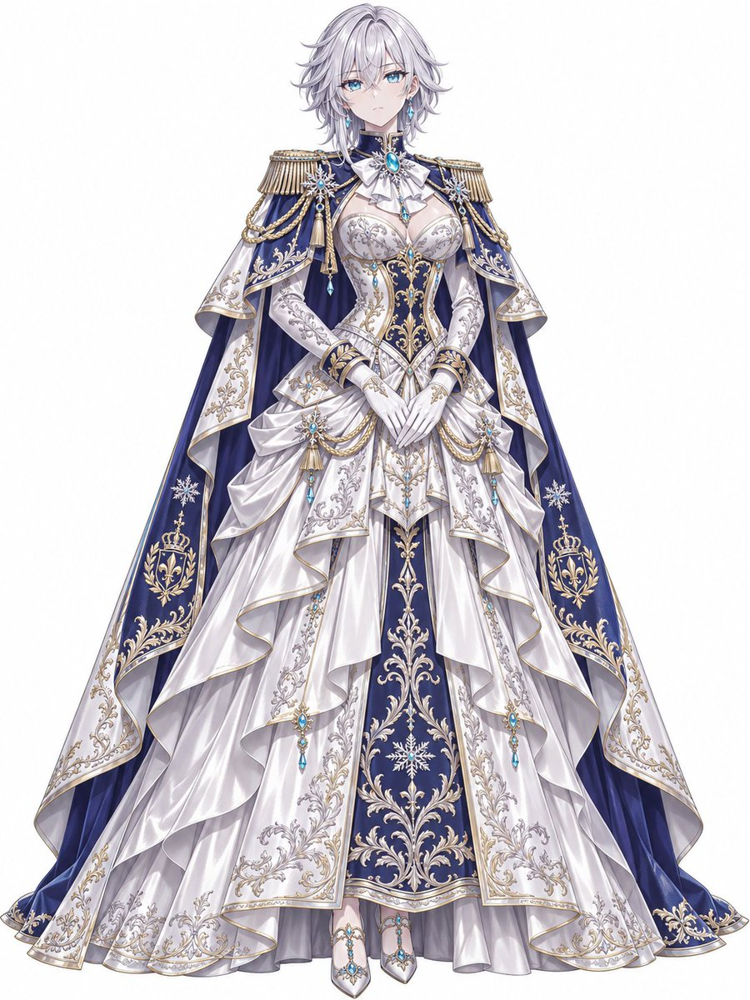
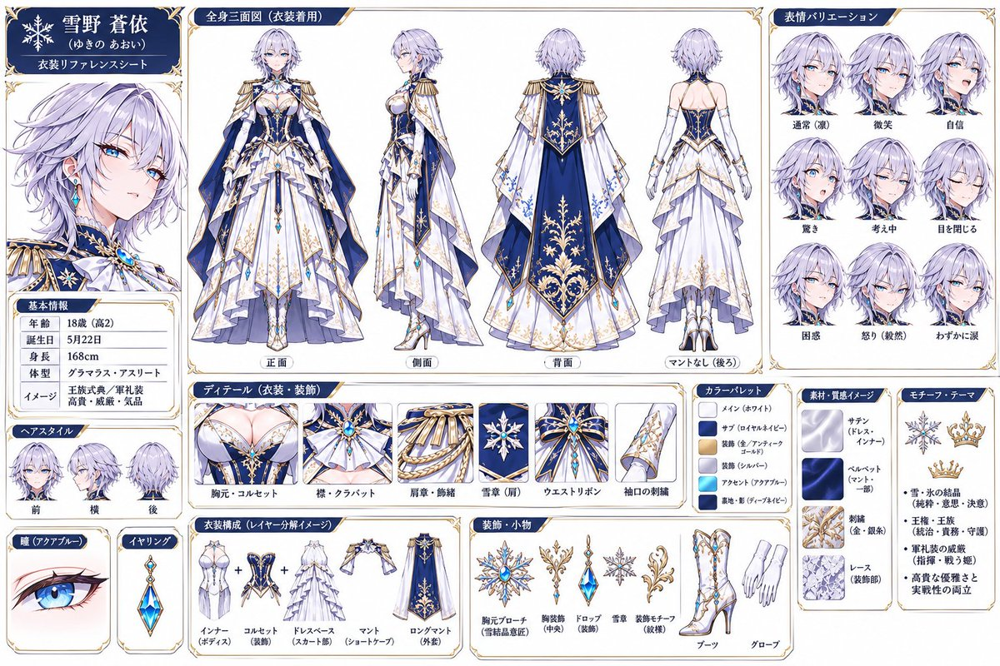
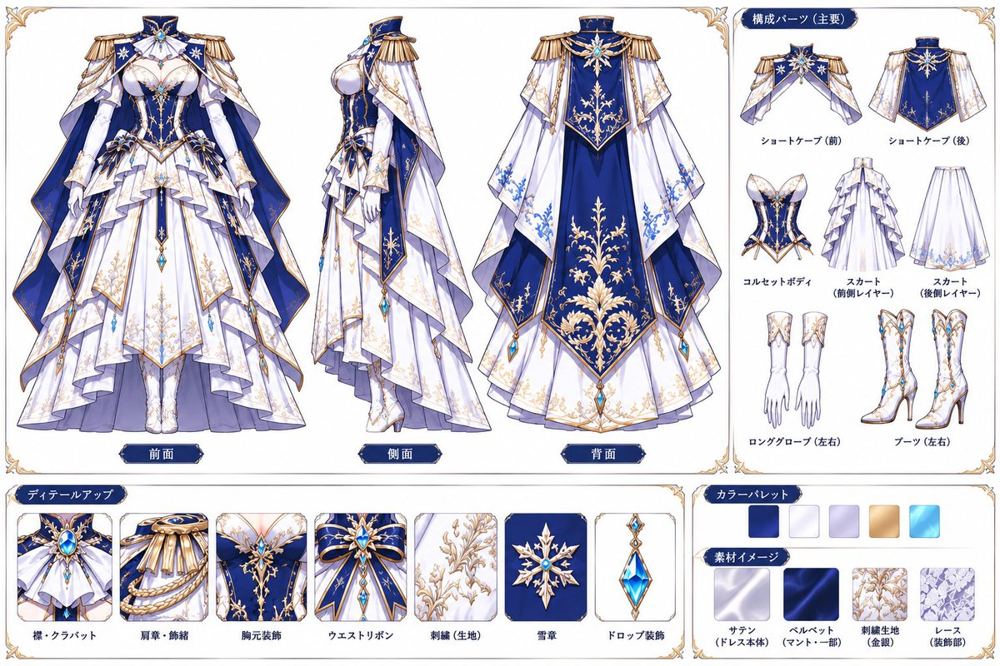
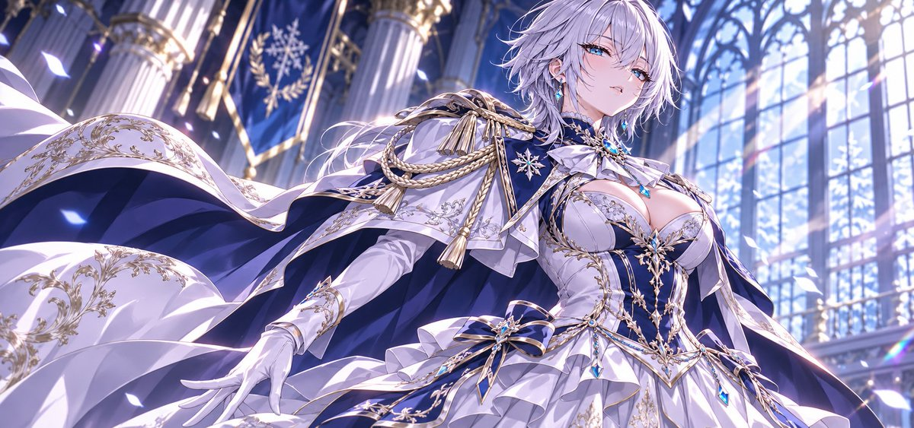

# 珍珠白 × 皇家藏青 × 古金的王族礼仪军装长裙：雪花宝石胸针与披肩肩章（#kk衣装プロンプト「王族」）

- 原帖链接：https://x.com/uRMS7Vm26qqEE5J/status/2123341132486918204
- 作者：k k（@uRMS7Vm26qqEE5J）
- 时间：2026-11-19 17:02 (UTC+8 / Asia/Taipei)
- 互动摘要：点赞 112 · 转发 15 · 回复 1 · 引用 5 · 书签 37 · 浏览 2818（采集快照：2026-11-20 19:45 UTC+8）
- 模型/工具：未注明（衣装 prompt，配合自家角色使用）
- 标签：二次元
- 媒体路径：
  - `media/images/2123341132486918204_1.jpg`（）
  - `media/images/2123341132486918204_2.jpg`（）
  - `media/images/2123341132486918204_3.jpg`（）
  - `media/images/2123341132486918204_4.jpg`（）
- 入库日期：2026-11-20
- 备注：prompt 在原帖正文末尾，从「original luxurious」起原样摘录（略去开头说明与话题标签）。作者说明第 3 张是纯衣装图，也可直接拿去用。原帖共 5 张图，仅收前 4 张（立绘与设定表）；第 5 张为胸口特写，按保守原则未入库。

## prompt 原文

```text
original luxurious royal ceremonial military gown, aristocratic princess uniform, elegant imperial fantasy couture, pearl white, royal navy blue, antique gold, metallic silver and aqua blue gemstone color scheme,

fitted pearl-white satin corset bodice with sculpted bust panels, sweetheart neckline, ornate silver floral embroidery, deep navy central panel, intricate antique-gold filigree ornaments extending from the bust to the narrow waist, elegant structured hourglass silhouette,

high navy military collar with delicate gold trimming, large layered white silk cravat bow at the neckline, elaborate silver snowflake-shaped brooch featuring a large oval aqua-blue gemstone, dangling blue crystal pendants,

short royal navy shoulder cape with pearl-white outer panels, ornate gold embroidered borders, structured military epaulettes, braided gold aiguillettes and decorative cords draped across the shoulders, silver snowflake insignia, flowing navy-and-white royal mantle,

long fitted pearl-white sleeves with intricate silver floral embroidery, gold-trimmed cuffs, elegant white opera gloves with delicate gold ornaments,

layered voluminous pearl-white ceremonial skirt with structured navy-blue fabric inserts, embroidered silver-gold patterns, elegant flowing satin drapery,

matching aqua-blue crystal drop earrings, refined silver jewelry, snowflake and royal heraldic motifs,

luxurious satin, silk, velvet and metallic embroidery textures, sophisticated aristocratic silhouette, regal elegance, dignified royal ceremonial fashion,

clean Japanese anime lineart, crisp cel shading, refined details, polished anime illustration,

fixed costume design, preserve exact silhouette, colors, layered construction, embroidery, shoulder cape, military cords, cravat, gemstone brooch and royal ornaments,

pure white background, full-body character illustration, no text, no watermark.
```

---

个人学习归档，非商业。prompt 与媒体版权归原作者 @uRMS7Vm26qqEE5J，引用请回到原帖。
