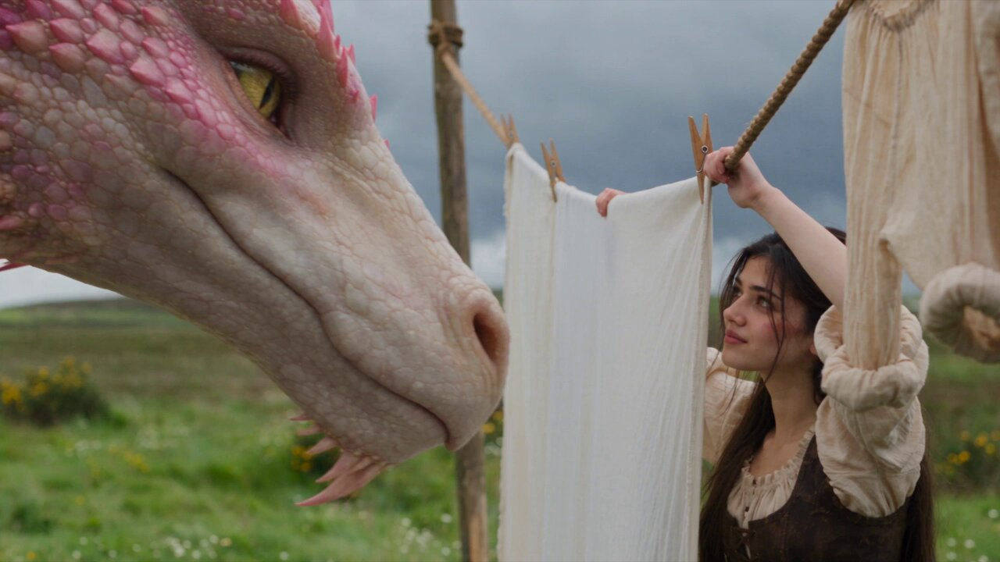

# 苏格兰荒原晾衣日：冰蓝巨龙帮金发女子晒床单的 30 秒奇幻短片（分镜 + 音效设计）

- 原帖链接：https://x.com/mehwishkiran07/status/2123372289832173959
- 作者：Mehwish kiran（@mehwishkiran07）
- 时间：2026-11-19 19:06 (UTC+8 / Asia/Taipei)
- 互动摘要：点赞 87 · 转发 20 · 回复 37 · 引用 0 · 书签 2 · 浏览 1097（采集快照：2026-11-20 09:10 UTC+8）
- 模型/工具：Seedance 2.5（作者标注）
- 标签：真人
- 媒体路径：
  - `media/video-stills/2123372289832173959_still.jpg`（视频封面截图，）
  - 视频本体未入库，仅保留原帖链接：https://x.com/mehwishkiran07/status/2123372289832173959
- 入库日期：2026-11-20
- prompt 来源：https://x.com/mehwishkiran07/status/2123372297868460389（作者自回复）
- 备注：prompt 在作者自回复（2123372297868460389），从「Cinematic, photorealistic」起原样摘录（略去开头的「Video Prompt ⤵️」）。女主为成年女性（young woman，长裙 + 皮质束腰上衣），全片温馨向、非性化。视频本体未入库，仅保留原帖链接。

## prompt 原文

```text
Cinematic, photorealistic fantasy video, 16:9, 30 seconds. Setting: a green Scottish-style moorland under dark stormy grey clouds with rain falling far in the distance, a small stream, wildflowers, a thatched stone cottage with a chimney, and a rope clothesline between wooden poles. Natural overcast light, realistic motion, shallow depth of field.

Characters: a huge blue-and-white dragon with pale scales, icy-blue crystal spikes along its head and back, grey curved horns, turquoise eyes and large blue wings; and a young woman with long pale-blonde braided hair, a cream puff-sleeved blouse, a brown leather corset bodice and a long brown skirt.

Shot 1 (0–4s): Close-up. The dragon leans its head in from the left. The woman holds up a large white sheet on the clothesline, looking up at the dragon and smiling. A cream blouse hangs on the line beside her.

Shot 2 (4–6s): Low wide shot. The dragon rears up on its hind legs, head lifted to the sky, wings spread. The cottage is on the left and the woman stands by the clothesline.

Shot 3 (6–9s): Wide shot. The dragon opens its mouth wide in a loud roar. A strong gust sends the white sheets flying off the line into the air while the woman crouches beside the tub. Sheets and clothespins tumble across the sky.

Shot 4 (9–13s): Close-up. A cream sheet lands over the dragon's head and spikes, covering its face. Wide shot: the dragon gallops across the meadow with wings flapping in motion blur, the sheet stuck on its snout, then stops and crouches while the woman watches from behind.

Shot 5 (13–17s): Close-up. A large white sheet flaps in front of the camera as the woman laughs with her hand raised. The dragon lowers its head beside the black tub, eyes closed, then opens its turquoise eyes. The woman, laughing, holds the sheet by its corners.

Shot 6 (17–19s): The woman shakes out the sheet and hangs it back on the clothesline, speaking to the dragon.

Shot 7 (19–24s): Extreme close-up. The dragon's face is behind the hanging sheet, held by wooden clothespins, its turquoise eyes with vertical pupils looking over the top edge. The sheet begins to glow with warm golden-orange light, as if the dragon is warming it from behind. The woman enters at the right edge, delighted and surprised, and places her hand on the warm glowing sheet. The dragon closes its eyes contentedly.

Shot 8 (24–28s): Medium shot. The dragon's head rests beside the black tub and the wicker basket. The woman smiles, folds the dry sheets, rolls the cloth and puts it into the basket.

Shot 9 (28–29s): The dragon closes its eyes and the woman hugs its snout, then gently strokes it with her hand.

Shot 10 (29–30s): Final wide shot across the stream. The dragon sits beside the thatched cottage, the tiny woman stands nearby, under the dark overcast sky with smoke rising from the chimney.

Audio: continuous soft wind, distant rolling thunder and gentle stream sounds throughout, with soft warm fantasy background music. Cloth flapping and rope creaking in the clothesline shots. A deep dragon roar and a heavy wing-flap whoosh in the gust shot, with thumping footsteps as it gallops. The woman's cheerful laughter, small gasps and soft speech. A low warm magical hum with gentle sparkle chimes while the sheet glows. Soft dragon breathing and a tender, peaceful ending with the stream and wind fading out.
```

---

个人学习归档，非商业。prompt 与媒体版权归原作者 @mehwishkiran07，引用请回到原帖。
