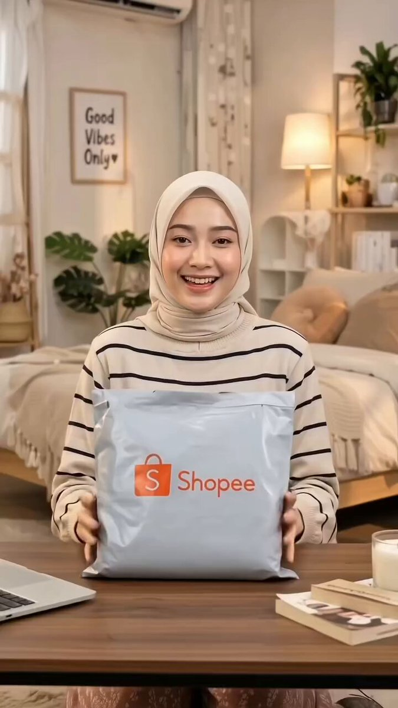
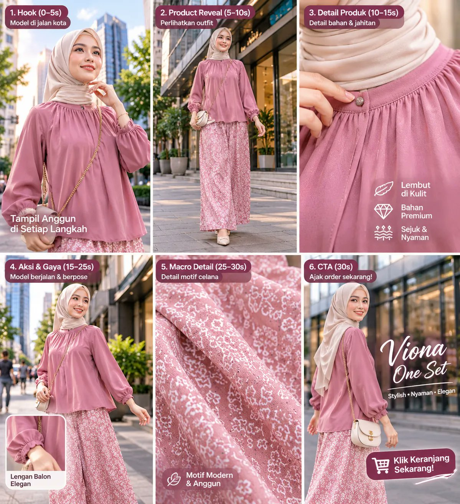

# 头巾女孩的 Shopee 开箱穿搭广告：豆沙粉衬衫 + 碎花阔腿裤的 40 秒保守风时装短片

- 原帖链接：https://x.com/DuaFatimaAi/status/2123375440677183611
- 作者：Dua Fatima（@DuaFatimaAi）
- 时间：2026-11-19 19:18 (UTC+8 / Asia/Taipei)
- 互动摘要：点赞 118 · 转发 16 · 回复 16 · 引用 0 · 书签 110 · 浏览 6597（采集快照：2026-11-20 19:45 UTC+8）
- 模型/工具：未注明具体模型（作者写可用 Gemini、Grok 或 GPT Image 2.0 出图再生成视频）
- 标签：真人
- 媒体路径：
  - `media/video-stills/2123375440677183611_still.jpg`（视频封面截图，）
  - `media/images/2123375440677183611_1.jpg`（）
  - 视频本体未入库，仅保留原帖链接：https://x.com/DuaFatimaAi/status/2123375440677183611
- 入库日期：2026-11-20
- prompt 来源：https://x.com/DuaFatimaAi/status/2123375445085192466（作者自回复）
- 备注：prompt 在作者自回复（2123375445085192466），从「Create a 40-second」起原样摘录（略去「Prompt」标签）。原帖为视频 + 一张拼图；作者流程要求上传自己的图片作参考。视频本体未入库，仅保留原帖链接。

## prompt 原文

```text
Create a 40-second realistic cinematic fashion promotional video featuring a beautiful young Muslim woman wearing a beige hijab and elegant modest clothing.

Scene 1: She sits behind a table in a cozy, beautifully decorated living room, smiling and presenting a Shopee shopping package to the camera.

Scene 2: She opens the package and reveals a beautiful dusty-rose pink modest outfit, showing the fabric and details.

Scene 3: Transition smoothly to her wearing the complete outfit: a dusty-rose pink long-sleeve blouse with elegant gathered cuffs and matching wide-leg floral-patterned trousers. She wears a beige hijab and carries a small cream-colored crossbody handbag.

Scene 4: Show her full outfit from different angles. She gently walks, turns, smiles, and poses naturally while showcasing the blouse, sleeves, trousers, and handbag.

Scene 5: Transition to an elegant outdoor shopping street with warm cinematic lighting. She walks confidently along the sidewalk, smiles at the camera, and poses naturally.

Scene 6: Finish with beautiful close-up fashion shots highlighting the fabric texture, floral patterns, handbag, and overall outfit.

Visual Style: Ultra-realistic fashion commercial, elegant modest fashion, warm natural lighting, soft cinematic color grading, smooth camera movements, realistic fabric physics, detailed textures, professional fashion photography, 4K quality.

Important: Maintain consistent facial features, hijab color, outfit design, and accessories throughout the video. Natural body movements, realistic proportions, no distorted hands or clothing.
```

---

个人学习归档，非商业。prompt 与媒体版权归原作者 @DuaFatimaAi，引用请回到原帖。
