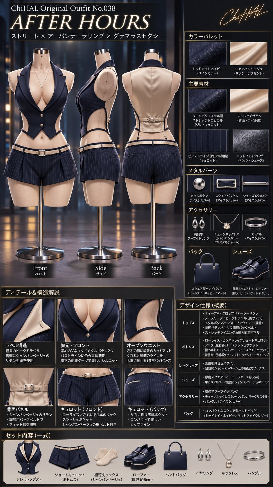
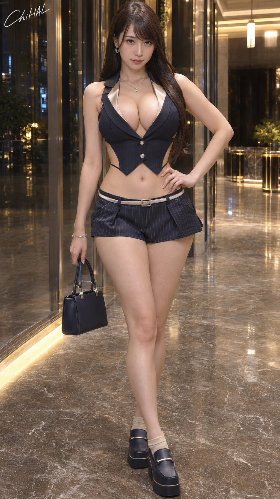
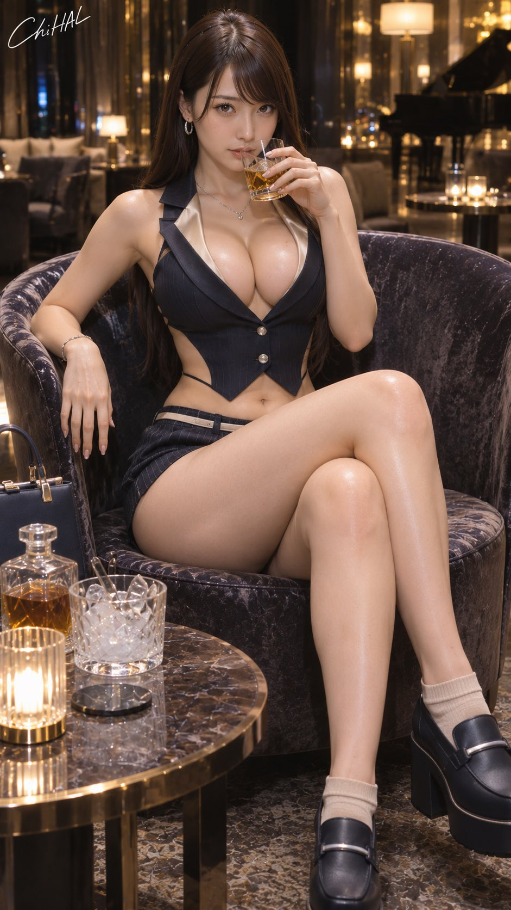

# ChiHAL Original Outfit No.038『AFTER HOURS』：午夜藏青深 V 西装马甲 × 细条纹短裤的夜店风都市套装（日文衣装 prompt）

- 原帖链接：https://x.com/chihal_ai0509/status/2123381494806667271
- 作者：ChiHAL/AI服飾デザイナー（@chihal_ai0509）
- 时间：2026-11-19 19:42 (UTC+8 / Asia/Taipei)
- 互动摘要：点赞 164 · 转发 9 · 回复 3 · 引用 2 · 书签 64 · 浏览 6287（采集快照：2026-11-20 09:10 UTC+8）
- 模型/工具：未注明（衣装 prompt，配合自己的 AI 模特/参考图使用）
- 标签：真人
- 媒体路径：
  - `media/images/2123381494806667271_1.jpg`（）
  - `media/images/2123381494806667271_2.jpg`（）
  - `media/images/2123381494806667271_3.jpg`（）
- 入库日期：2026-11-20
- prompt 来源：https://x.com/chihal_ai0509/status/2123381581922644290（作者自回复）
- 备注：prompt 在作者自回复（2123381581922644290），从「トップス」起原样摘录（略去开头的「衣装プロンプト↓」）。尺度标注：成年女性性感时装（深 V 无袖马甲、露腰、短裤），作者自标「GLAMOROUS SEXY」，非露骨；示例图人物外貌明确为成年人。

## prompt 原文

```text
トップス

ミッドナイトネイビーのディープV・クロップドテーラードジレ。

上質なウールポリエステル混ストレッチトロピカル素材を使用。表面には細かな織り目と上品なマット感を持たせる。

肩幅はややコンパクト。袖のないノースリーブ仕様で、肩と腕をすっきりと見せる。

襟は細身のピークドラペル。ラペルの裏側にはシャンパンベージュのサテン生地を使用し、動きに合わせて控えめな光沢が見える構造。

胸元はデコルテを大胆に美しく見せる深めのVネック。

フロントにはアイスシルバーの小さなメタルボタンを二つ縦に配置。

バストラインに自然に沿う立体裁断。胸下には緩やかな曲線的ダーツを施し、ウエストに向かって引き締まるシルエットを形成する。

裾はおへそより上で終わるクロップド丈。

フロント裾は左右それぞれが緩やかなV字を描く、テーラードジレらしいシャープなカッティング。

左右の脇には縦長のオープンウエスト・カットアウトを設け、くびれと腹部のラインを大胆に見せる。

カットアウトの縁にはミッドナイトネイビーの細い共布パイピングを施す。

背面にはシャンパンベージュのストレッチサテンパネルを配置し、中央に小さな調節用バックベルトを備える。

内側には同色のストレッチライニングと胸元の固定パネルを備え、安定した着用感を確保する。

ボトムス

ミッドナイトネイビーのローライズ・ピンストライプショートキュロット。

上質なウールポリエステル混ストレッチトロピカル素材を使用。表面にはアイスシルバーの極細ピンストライプを約1cm間隔で配置。

ウエスト位置は腰骨付近のローライズ。

腰回りからヒップにかけて自然にフィットし、裾に向かってわずかに広がるコンパクトなキュロットシルエット。

丈は太ももの上部までの大胆なショート丈。

フロントには左右対称の小さなタックを一本ずつ配置し、テーラードパンツの端正な印象を演出する。

ウエストにはシャンパンベージュの細い共布ベルトを配置。中央にはアイスシルバーの小さなスクエアバックルを施す。

左右の腰には斜めのスラッシュポケットを配置。

裾は緩やかな直線カッティングで、細いダブルステッチ仕上げ。

背面には小さな飾り玉縁ポケットを左右に配置。

内側にはミッドナイトネイビーのストレッチショートライニングを備え、自然な着用感と動きやすさを確保する。

レッグウェア

脚全体は素肌を見せるスタイル。

タイツやニーハイソックスは使用しない。

足首にはシャンパンベージュの極短丈ソックスを合わせる。

シューズ

ミッドナイトネイビーの厚底スクエアトゥ・ローファー。

上質なマットフェイクレザー素材を使用。

つま先はシャープすぎないスクエアトゥ。

甲部分にはアイスシルバーの細いメタルバーを一本配置。

ソールは安定感のある約6cmの厚底ラバー仕様。

側面にはシャンパンベージュの細いラインを一本施す。

アクセサリー

アイスシルバーの小ぶりな幾何学フープイヤリング。

首元には細いシルバーチェーンネックレスを一本。中央には小さなシャンパンカラーのクリスタルチャームを配置。

バッグはミッドナイトネイビーのコンパクトなスクエア型ハンドバッグ。

上質なマットフェイクレザー素材を使用。ハンドル部分にはアイスシルバーの小さなメタルパーツを配置。

手首にはアイスシルバーの細いバングルを一つ。

素材・ディテール

ウールポリエステル混ストレッチトロピカルの細かな織り目、サテンの上品な光沢、ピンストライプの精密な配置、フェイクレザーのマットな表面、メタルボタンとバックルの自然な反射を精密に表現する。

テーラードジレのラペル構造、バストラインに沿う立体裁断、オープンウエストの補強、ショートキュロットのタックとポケットの縫製など、実際に製作・着用可能な衣装構造を優先する。

デコルテ、ウエスト、脚のラインを大胆に見せながら、メンズライクなテーラリングの端正さとグラマラスなストリートファッションを融合させる。

ミッドナイトネイビーの落ち着いた色彩とシャープなカッティングを主役にした、女性向けセクシーストリートファッションとして仕上げる。

既存ブランドのロゴ、文字、エンブレムは使用しない。
```

---

个人学习归档，非商业。prompt 与媒体版权归原作者 @chihal_ai0509，引用请回到原帖。
