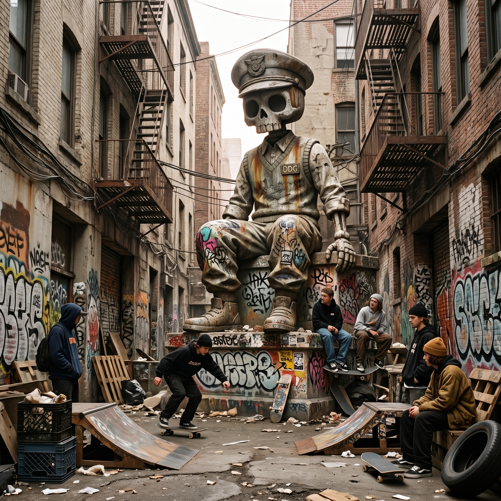

# 被城市遗忘的涂鸦雕像：后巷里贴满贴纸与喷漆的巨大彩色雕像与滑板少年们（#Prompt Share）

- 原帖链接：https://x.com/edizkan_/status/2123484565465678040
- 作者：Edizkan ⭕🦇（@edizkan_）
- 时间：2026-11-20 02:32 (UTC+8 / Asia/Taipei)
- 互动摘要：点赞 24 · 转发 4 · 回复 7 · 引用 8 · 书签 3 · 浏览 1549（采集快照：2026-11-20 19:45 UTC+8）
- 模型/工具：未注明
- 标签：其它
- 媒体路径：
  - `media/images/2123484565465678040_1.jpg`（）
- 入库日期：2026-11-20
- 备注：prompt 在原帖正文，从「A weathered」起原样摘录（含 Style 与 Negative Prompt 行；略去开头介绍与 @ 提及）。

## prompt 原文

```text
A weathered coloured statue is partially hidden behind buildings in a back alley. Urban explorers and skaters hang around the base. The character is covered in layers of colorful graffiti, stickers, and street tags — it feels like a sacred relic in a forgotten zone.
Style: Urban decay, warm overcast tones, lo-fi camera vibe
Negative Prompt: No polished surfaces, no neon, no digital overlays ar 1:1
```

---

个人学习归档，非商业。prompt 与媒体版权归原作者 @edizkan_，引用请回到原帖。
