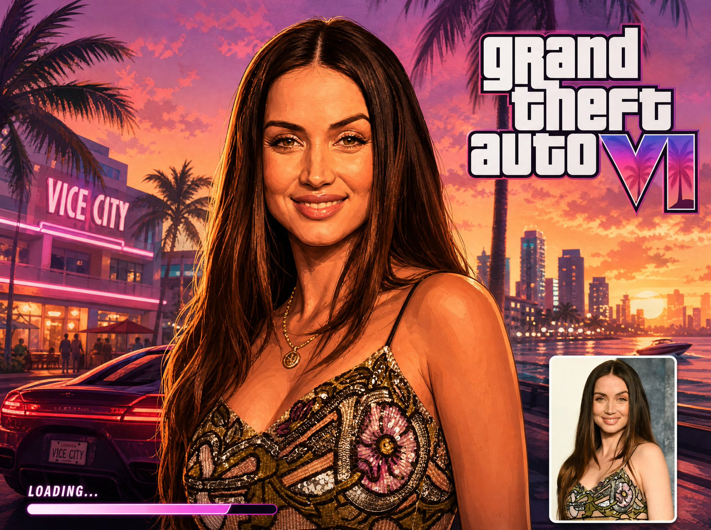
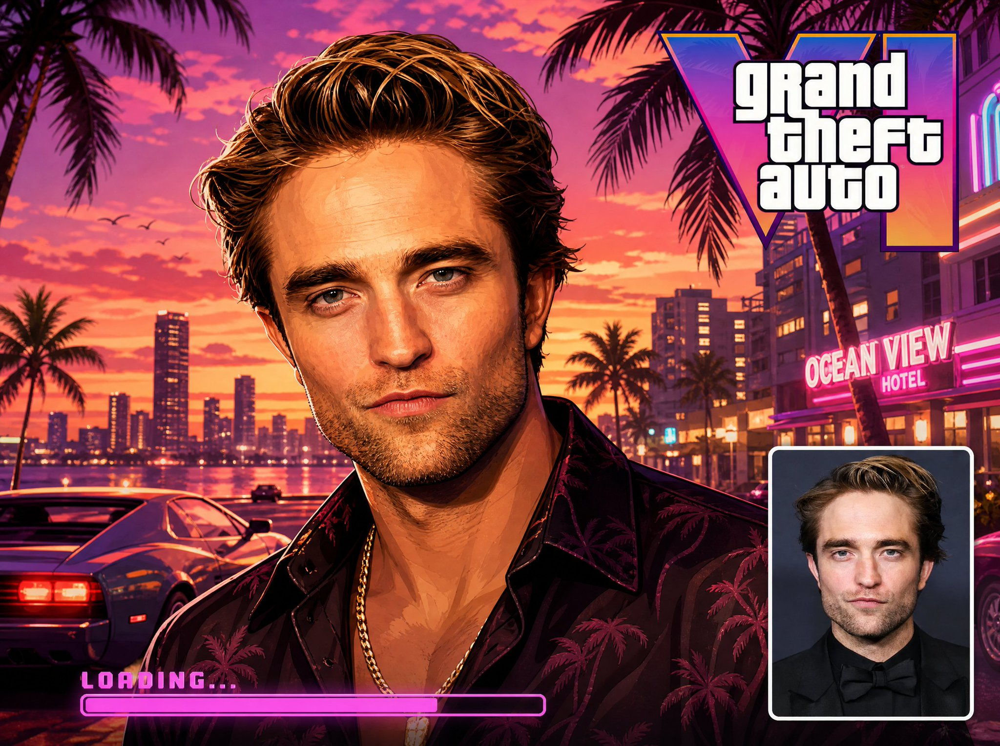

# GTA VI「Vice City 角色揭晓」海报：照片一键变 Rockstar 风角色立绘 + 加载条 + 原图小窗（JSON 结构化 prompt）

- 原帖链接：https://x.com/Just_sharon7/status/2123499286222741652
- 作者：Sharon Riley（@Just_sharon7）
- 时间：2026-11-20 03:30 (UTC+8 / Asia/Taipei)
- 互动摘要：点赞 326 · 转发 9 · 回复 54 · 引用 0 · 书签 7 · 浏览 7357（采集快照：2026-11-20 19:45 UTC+8）
- 模型/工具：GPT Image 2.6（作者标注，经 TapNow）
- 标签：真人
- 媒体路径：
  - `media/images/2123499286222741652_1.jpg`（）
  - `media/images/2123499286222741652_2.jpg`（）
- 入库日期：2026-11-20
- 备注：prompt 在原帖正文，从「"task"」起原样摘录（略去开头标题、工具标注、人名与「prompt」标签；原帖 JSON 开头即缺少左花括号，照原样保留）。需上传一张人物照片作参考。作者示例用的是 Ana de Armas 与 Robert Pattinson 的照片（名人脸，按用户偏好不特别跳过）。

## prompt 原文

```text
"task": "Image-to-image character transformation",
  "reference_image": "Uploaded original photograph",
  "output_type": "Cinematic video game character poster",

  "creative_direction": {
    "concept": "Recreate the individual in the reference photograph as a compelling protagonist from the Grand Theft Auto VI universe, using the distinctive visual language of premium Rockstar Games promotional illustrations.",
    "visual_style": "High-end semi-realistic digital illustration, bold graphic contours, sophisticated cel shading, painterly textures, realistic anatomy, expressive facial rendering, and vivid cinematic color grading.",
    "artistic_quality": "AAA video game key art, professional promotional illustration, intricate environmental details, sharp character rendering, and polished poster composition.",
    "mood": "Confident, stylish, cinematic, adventurous, and infused with the vibrant energy of Vice City."
  },

  "character_design": {
    "identity_reference": "Use the person in the uploaded photograph as the exclusive character identity reference.",
    "identity_preservation": {
      "face_structure": "Preserve the original facial proportions, jawline, cheekbones, nose, lips, eyes, and distinctive facial characteristics.",
      "hair": "Maintain the original hairstyle, hair length, texture, and natural color.",
      "skin": "Retain the person's authentic skin tone and recognizable complexion.",
      "expression": "Preserve the reference expression while translating it naturally into an illustrated character.",
      "likeness_priority": "Maximum facial resemblance with no unnecessary changes to identity.",
      "restrictions": [
        "Do not replace the original face.",
        "Do not alter the person's ethnicity or defining features.",
        "Avoid exaggerated cartoon proportions.",
        "Do not introduce facial distortions.",
        "Maintain realistic human anatomy."
      ]
    },
    "wardrobe": {
      "direction": "Contemporary Vice City street fashion with stylish, character-appropriate details.",
      "flexibility": "Retain recognizable clothing elements where possible, while allowing tasteful adjustments to enhance the game's visual atmosphere.",
      "accessories": "Add subtle accessories only when they complement the subject's appearance."
    },
    "rendering": {
      "outlines": "Clean, confident graphic outlines with controlled line-weight variation.",
      "shading": "Layered cel shading combined with smooth cinematic gradients.",
      "textures": "Detailed illustrated skin, realistic fabric folds, reflective accessories, and painterly highlights.",
      "appearance": "A believable open-world game protagonist rather than a generic cartoon avatar."
    }
  },

  "environment": {
    "location": "Vice City-inspired tropical coastal metropolis",
    "setting": "A lively Miami-inspired cityscape featuring palm-lined streets, elegant Art Deco buildings, glowing storefronts, luxury vehicles, and distant waterfront scenery.",
    "sky": "Spectacular tropical sunset with luminous orange, coral pink, violet, and deep purple clouds.",
    "lighting": {
      "primary": "Warm golden-hour sunlight illuminating the character.",
      "secondary": "Soft magenta and violet neon reflections.",
      "rim_light": "Subtle cinematic edge lighting separating the character from the background.",
      "contrast": "Dramatic but balanced highlights and shadows."
    },
    "atmosphere": "Energetic coastal nightlife, tropical warmth, stylish urban luxury, and cinematic open-world adventure.",
    "depth": "Detailed foreground, layered midground architecture, and softly atmospheric distant skyline."
  },

  "composition": {
    "layout": "Premium cinematic character-reveal poster",
    "character_position": "Prominent central or slightly left-of-center placement.",
    "camera_angle": "Eye-level cinematic portrait with a confident hero composition.",
    "framing": "Medium portrait or three-quarter character framing based on the original photograph.",
    "visual_hierarchy": [
      "Recognizable illustrated character",
      "Grand Theft Auto VI branding",
      "Vibrant Vice City environment",
      "Original photograph inset",
      "Loading-screen interface"
    ],
    "balance": "Maintain clear visual separation between the main character, title graphics, loading bar, and photographic inset."
  },

  "branding": {
    "logo": {
      "text": "Grand Theft Auto VI",
      "placement": "Upper-right corner",
      "design": "Prominent stacked Grand Theft Auto lettering paired with a large stylized Roman numeral VI.",
      "appearance": "Authentic-looking video game promotional branding with bold typography and a vibrant pink-purple tropical gradient.",
      "visibility": "Sharp, legible, correctly spelled, and unobstructed."
    },
    "interface_style": "Elegant cinematic video game loading-screen graphics."
  },

  "loading_screen": {
    "enabled": true,
    "position": "Along the lower portion of the composition",
    "label": "LOADING...",
    "typography": "Minimal, modern, uppercase sans-serif lettering",
    "progress_bar": {
      "shape": "Long, slim horizontal rectangle",
      "fill": "Vibrant pink-to-purple gradient",
      "background": "Subtle translucent dark track",
      "glow": "Soft neon edge illumination"
    },
    "design_rule": "Keep the interface refined and secondary to the character artwork."
  },

  "original_photo_inset": {
    "enabled": true,
    "source": "Exact original uploaded photograph",
    "position": "Bottom-right corner",
    "size": "Small but clearly recognizable",
    "shape": "Rectangular frame with softly rounded corners",
    "border": {
      "color": "Pure white",
      "thickness": "Moderately thick",
      "finish": "Clean and polished"
    },
    "shadow": "Soft realistic drop shadow creating a slightly elevated appearance.",
    "image_integrity": {
      "preserve_original": true,
      "allow_stylization": false,
      "allow_recoloring": false,
      "allow_face_modification": false,
      "allow_recomposition": false,
      "instruction": "Display the original photograph exactly as supplied, preserving its photographic appearance, original colors, facial features, lighting, and composition."
    },
    "placement_rule": "Keep the photographic inset separate from the main character and avoid covering important facial or branding details."
  },

  "color_palette": {
    "primary": [
      "Tropical sunset pink",
      "Electric magenta",
      "Deep violet",
      "Sunset orange"
    ],
    "secondary": [
      "Warm golden yellow",
      "Turquoise blue",
      "Neon purple",
      "Midnight navy"
    ],
    "color_treatment": "Rich, saturated cinematic colors with harmonious gradients, luminous highlights, and controlled contrast."
  },

  "technical_specifications": {
    "resolution": "Ultra-high resolution",
    "detail_level": "Maximum",
    "sharpness": "Crisp character outlines and finely rendered textures",
    "lighting_quality": "Premium cinematic illumination",
    "rendering_quality": "Professional AAA game promotional artwork",
    "composition_quality": "Print-ready poster aesthetic",
    "final_finish": "Clean, vibrant, polished, and visually striking"
  },

  "negative_prompt": [
    "Unrecognizable facial identity",
    "Changed facial structure",
    "Different hairstyle",
    "Incorrect skin tone",
    "Generic cartoon appearance",
    "Childlike character proportions",
    "Poor anatomy",
    "Distorted facial features",
    "Asymmetrical eyes",
    "Extra fingers",
    "Malformed hands",
    "Low-resolution textures",
    "Blurry illustration",
    "Flat lighting",
    "Washed-out colors",
    "Messy composition",
    "Incorrect logo spelling",
    "Unreadable typography",
    "Distorted loading bar",
    "Altered original photo inset",
    "Stylized photographic inset",
    "Unwanted duplicate characters",
    "Watermarks",
    "Unnecessary text"
  ],

  "final_instruction": "Transform the uploaded subject into an exceptionally detailed GTA VI-inspired character illustration while maintaining unmistakable facial identity. Combine expressive illustrated rendering, cinematic Vice City scenery, dramatic tropical sunset lighting, prominent game branding, a refined loading interface, and a small untouched original-photo inset. Deliver a cohesive, visually spectacular character-reveal poster with premium video game promotional quality."
}
```

---

个人学习归档，非商业。prompt 与媒体版权归原作者 @Just_sharon7，引用请回到原帖。
