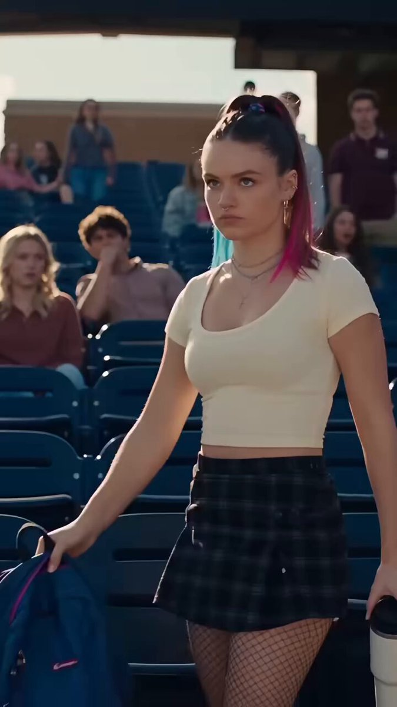

# 可乐从红纸杯倾倒在高马尾女生头顶：极近景慢动作液体物理特写（9:16）

- 原帖链接：https://x.com/SeeratFatima112/status/2123582650753720627
- 作者：Seerat Fatima（@SeeratFatima112）
- 时间：2026-11-20 09:02 (UTC+8 / Asia/Taipei)
- 互动摘要：点赞 35 · 转发 1 · 回复 11 · 引用 0 · 书签 7 · 浏览 3187（采集快照：2026-11-20 19:45 UTC+8）
- 模型/工具：Seedance 2.5（作者标注）
- 标签：真人
- 媒体路径：
  - `media/video-stills/2123582650753720627_still.jpg`（视频封面截图，）
  - 视频本体未入库，仅保留原帖链接：https://x.com/SeeratFatima112/status/2123582650753720627
- 入库日期：2026-11-20
- prompt 来源：https://x.com/SeeratFatima112/status/2123582657519026322（作者自回复）
- 备注：prompt 在作者自回复（2123582657519026322），从「Create an ultra」起原样摘录（略去「AI Video Generation Prompt:」标签）。prompt 写 young woman；视频封面为球场看台场景，日常着装，非性化。视频本体未入库，仅保留原帖链接。

## prompt 原文

```text
Create an ultra-realistic cinematic close-up video of a person pouring dark Coca-Cola from a red Coca-Cola paper cup directly onto the top of a young woman's head. A thick, glossy stream of dark brown fizzy cola flows continuously from the tilted cup onto her hair, creating realistic liquid splashes, reflections, and flowing droplets. The woman's dark brown hair is tied in a high ponytail with a red hair tie. Capture the liquid cascading naturally over her hair in beautiful slow motion.

Camera: Extreme close-up, focus on the cup, pouring liquid, and hair. Smooth cinematic camera movement with shallow depth of field.

Lighting: Warm golden sunlight, dramatic highlights, realistic reflections.

Quality: Photorealistic, 4K, highly detailed liquid physics, realistic hair textures.

Format: 9:16 vertical, no cuts, no subtitles, no extra objects, no watermark.
```

---

个人学习归档，非商业。prompt 与媒体版权归原作者 @SeeratFatima112，引用请回到原帖。
